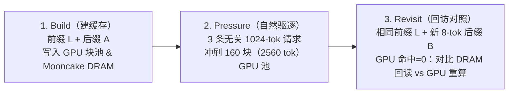
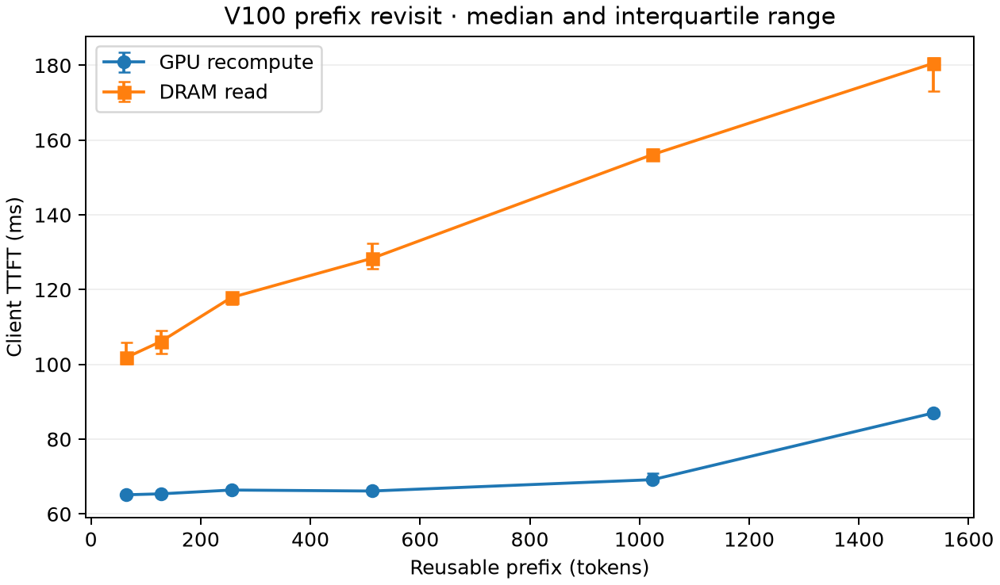

# ⚡ KV Cache 分层卸载与外部缓存实验仓库

一个持续推进的 **LLM 推理 KV Cache 系统研究与实机验证仓库**。项目在单张 Tesla V100 服务器上基于源码构建的 `1Cat-vLLM` 与 `Mooncake Store` 搭建真实推理与外部主存缓存链路，系统检验“**当 GPU 显存淘汰前缀后，从主机 DRAM 读回 KV Cache 与由 GPU 重新计算 Prefill 相比究竟谁更快、每一毫秒花在哪**”，并保留全部脚本、环境快照、原始校验记录与原理解读笔记。

---

## 💡 项目介绍

大语言模型逐个生成 token 时，每一步都需要读取之前所有历史 token 在每一层 Attention 中算出的 Key / Value 张量（**KV Cache**）。长上下文和高并发下，KV Cache 会迅速占满昂贵且容量有限的 GPU 显存，迫使旧前缀被淘汰。

把被淘汰的前缀 KV 留在更大的主机 CPU 内存（DRAM）乃至 NVMe SSD 中，确实能避免前缀彻底丢失，但下次命中时必须经历**目录查询 → 分配 GPU 物理块 → 跨进程/跨介质搬运字节 → 同步与剩余后缀计算**。因此本项目聚焦一个朴素但关键的系统问题：

> **在有限显存与真实延迟约束下，从外部缓存取回 KV 省下的 Prefill 计算，能否抵消查找、数据搬运与框架调度的开销？在什么规模、硬件和策略下才能获得净收益？**



如果第一次接触 KV Cache 推理系统，建议先阅读 [项目认识](docs/01-项目认识.md)（10 分钟串起自回归生成、显存账本、vLLM、Mooncake 与真实请求链路）。

---

## 🧭 任务说明

项目按“**基础机制与单卡打通 → 任务 A（实机时间账）→ 任务 B（轨迹命中账）→ 后续分层扩展**”推进：

| 阶段 | 任务内容 | 核心验收标准 | 当前状态 |
|---|---|---|---|
| **基础机制与单卡部署** | Transformer、增量 KV 与前缀索引、PagedAttention（COW）、双进程 TCP 传输；单卡 V100 源码编译 `1Cat-vLLM` + `Mooncake Store` 并验证重启后 DRAM 恢复 | CPU/TCP 误差 $\le 5.55 \times 10^{-16}$；V100 保存 `14 MiB`、重启恢复 `13.5625 MiB`（31/31 DRAM key），16 token 输出完全一致 | ✅ 已完成（[Week 1 结果](results/week1/README.md)） |
| **任务 A（1~5）** | 单机单卡同一实例内自然淘汰 GPU 前缀，在 `64 ~ 1536` tokens 下对比 Mooncake DRAM 回读与 GPU 重算的流式 TTFT，并拆解查找、搬运与计算开销 | 两组均开 GPU 前缀缓存、同 160 块预算、双种子交换先后共 36 对，每条请求硬核验 GPU 0 命中与真实 DRAM 搬运字节 | ✅ 已完成（[任务 A 报告](results/week2-3/task-a/README.md)） |
| **任务 A（6 · 可选）** | 基于实测代价设计按前缀长度动态选择回读或重算的策略，在独立混合长度请求集上与“始终回读”“始终重算”对照 | 验证集与训练集分离，走相同 Store 查找路径（选路连接器 [task_a_routing.py](scripts/task_a_routing.py) 为草稿实现，尚未实机验收） | ⏳ 待实验 |
| **任务 B（1~5）** | 基于 Mooncake 公开对话与工具调用轨迹，扫描缓存池容量对连续前缀 token 命中率的影响，并在相同容量下比较 FIFO、LRU 与改进驱逐策略 | 先查后写、仅统计从头连续命中前缀，复现容量–命中率趋势并解释策略差异 | ⏳ 待开展 |
| **后续扩展方向** | 三级存储（GPU + DRAM + SSD）回读、活跃长序列显存溢出、预取与计算/I/O 重叠、跨节点 PD 分离 | 基于 A/B 实测结论按硬件资源逐步扩展 | ⏳ 规划中 |

详细研究设定与完整复现示例（含环境脚本、模型路径与四组扫描命令）见 [项目说明 · 任务 A 完整复现示例](docs/00-项目说明.md#2-任务-a-实机基准完整复现示例)。

---

## 📊 成果分析

### 1. 任务 A（1~5）主结果：单卡 V100 + 1.5B 模型 + 同机 TCP

实验在独占空闲的 `Tesla V100S-PCIE-32GB` 上运行 `Qwen2.5-1.5B-Instruct`（FP16，`--enforce-eager`，`block_size=16`，每 token KV 为 `28 KiB`），通过 `160` GPU 块 + `3×1024` 干扰请求确保每次回访 GPU 本地命中严格为 `0`，经 `4 GiB` Owner DRAM 与同机 TCP（`MC_FORCE_TCP=1`）完成回读，每档 6 对共 **36 对**受控样本：



| 前缀长度 (tokens) | 回读 KV 大小 | GPU 重算 TTFT 中位数 (ms) | DRAM 回读 TTFT 中位数 (ms) | 配对差值 (回读 − 重算) | Lookup (ms) | GET (ms) | 有效带宽 (MB/s) | 输出一致 |
|---:|---:|---:|---:|---:|---:|---:|---:|---:|
| 64 | 1.75 MiB | 65.13 | 101.83 | +36.82 ms | 0.23 | 4.59 | 400.2 | 6 / 6 |
| 128 | 3.50 MiB | 65.39 | 106.18 | +41.29 ms | 0.22 | 7.27 | 505.1 | 6 / 6 |
| 256 | 7.00 MiB | 66.40 | 117.91 | +50.69 ms | 0.25 | 16.81 | 436.7 | 5 / 6 |
| 512 | 14.00 MiB | 66.14 | 128.37 | +62.32 ms | 0.25 | 26.76 | 548.6 | 6 / 6 |
| 1024 | 28.00 MiB | 69.18 | 156.16 | +85.77 ms | 0.28 | 48.87 | 600.8 | 6 / 6 |
| 1536 | 42.00 MiB | 87.03 | 180.57 | +93.88 ms | 0.36 | 72.82 | 604.8 | 6 / 6 |

**三点核心发现**（完整拆解与诊断数据见 [任务 A 实验报告](results/week2-3/task-a/README.md)）：

1. **当前条件下回读全程慢于重算（0/36 胜出）**：在 `64 ~ 1536` tokens 区间内，目录查找（`0.22 ~ 0.36 ms`）几乎无感，但同机 TCP 有效搬运带宽仅约 `400 ~ 605 MB/s`，1536 tokens（42 MiB）单是 `GET` 就需要 `72.82 ms`。
2. **算子路径回退放大了短后缀开销**：独立非计时诊断显示，重算组全程走稠密 `prefill_no_prefix_dense_flash`（`64 / 256 / 1536` tokens 首步前向分别为 `29.7 / 30.4 / 76.3 ms`）；而回读后剩余的 8-token 短后缀在 `FLASH_ATTN_V100` 后端中触发 `prefill_smallq_decode_scalar` + `prefill_prefix_flash`（耗时 `52.3 / 52.9 / 66.7 ms`）。短前缀下增量计算反而更慢，即便到 1536 tokens 前向也仅省约 `9.7 ms`，远抵消不了 `72.8 ms` 的搬运与框架同步成本。
3. **KV 搬运逐字节无损，35/36 边界已定位**：对唯一不一致样本（`length=256, seed=53, rep=1`）的专项诊断证实，跨三档抽取的 **116 块（50.75 MiB，约 53.2 MB）KV 显存快照在 PUT 前与 GET 后逐字节完全一致**；差异发生在无损传输之后，与不同执行路径及查询形状下的 FP16 数值差异一致（全词表最大 logit 差 `0.0195`，未做逐算子隔离），且恰好落在几乎打平的 Top-2 候选（差 `0.0078`）上。统一调度粒度为 `max_num_batched_tokens=64` 后 6/6 输出全部一致（单独归档于 [fixed-granularity/](results/week2-3/task-a/fixed-granularity/)）。

### 2. Week 1 基础机制与部署验收摘要

- **本地机制检查（4 项全通过）**：手写 Attention vs SDPA 最大误差 `1.11e-16`；增量 KV vs 完整重算最大误差 `5.55e-16`；分页块池共享、COW 与释放回收全通过；双进程 Mooncake Transfer Engine TCP 传输 `3541 B`（含 `768 B` KV）续算误差 `2.22e-16`。
- **单卡 V100 跨重启恢复验证**：512-token 输入冷保存 `14 MiB`（32 块），仅重启 vLLM 后从独立 Owner DRAM 恢复 `13.5625 MiB`（31 块，保留末块采样重算），16 个生成 token 与全显存对照逐位一致。

---

## 🗂️ 阅读导航与目录说明

```text
.
├── docs/          # 面向读者的核心总览文档
│   ├── 00-项目说明.md
│   ├── 01-项目认识.md
│   └── 02-服务器目录说明.md
├── notes/         # 分主题深度技术笔记（Transformer → KV Cache → vLLM → Mooncake → 工程部署 → 任务 A）
├── scripts/       # 全部可运行脚本与说明（scripts/README.md）
├── results/       # 实验结果总索引、分析报告、汇总表与图表（results/README.md）
├── environment/   # 各实验环境的软件版本与复现配置（environment/README.md）
├── CONTRIBUTING.md
└── LICENSE
```

- **分主题笔记（`notes/`）**：[00 认识项目](notes/00-认识项目.md) · [01 再读 Transformer](notes/01-再读Transformer.md) · [02 了解 KV Cache](notes/02-了解KV-Cache.md) · [03 认识 vLLM](notes/03-认识vLLM.md) · [04 认识 Mooncake](notes/04-认识Mooncake.md) · [05 从真实工程场景认识项目](notes/05-从真实工程场景认识项目.md) · [06 认识任务 A](notes/06-认识task-a.md)
- **目录指南**：[脚本说明](scripts/README.md) · [结果总索引](results/README.md) · [环境清单](environment/README.md) · [服务器目录说明](docs/02-服务器目录说明.md)

原创文档与代码采用 [MIT 许可](LICENSE)；第三方论文、框架、模型与数据集遵循各自许可。
