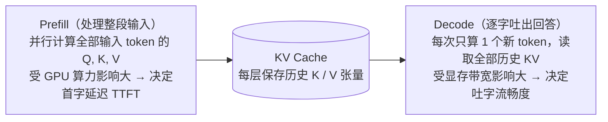
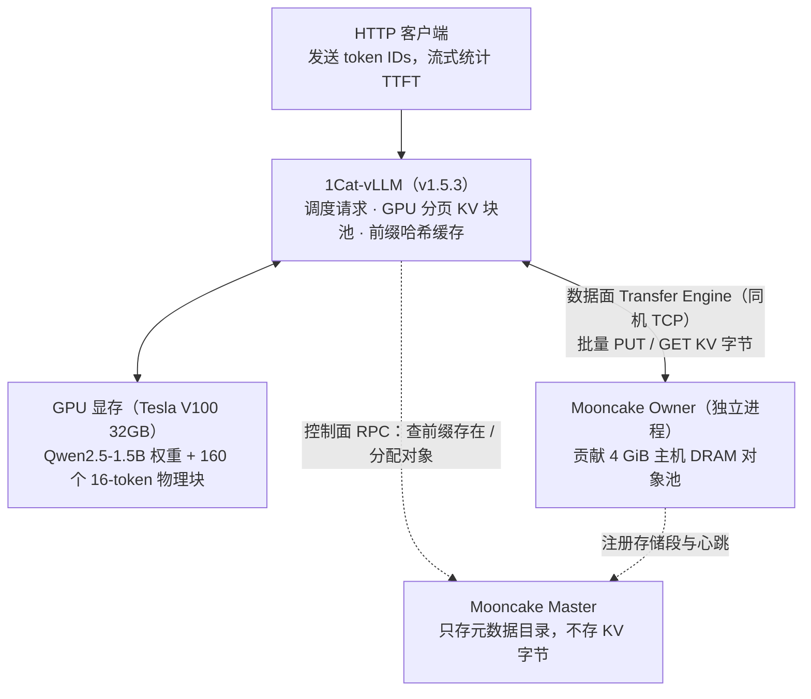
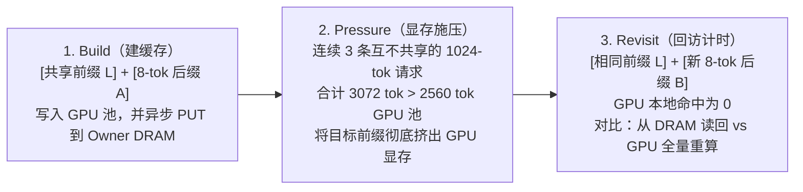

# 项目认识：从零理解 KV Cache 分层缓存与主存回读

即使没有系统学过深度学习框架或分布式存储，也可以带着一个非常具体的问题来认识这个项目：

> **大语言模型回答问题时，需要反复用到前面已经算过的上下文状态（KV Cache）。当 GPU 显存装不下时，把这些状态存进更大的 CPU 内存里，下次再遇到相同前缀直接读回来——这听起来很划算，但在真实服务器上究竟划不划算？**

这篇文档沿着“模型怎么生成文字 → 显存为什么不够用 → vLLM 和 Mooncake 各自做什么 → 一条真实请求怎样跑完 → 为什么读缓存未必比重算快”的顺序，把整个项目的来龙去脉讲清楚。

---

## 1. 大语言模型怎样生成文字？KV Cache 从哪来？

大语言模型不是一口气吐出整段答案，而是**逐个 token 接龙**（自回归生成）：先读完用户的全部输入（**Prefill 阶段**），预测出第 1 个回答 token；再把这个 token 拼回末尾，预测第 2 个 token（**Decode 阶段**），如此循环。

在 Transformer 每一层的自注意力（Self-Attention）计算中，每个 token 都会被投影成三个向量：
- **Query（Q）**：当前 token 想查什么信息；
- **Key（K）**：历史 token 提供什么索引特征；
- **Value（V）**：历史 token 真正携带的内容。

因为因果掩码限制每个位置只能看到它之前的 token，前面已经算过的历史 token 的 **K** 和 **V** 在后续生成中不会再改变。**KV Cache** 做的事情非常直接：把每一层已经算好的历史 K、V 张量存下来，下一轮只算新 token 自己的 Q、K、V，直接和缓存里的历史 K、V 做注意力，省去对整段历史的重复计算。

---

## 2. 为什么 KV Cache 会把 GPU 显存撑爆？

KV Cache 不是文本，也不是模型权重，而是**每一条请求在每一层里独有的运行时张量**。对于标准 Decoder-only 模型，每增加 1 个 token，跨所有层需要保存的 KV 字节数是固定的：

$$
M_{\text{token}} = 2\;(\text{K 和 V}) \times L\;(\text{层数}) \times H_{\text{kv}}\;(\text{KV 头数}) \times d_h\;(\text{单头维度}) \times s\;(\text{精度字节数})
$$

以本项目实机部署的 **Qwen2.5-1.5B-Instruct（FP16）** 为例：
- 模型共 `28` 层，采用 GQA（`12` 个 Q 头共享 `2` 个 KV 头），单头维度 `128`，FP16 每元素占 `2` 字节；
- **单 token 跨 28 层 KV 大小**：$2 \times 28 \times 2 \times 128 \times 2 = 28{,}672\text{ B} = \mathbf{28\text{ KiB}}$；
- **单个 16-token KV 块**：$16 \times 28\text{ KiB} = \mathbf{448\text{ KiB}}$；
- **一段 1536-token 的前缀（96 块）**：$1536 \times 28\text{ KiB} = \mathbf{42\text{ MiB}}$。

1.5B 属于轻量小模型；换成 7B～70B 模型，或面对数万 token 的文档问答、多轮对话与高并发请求时，KV Cache 很快会达到数十 GB，把单张 GPU 有限的 HBM（高带宽显存）全部填满。

与此同时，在线服务中存在大量**跨请求的公共前缀**（例如相同的系统提示词、同一份长文档、多轮对话的历史上下文）。只要从第 0 个 token 开始的前缀完全一致，且模型与配置相同，新请求就可以直接复用旧请求留下的前缀 KV，跳过这段前缀的 Prefill 计算。

---

## 3. 硬件的阶梯：显存、主存与 SSD

既然 GPU 显存又快又贵、容量紧张，而同一台服务器往往配有几百 GB 空闲的 CPU 内存（DRAM）和 TB 级 NVMe SSD，一个自然的系统思路就是把 KV Cache 做成**多级存储**：

| 存储层 | 容量 | 带宽 / 延迟特征 | 在系统中的角色 |
|---|---|---|---|
| **GPU HBM（显存）** | 最小（如 V100 为 32 GiB） | 最快、延迟最低 | 正在计算与最热的前缀 KV |
| **CPU DRAM（主机内存）** | 较大（如本实验机约 504 GiB） | 经 PCIe / 同机传输，带宽次之 | GPU 显存淘汰后的二级缓存池（任务 A 实测对象） |
| **NVMe SSD（固态硬盘）** | 最大（TB 级） | 需经存储栈与内存搬运，延迟最高 | 大规模冷 KV 持久化层（后续扩展方向） |

分层带来容量的同时，也引入了核心矛盾：**数据离 GPU 越远，放得下越多前缀，但真正要用时把它搬回显存的耗时也越长。**

---

## 4. 真实系统里的三个软件主角

在实验室单张 V100 服务器上，整套可运行的推理与外部缓存系统由三个组件配合完成：

1. **模型（Qwen2.5-1.5B-Instruct）**：提供网络结构定义（`config.json`）与训练好的 FP16 权重（`model.safetensors`），决定每个 token 如何变成 Q/K/V 和词表分数。
2. **推理引擎（1Cat-vLLM v1.5.3，针对 V100 / SM70 源码构建）**：
   - 用 **PagedAttention** 把 GPU 显存划成定长 16-token 物理块，通过块表按需分配，消除连续显存碎片；
   - 开启 **Automatic Prefix Caching（APC）** 后，请求结束不会立刻销毁满块，而是用 SHA-256 前缀哈希链索引留作热缓存，池满时按 LRU 淘汰最久未用的块；
   - 通过 `MooncakeStoreConnector`（`kv_role="kv_both"`）把同一个推理实例同时接入外部缓存的写入和读取路径。
3. **外部缓存与传输层（Mooncake 0.3.14）**：
   - **Master**：目录服务，记录每个前缀块 Key 存在哪、是否可用，本身不存 KV 载荷；
   - **Owner**：独立运行的 `mooncake_client` 进程，注册一片主机 DRAM（如 4 GiB）专门存放 KV 原始字节；
   - **Transfer Engine**：负责把已注册的 GPU 显存块与 Owner DRAM 之间的大块字节直接搬运（本项目单机实验强制走同机 TCP 路径，确保路径可观测、可复现）。

---

## 5. 跟着一条请求看清“自然淘汰 → 主存回读”

为了真实模拟线上服务里“显存被挤爆，但主存里还有副本”的场景，任务 A 在**同一个持续运行的 vLLM 实例**里把 GPU KV 块池精确锁定为 `160` 块（`2560` tokens），对每档前缀长度执行三步循环：

当第 3 步的回访请求到达时，两组对照走上完全不同的路径：
- **重算组（关闭 Mooncake Store，保留 GPU 前缀缓存）**：查本地 GPU 未命中 → 直接对 `L + 8` 个 token 完整重算一次 Prefill。
- **回读组（开启 Mooncake Store，同样保留 GPU 前缀缓存）**：查本地 GPU 未命中 → 向 Master 查询命中 `L` 个 token（`L/16` 块）→ 在 GPU 分配空块 → 通过 Transfer Engine 从 Owner DRAM 把 `L × 28 KiB` 字节搬回 GPU → 只对最后 `8` 个新后缀 token 做前向计算。

---

## 6. 为什么“有缓存”不等于“一定更快”？

把回读组与重算组的首字延迟拆开，就能一眼看出性能胜负的本质：

$$
T_{\text{回读}} = T_{\text{目录查找}} + T_{\text{DRAM 搬运 (GET)}} + T_{\text{8-tok 后缀计算}} + T_{\text{调度与同步开销}}
$$

$$
T_{\text{重算}} = T_{\text{完整 }(L+8)\text{ Prefill}} + T_{\text{基础调度开销}}
$$

只有当**省下来的前缀 Prefill 计算时间**大于**查找 + 搬运 + 额外同步与算子切换成本**时，从主存回读才会比直接重算更快。

本项目在 V100 + `Qwen2.5-1.5B` + 同机 TCP 上的实测给出了一个极具启发性的反直觉现象（完整数据见 [任务 A 实验报告](../results/week2-3/task-a/README.md)）：
- 在 `64 ~ 1536` tokens 范围内，**回读反而比直接重算更慢**（中位数多花 `36.8 ms ~ 93.9 ms`）；
- 拆开来看，原因不只在同机 TCP 搬运（1536 tokens 搬 42 MiB 耗时约 `72.8 ms`，有效带宽约 `605 MB/s`），还在于 **1.5B 模型 Prefill 算力负担轻**，以及 **V100 后端对“有缓存前缀 + 8-token 短后缀”会切到较慢的小-q 标量回退路径**，导致短前缀下增量计算反而不如整段稠密 FlashAttention 快。

这也说明了为什么分层 KV 缓存研究必须拆成两块拼图来回答：
- **任务 A** 负责把单机真实硬件上的“时间账”算透，找到搬运、算子与调度各自花掉的每一毫秒，以及不同模型规模/传输带宽下收益交叉点的移动规律；
- **任务 B** 负责用真实生产轨迹把“命中率账”算透，研究多大缓存池、采用什么驱逐策略才能最大化连续前缀复用。

---

## 延伸阅读

如果想沿着某一个模块继续深入源码、公式或实验细节，可以直接跳转对应笔记：

- [再读 Transformer](../notes/01-再读Transformer.md)：从完整 Attention 矩阵形状到 Decoder-only 推理推导。
- [了解 KV Cache](../notes/02-了解KV-Cache.md)：数学等价性、GQA 显存账本与前缀哈希链。
- [认识 vLLM](../notes/03-认识vLLM.md)：PagedAttention、Continuous Batching、Chunked Prefill 与 APC。
- [认识 Mooncake](../notes/04-认识Mooncake.md)：Transfer Engine、Master/Owner 分工与 `kv_both` 协同机制。
- [从真实工程场景认识项目](../notes/05-从真实工程场景认识项目.md)：顺着服务器真实目录与 1Cat-vLLM 源码，逐行跟踪一次模型启动与 KV 保存/恢复。
- [认识任务 A](../notes/06-认识task-a.md)：任务 A 的控制变量设计、脚本架构与实测归因详解。
