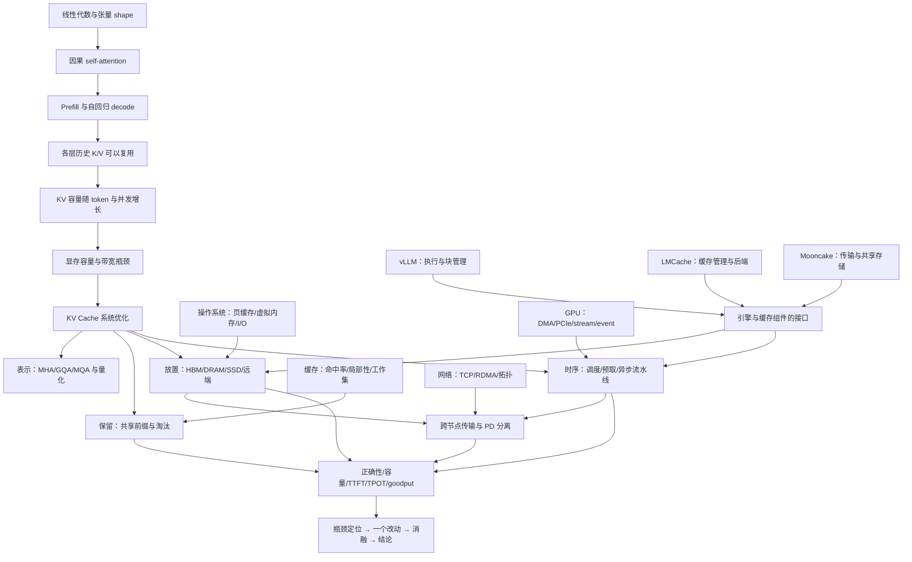
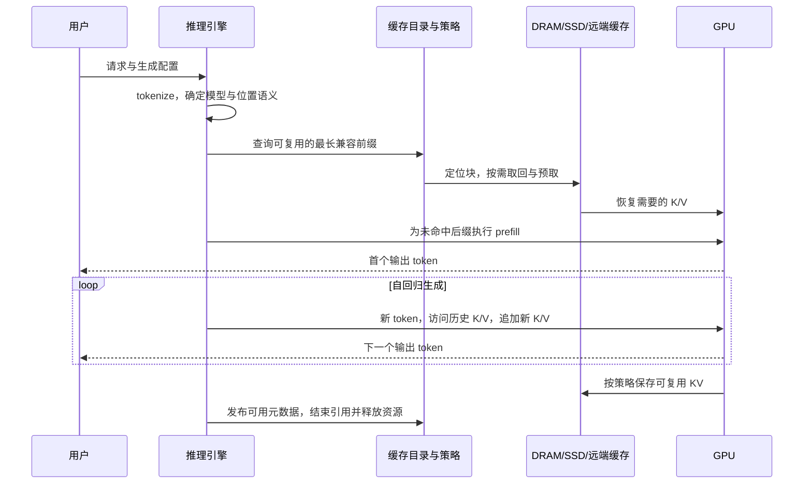

# KV Cache 系统全景

## 1. 先建立一个具体场景

用户上传一份长文档，让模型回答问题。处理文档时，模型会为每层、每个历史 token 生成 Key 和 Value。生成答案时，新 token 的 Query 会访问这些历史 K/V。

第二轮用户继续问同一文档。如果历史 token、位置和模型状态都兼容，系统可以恢复原来的 KV，省掉重复的历史前缀计算。但历史 KV 可能很大，GPU 又要留空间运行其他请求，于是需要把暂时不用的数据放到 DRAM 或 SSD。下一轮来临时，再在合适时机取回。

问题因此从“能否保存一个张量”变成了：保存谁、放在哪、什么时候搬、搬多少、搬运时 GPU 能否继续算、恢复后是否仍然正确。

## 2. 全景知识图谱

箭头表示依赖关系或因果联系。并不是要求先学完所有节点才可动手。



把优化再归纳为三个问题很有帮助：**何时执行与访问、放在哪里并怎样迁移、怎样表示并保留**。这是指定综述的主要分类视角；本图在此基础上增加了学习依赖和实验路径。[系统感知 KV Cache 综述](https://arxiv.org/abs/2607.08057)

## 3. 容易混淆的六件事

| 概念 | 改变了什么 | 典型收益 | 不能直接推出什么 |
|---|---|---|---|
| 请求内 KV Cache | 不重复计算历史 K/V | 降低自回归重复计算 | 历史 attention 不再需要计算 |
| Prefix caching | 相同、兼容前缀跨请求复用 | 省掉重复 prefill | 任意相同文本片段都可以直接拼接 |
| Paging / PagedAttention | 非连续物理块映射为逻辑序列 | 少碎片、灵活共享 | 自动实现 DRAM/SSD 卸载 |
| Offloading | 数据移到容量更大的低层 | 扩大有效容量，保留更多会话 | 每个请求都更快 |
| KV transfer / PD 分离 | 执行阶段或缓存拥有者跨进程/设备 | 独立调度、资源池化 | 只要有两台机器就有效 |
| Compression / sparse retention | 改变 KV 表示或保留集合 | 少搬、少存、可能少算 | 与无损搬运具有相同正确性标准 |

FlashAttention 则主要优化 attention 内核的片上/显存 I/O 与中间结果存储，可以和分页、缓存复用、卸载协同；它不是 SSD 缓存系统。[FlashAttention](https://arxiv.org/abs/2205.14135)

## 4. 两类卸载，两个研究问题

### A. 间歇会话与公共前缀复用

场景：一轮回答结束后暂时没有新 token 要算，把 KV 保存到 DRAM/SSD；下一轮恢复。

- 主要矛盾：用容量换命中率，用取回时间换重算时间。
- 收益首先体现于下一轮 TTFT、prefill GPU 时间、SLO 下的服务能力。
- 一个前缀通常在恢复阶段读一次，随后进入 GPU 正常生成。
- 冷会话可以放 SSD；热点前缀放 DRAM；当前请求工作集放 HBM。
- 必须比较“读旧 KV”与“重新计算该前缀”哪个更便宜。

这类场景是理解 CachedAttention、LMCache、Mooncake 缓存复用机制的入口。[CachedAttention](https://www.usenix.org/conference/atc24/presentation/gao-bin-cost)

### B. 活跃 decode 工作集卸载

场景：单个活跃长请求或多个同时 decode 的请求，全部 KV 已经放不下显存，只能让部分历史 KV 持续停留在 DRAM/SSD。

- 普通 dense attention 的每个 decode step 仍需要访问全部历史 KV。
- 若按层加载并在层计算后释放，这些数据可能下个 token 还要再次传输。
- 主要矛盾是每 token 的带宽与 deadline，通常直接影响 TPOT/ITL。
- 分层的容量收益成立，但慢层访问代价可能使逐 token 延迟无法接受。
- 选择性稀疏取回或在 CPU/存储侧算 attention 可以减少部分数据移动，却已扩大研究范围，可能改变数值或模型语义。

**实验边界**：prefix reuse 基准不能证明“超显存的活跃 decode”已经实现。活跃工作集卸载需要独立的正确性、容量和每步搬运实验。

## 5. 一个请求的完整生命周期



真实系统的保存与取回可以流水化，这里用顺序图强调依赖。不能在写入尚未完成时把块标为可读，也不能把仍被 DMA 使用的缓冲区交给下一请求覆盖。

## 6. 三层内存与数据路径

```text
GPU attention 内核
      ↕ 读写 GPU 显存
HBM：当前计算工作集、必要缓冲
      ↕ PCIe / 平台支持的互连；H2D / D2H
DRAM：热点会话、元数据、pinned staging buffers
      ↕ NVMe I/O；buffered / direct / io_uring / SPDK 等具体路径
SSD：较冷、较大规模、可能再次复用的 KV

可选的旁路：远端 DRAM/SSD ← TCP/RDMA → 本机内存或 GPU
```

这是逻辑层级；“远端 DRAM”和“本地 SSD”谁更快取决于实际链路、并发和数据大小，不能按距离预先排序。拓扑上，GPU、NIC、SSD 可能竞争同一 PCIe 根端口；DRAM 的 NUMA 放置也会改变结果。

一次 SSD 命中可能走“SSD → 普通主存 → pinned 主存 → GPU”，也可能省掉部分中转。逻辑上搬一次，不等于物理上只发生一次拷贝。因此必须按路径分别计字节和时间。

## 7. vLLM、LMCache、Mooncake 各做什么

| 组件 | 最先理解的职责 | 读代码时找什么 |
|---|---|---|
| vLLM | 请求调度、模型执行、GPU KV 块管理、内核调用 | 请求何时进入 batch，逻辑块怎样映射，connector 何时 load/save |
| LMCache | 引擎与多级缓存之间的复用与存储管理 | 怎样生成 cache key、怎样查找命中、怎样组织后端与缓存生命周期 |
| Mooncake Transfer Engine | 大块数据的传输基础设施 | 注册内存、定位地址、提交批量传输、完成通知 |
| Mooncake Store | 对象化共享缓存与数据位置管理 | 对象放置、元数据与数据面分离、get/put 和低层存储 |

Mooncake 官方集成文档分别给出 PD 传输与缓存存储/共享两类场景；不能只根据组件名字判断是否在做同一个实验。[Mooncake 与 vLLM 集成](https://kvcache-ai.github.io/Mooncake/deployment/integrations/vllm/index.html)

比较不同缓存组件时，应固定引擎版本、模型、工作负载和缓存命中条件，分别验证各自的数据路径。单机功能验证与多机传输评测回答不同问题，需要分开记录。

## 8. 单机和多机的边界

| 资源 | 能研究 | 不能据此证明 |
|---|---|---|
| 普通电脑，无 GPU | attention 原理、容量预算、缓存 key、模拟策略、实验脚本 | GPU 重叠、真实 NVMe/GPU 端到端收益 |
| 一机一 GPU | GPU 常驻、DRAM/SSD 复用、主机拷贝、单机缓存组件 | 实际跨机 RDMA 性能；独立 GPU 上的 PD 并行收益 |
| 一机多 GPU | 本机 PD、跨 GPU 传输、拓扑与干扰 | 跨机交换网络的性能与失败语义 |
| 多机，无 RDMA | TCP 传输、远端共享缓存、端到端功能与网络瓶颈 | RDMA/GPUDirect 的加速效果 |
| 多机，有兼容 RDMA 环境 | 真实跨机 KV 传输、PD 资源分配和扩展实验 | 自动获得优于单体服务的结论 |

一台机器上的多个进程可以验证协议和对象路径。Mooncake 官方也提供本机两进程 TCP 示例；loopback 结果只能代表本机软件路径。[Transfer Engine 文档](https://kvcache-ai.github.io/Mooncake/design/transfer-engine/index.html)

## 9. 用什么来判断系统变好了

一个好的目标是：**满足 TTFT 与每 token 延迟 SLO 的条件下，让更多请求成功完成，同时控制显存、CPU、内存和 I/O 成本。**

由此会出现合理的权衡：

- 卸载后单请求略慢，但避免 OOM 并提升并发，总体可能更有价值。
- TTFT 大幅下降，但写回抢占带宽使 p99 ITL 变差，不能只报 TTFT。
- 缓存命中率更高，但加载旧 KV 比重算更慢，命中不是收益本身。
- I/O 带宽变高，却因为多读无用块而让端到端服务变差。

系统评测需要解释优化机制、资源代价与服务质量之间的因果关系，并为结论提供可复现证据。
