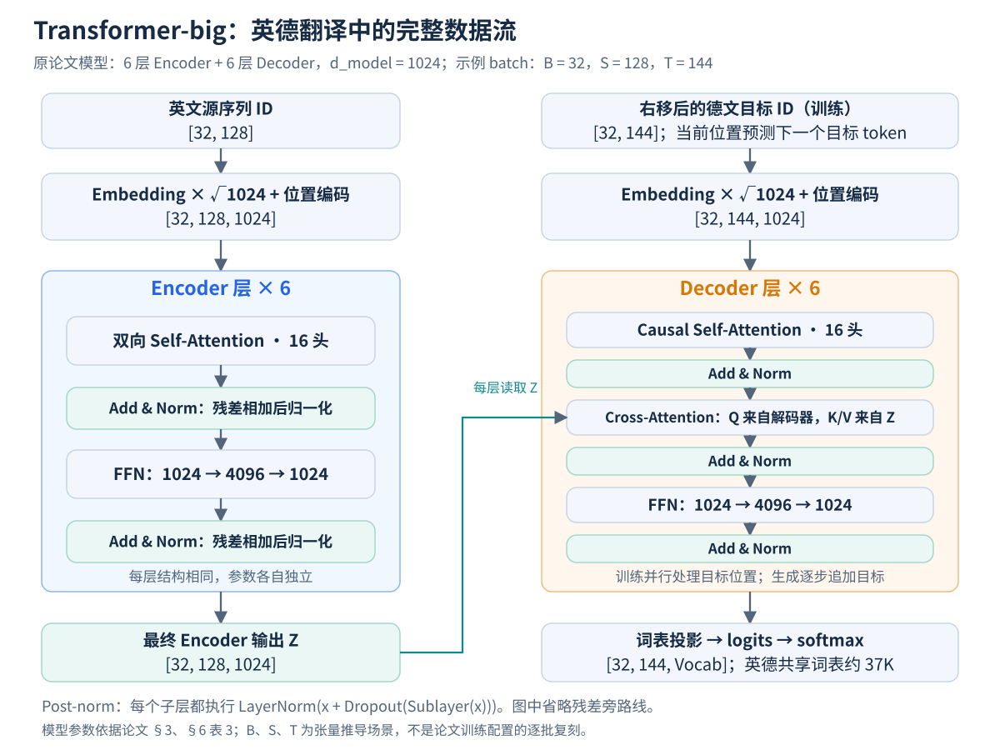
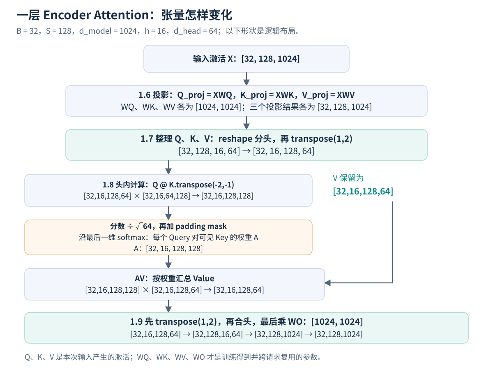
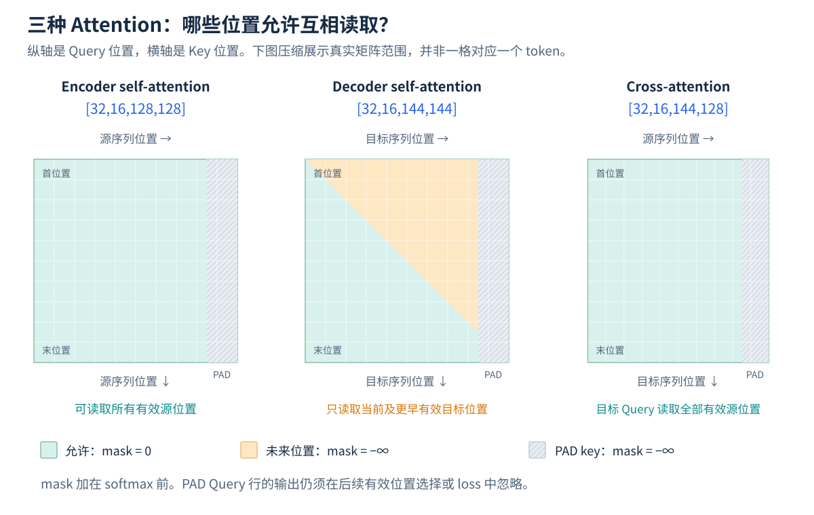
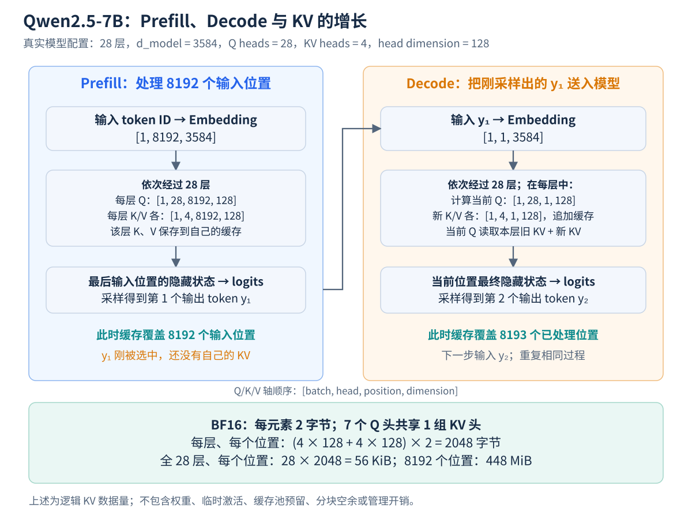

# 再读 Transformer：从完整翻译模型到大语言模型

理解 Transformer，不能只停在“输入 token，经过 Attention，输出 token”。真正需要弄清楚的是：**每一步拿到什么数据，怎样计算，结果的形状是什么，又交给下一步做什么。**

这篇笔记分成两个部分：

1. **Transformer 超详细解读**：以《Attention Is All You Need》的英德翻译模型为依据，走完数据准备、Encoder、Decoder、训练和翻译生成的全过程。
2. **当今大语言模型是如何利用 Transformer 的**：解释从 Transformer 到 LLM 还需要哪些工作，再用 Qwen2.5 的真实配置追踪一次长上下文生成，最后讨论 ChatGPT、DeepSeek 和推理框架分别处在哪一层。

第一部分采用论文中的 **Transformer-big**，不会把模型缩成两层、两个头、几个维度。论文事实、本文设定的业务批次和根据形状推导的容量会明确区分。文中的容量都是计算值，不是服务器实测结果。

全文主要依据 [Transformer 原论文 v7](https://arxiv.org/html/1706.03762v7)。模型结构对应第 3 节和图 1、图 2；训练对应第 5 节；big 配置对应表 3。图示为本文按公式重新绘制，图片中的维度与正文一致。

## 一、Transformer 超详细解读

### 1.1 先确定场景：我们究竟在计算什么？

原论文研究的重要任务是**机器翻译**。给定一段英文，模型输出对应的德文。训练时，数据集同时提供英文和正确德文；上线翻译时，只有英文，德文必须由模型逐步生成。

比如，一个翻译服务要处理技术文档，其中一条源文本是：

> After the server receives a request, it checks whether the required data is already in memory. If the data is only available on the storage device, the server must load it before starting the next computation.

这句话只是用来说明业务内容，不声称来自论文数据集，也不把未经实际分词的结果标成确定的 token 数。实际系统会把许多待翻译片段组成批次，而不会为讲解把整条计算链压缩成几个单词。

本文固定使用下面的**一个具体批次设定**：

| 符号 | 本文数值 | 含义 |
|---|---:|---|
| `B` | 32 | 批次内有 32 条独立翻译样本 |
| `S` | 128 | 源序列补齐后的长度，包含需要计入序列的特殊 token |
| `T` | 144 | 训练时目标输入与目标标签补齐后的长度 |
| `d_model` | 1024 | 层与层之间每个位置的表示维度 |
| `h` | 16 | 每个 Attention 子层的头数 |
| `d_k`、`d_v` | 64 | 每头的 Key/Query 维度、Value 维度 |
| `d_ff` | 4096 | 前馈网络的中间维度 |
| `N` | 6 + 6 | 6 层 Encoder，6 层 Decoder |
| `V_vocab` | 约 37000 | 原论文英德任务的共享词表大小 |

`B、S、T` 是本文为追踪张量而设定的实际规模批次；其余结构参数来自论文。论文并没有固定使用“32 条、128/144 长度”的 batch，而是按相近长度组批，每批约含 25000 个源 token 和 25000 个目标 token。两者不能混为一谈。[原论文 §5.1、表 3](https://arxiv.org/html/1706.03762v7#S5.SS1)

几个词先说清楚：

- **token**：分词器产生的一个离散单位，可能是一个词、词的一部分或符号，不固定等于一个汉字或英文单词。
- **token ID**：这个单位在词表中的整数编号。编号本身没有“数字越接近，意思越接近”的含义。
- **向量**：这里就是按顺序存放的一组数。例如某个位置的表示有 1024 个浮点数。
- **张量**：带多个轴的数值数组。`[32,128,1024]` 表示 32 条序列，每条 128 个位置，每个位置 1024 个数。
- **参数/权重**：通过训练更新、保存到模型文件里的数，例如投影矩阵。
- **激活/中间结果**：某次输入经过计算得到的数，例如这一批的 Q、K、V。

**同一个 token ID 在不同上下文中，初始查到的 embedding 可以一样，但经过 Attention 后的表示通常不同。** 后面的计算就是在不断更新这些位置的表示。

### 1.2 先看全貌：Encoder 和 Decoder 各负责哪一段？



从输入到输出，主要有四段：

```text
英文 token ID
    ↓ embedding + 位置编码
6 层 Encoder
    ↓ 每个英文位置都有一个更新后的 1024 维表示
Encoder 最终输出 Z
    ↓ 提供给 Decoder 每一层的交叉注意力
6 层 Decoder，同时处理已经知道的德文前缀
    ↓ 每个目标位置得到一个 1024 维表示
词表投影 + softmax
    ↓
预测下一个德文 token 的分布
```

Encoder 的输出不是一句翻译，也不是把整段英文压成一个 1024 维向量。它是：

```text
Z：[32, 128, 1024]
```

32 条输入各自保留 128 个位置。Decoder 可以从这些源位置中提取信息。

论文说每个栈里有 6 个相同结构的层，意思是**结构重复，参数不共享**。第 1 层和第 6 层有各自训练出来的投影矩阵、前馈网络和归一化参数。

此外，这里的一个“层”不是一次矩阵乘法：

| 一层的类型 | 内部子层 |
|---|---|
| Encoder layer | 多头自注意力；前馈网络 |
| Decoder layer | 带因果 mask 的多头自注意力；Encoder–Decoder 交叉注意力；前馈网络 |

每个子层外面还各有一次残差相加和 LayerNorm。[原论文 §3.1](https://arxiv.org/html/1706.03762v7#S3.SS1)

原论文为什么强调这种结构？RNN 的第 i 个隐藏状态依赖第 i−1 个状态，处理同一序列时存在沿位置逐步推进的依赖。Self-Attention 在拿到本层输入后，可以用矩阵运算同时处理多个位置，并直接建立相隔较远位置之间的连接。**层与层仍有先后关系，未来生成 token 仍有先后关系**；提高并行度并不意味着整个模型没有顺序依赖。[原论文 §1、§4](https://arxiv.org/html/1706.03762v7#S4)

### 1.3 文本怎样变成一个能送进 GPU 的 batch？

#### 分词并查 token ID

原论文的英德任务采用 BPE，并使用约 37000 个 token 的共享源/目标词表。BPE 会根据已学习的合并规则，把文本表示成词表中已有的子词单位；运行时使用的是固定的分词规则，通常不会每收到一条消息就重新训练分词器。

这些规则怎样得到？传统子词 BPE 先把训练语料中的词表示为基础字符及边界标记，统计相邻单位对的出现频率；反复合并高频相邻对，形成新的单位，并记录合并顺序。处理新文本时，先按约定做文本预处理，再按照这份固定规则进行合并，最后把得到的单位查成 ID。因此，一个常见词可能成为一个 token，一个不常见词或词形可能分成多个 token。原论文引用的是这种子词方法，不能与现代某些 tokenizer 的字节级处理直接画等号。[Sennrich 等：Neural Machine Translation of Rare Words with Subword Units](https://aclanthology.org/P16-1162/)

分词结束后，32 条英文得到 32 个长度不等的整数列表，德文也一样。源文本和译文不必有相同 token 数，所以 `S=128`、`T=144` 完全合理。

#### 为什么需要 padding？

一种常见的批处理表示需要规则的矩形数组。若某条源序列只有 103 个有效位置，就在尾部补 25 个 PAD，使这一批的源长度都成为 128。

```text
source_ids：[32, 128]       整数 token ID
source_valid：[32, 128]     哪些位置是真的输入，哪些是 PAD
```

**PAD 只是补形状用的占位符。** 它不能作为有效内容参与 Attention，也不能被当作必须预测的正确答案。后面需要两类处理：

1. Attention 的 key padding mask：不让有效 Query 读取 PAD 位置的 Key/Value。
2. 损失 mask：不对目标标签中的 PAD 计算训练损失。

给 embedding 的 PAD 行设为零并不能替代 mask：即使某个 K 是零，和 Q 的点积为零，`exp(0)=1`，softmax 仍可能给它非零权重。

按长度接近的样本组批，可以减少补齐位置。现代实现还可能把有效 token 打包，省去部分 padding 计算；本文先用矩形布局把含义讲清楚，不把这个布局说成唯一实现。

#### 训练时目标序列要右移一位

假设一条德文译文的有效 token 是 `y₁,…,yₘ`。训练时，输入与标签是：

```text
Decoder 输入：START, y₁, y₂, …, yₘ
训练标签：    y₁,    y₂, y₃, …, EOS
```

`START` 表示启动解码所用的起始符号；它的具体 ID、是否复用某个特殊 token 由实现决定。`EOS` 表示结束。

这个排列的含义是：**输入位置 i 的输出负责预测下一项，而不是把自己已经拿到的 token 原样输出。** 所有行再补到 144：

```text
target_input_ids：[32, 144]
target_labels：   [32, 144]
target_valid：    [32, 144]
```

输入标签右移还不够，后面的因果 mask 也必须正确。否则，位置 i 能读取右边位置，那里恰好放着它要预测的答案，训练就发生了信息泄漏。

这些整数数组和 mask 由数据处理程序产生，再交给模型。GPU 进行前向计算前必须能访问相应数据；异步传输“已经提交”不代表传输“已经完成”，实际执行要通过流顺序或事件依赖保证计算不会读取尚未写完的缓冲区。

### 1.4 Embedding：整数编号怎样成为 1024 个浮点数？

设 embedding 参数为：

```text
E：[V_vocab, 1024]
```

对于 `source_ids[b,s]`，从 E 中取出对应行，放到 `X[b,s,:]`。这相当于查表，不是把 ID 这个整数复制 1024 次，也通常不必真的构造巨大的 one-hot 矩阵再相乘。

```text
source_ids [32,128]  →  source embedding [32,128,1024]
target_ids [32,144]  →  target embedding [32,144,1024]
```

E 是训练参数；查出来的这一批向量是激活。训练的反向传播会把损失对 embedding 的影响汇总到相应参数行上。

原论文在 embedding 输出上乘以：

$$
\sqrt{d_{\mathrm{model}}}=\sqrt{1024}=32.
$$

因此，对源输入的某个位置，暂时得到 `32 × E[token_id]`。论文还说明两侧 embedding 和输出前的词表投影共享权重；在这里的英德共享词表设置中，这种共享让同一组参数同时参与查表和词表打分。**权重共享不代表两种操作相同**，输出时还要按相反的矩阵方向使用它。[原论文 §3.4](https://arxiv.org/html/1706.03762v7#S3.SS4)

### 1.5 位置编码：顺序信息具体加在哪里？

单靠 token embedding 和不带位置约束的 self-attention，不能把序列顺序完整交给模型。原始 Transformer 在两个栈的输入处加入正弦位置编码：

$$
PE(p,2i)=\sin\left(\frac{p}{10000^{2i/d_{\mathrm{model}}}}\right),
\qquad
PE(p,2i+1)=\cos\left(\frac{p}{10000^{2i/d_{\mathrm{model}}}}\right).
$$

这里：

- `p` 是当前位置，按 0 开始编号；
- `i=0,…,511`，每个 i 对应两个维度；
- 偶数维放 sin，奇数维放 cos；
- 不同维度使用不同频率，合起来仍然是 1024 个数。

源侧位置编码形状为 `[128,1024]`，在 batch 轴上广播给 32 条序列：

$$
X^{(0)}_{b,s,:}=\mathrm{Dropout}\big(32E[\mathrm{source\_ids}_{b,s}]+PE(s,:)\big).
$$

“广播”表示每条序列使用同一套位置计算规则，不必为 batch 中每一行重新存一份位置表。目标侧同理，得到 `[32,144,1024]`。

**位置编码是逐元素相加，不是拼到向量后面。** 所以相加后仍然是 1024 维，不会变成 2048 维。原论文在栈底加一次，不是在每层都重新执行一次这个相加。

使用 sin/cos 的一个性质是：固定相对位移 k 后，可以用一个与 p 无关的线性变换把位置 p 的每对 sin/cos 转成位置 p+k 的那一对。这给学习相对位置关系提供了条件；但“位置公式能计算更大的 p”不等于“模型在任意长的文本上都可靠”。[原论文 §3.5](https://arxiv.org/html/1706.03762v7#S3.SS5)

### 1.6 进入一层 Encoder：先产生 Q、K、V

现在第 1 层拿到：

```text
X：[32,128,1024]
```

原始 Transformer 是后面才做 LayerNorm 的 **Post-Norm** 结构。这里先把 X 直接送进该层的 Self-Attention；不要提前套用现代模型常见的 Pre-Norm 顺序。

论文给每个头设置独立投影。第 a 个头的参数为：

```text
WQ_a：[1024,64]
WK_a：[1024,64]
WV_a：[1024,64]
```

对应计算：

$$
Q_a=XW^Q_a,\qquad K_a=XW^K_a,\qquad V_a=XW^V_a.
$$

为什么 `[32,128,1024]` 能乘 `[1024,64]`？因为矩阵乘法作用在最后一维。把前两维暂时看成 `32×128=4096` 行，实际上就是：

```text
[4096,1024] × [1024,64] → [4096,64]
```

再恢复 batch 和位置轴，得到 `[32,128,64]`。

更细一点，一个输出元素是：

$$
Q_a[b,s,r]=\sum_{u=0}^{1023}X[b,s,u]W^Q_a[u,r].
$$

也就是说，**一个头里的一个数，来自该位置全部 1024 个输入维度的加权求和**。不是“第 1 个头只拿原向量前 64 维，第 2 个头只拿接下来 64 维”。分头发生在学习投影之后。

实际计算经常把 16 个头的权重并排放在一起，用更大的矩阵乘法：

```text
WQ、WK、WV 各自：[1024,16×64] = [1024,1024]

Q_flat = X @ WQ：[32,128,1024]
K_flat = X @ WK：[32,128,1024]
V_flat = X @ WV：[32,128,1024]
```

也可以把 QKV 三次投影融合成一次输出 3072 维的投影，再拆开；融合只是实现选择，不改变三组参数的含义。

**Q、K、V 是当前输入的计算结果；WQ、WK、WV 才是训练得到的权重。** 同一层在不同请求上复用权重，但算出的 QKV 不一定相同。

本文矩阵按“输入在左侧”书写；一些框架把 Linear 权重存成 `[输出维度,输入维度]`，计算时实际使用转置。看代码里的 shape 时必须先确认这个约定。

### 1.7 多头到底怎样组织？reshape 和 transpose 在做什么？

以 Q 为例：

```text
[32,128,1024]
       ↓ reshape：1024 拆成 16×64
[32,128,16,64]
       ↓ transpose：把 head 轴移到 position 轴前
[32,16,128,64]
```

最终四个轴分别是：

```text
[哪条样本, 哪个头, 哪个位置, 该头向量的哪个元素]
```

K、V 也进行相同变换。`reshape` 和 `transpose` 不会学习新参数，也不代表已经做过 Attention；它们是在改变数据的分组和访问方式。

在常见框架里，transpose 可能只改变 stride，也就是各轴如何映射到底层内存；后续算子若要求连续布局，才可能执行真实复制。因此：**逻辑 shape 相同，不代表底层布局和复制代价相同。**



### 1.8 Attention 的每一步：打分、缩放、mask、softmax、汇总

#### 第一步：Q 与 K 做点积

对每条样本、每个头分别计算：

```text
Q：  [32,16,128,64]
Kᵀ： [32,16,64,128]     只转置最后两个轴
                    ↓ 矩阵乘法
分数：[32,16,128,128]
```

不要把 batch 轴一起转置，也不要让不同样本彼此相乘。32 条翻译在这里互不读取内容。

分数张量的一个元素：

$$
R[b,a,i,j]=\sum_{r=0}^{63}Q[b,a,i,r]K[b,a,j,r].
$$

`i` 是发起查询的位置，`j` 是被读取的位置。比如第 5 条样本、第 3 个头、第 73 个位置对第 25 个位置的分数，就是两条 64 维向量的点积。

这一步生成的是“位置 i 怎样分配读取位置 j 的权重”的原始分数，还没有混合 Value，也没有变成词表概率。

#### 第二步：除以 √d_k

这里：

```text
√d_k = √64 = 8
```

所以将所有分数除以 8。原论文给的解释是：在各分量独立、均值 0、方差 1 的简化假设下，64 项乘积之和的方差会随 64 增大；除以 √64 能把尺度拉回较稳定的范围，减少 softmax 过早变得过于尖锐、梯度很小的问题。

除的是 **每头的 Key 维度平方根**，不是序列长度平方根，也不是不分头的 `√1024`。[原论文 §3.2.1、式 (1)](https://arxiv.org/html/1706.03762v7#S3.SS2.SSS1)

#### 第三步：在 softmax 前加入 mask

把允许连接的位置记为 0，把禁止连接的位置记为负无穷：

$$
L_{ij}=\frac{R_{ij}}{\sqrt{d_k}}+M_{ij}.
$$

这样，被禁止位置在后续 softmax 中的指数为 0，不能分走权重。实现里可能使用布尔 mask、有限的极小数或内核自带的因果模式；需要核对 API 中 `True` 究竟表示允许还是禁止。

Encoder Self-Attention 的有效位置可以读取源序列前后任意有效位置，因此主要需要屏蔽源 PAD。Decoder 的未来位置屏蔽稍后单独讲。

#### 第四步：沿 Key 轴做 softmax

对于固定的 `b、a、i`，对所有可见位置 j 计算：

$$
A_{ij}=\frac{\exp(L_{ij}-m_i)}{\sum_{j'\ \mathrm{allowed}}\exp(L_{ij'}-m_i)},
\qquad m_i=\max_{j\ \mathrm{allowed}}L_{ij}.
$$

减去行最大值不改变结果，但可以避免直接算很大指数而溢出。softmax 的轴是**最后一维，也就是被读取的 Key 位置**。不是在不同头之间归一化，也不是在整个 batch 上归一化。

在没有 attention dropout 的这个数学分布中，同一行的可见权重非负且和为 1。训练实现若随后对 Attention 权重做 dropout，dropout 后那一行不能再机械地要求和仍为 1。

如果错误 mask 让一整行没有任何可见位置，朴素 softmax 会遇到未定义结果，可能产生 NaN。系统必须正确处理空序列、PAD query 或全屏蔽行，不能把 NaN 当作正常的零输出。

#### 第五步：用 Attention 权重加权 Value

```text
A：[32,16,128,128]
V：[32,16,128,64]
                ↓ 矩阵乘法
O：[32,16,128,64]
```

一个输出元素为：

$$
O[b,a,i,r]=\sum_{j=0}^{127}A[b,a,i,j]V[b,a,j,r].
$$

对位置 i，模型把各个可见位置的 Value 按刚算出的比例相加，得到一个新的 64 维向量。

这时可以准确区分 Q、K、V：

| 数据 | 直接参与的计算 | 作用 |
|---|---|---|
| Q | 与每个 K 点积 | 决定当前 Query 的匹配条件 |
| K | 与各 Query 点积 | 决定该位置怎样参与匹配 |
| V | 被 Attention 权重加权求和 | 提供输出中实际混合的向量内容 |

这些向量的语义由训练形成，不能预先指定“某个头只负责语法、另一个头只负责情感”。Attention 权重也不直接等于完整的因果解释：之后还有输出投影、残差、多层计算。

### 1.9 拼接多头，为什么还需要 W_O？

16 个头分别算完，得到：

```text
[32,16,128,64]
    ↓ transpose
[32,128,16,64]
    ↓ 合并最后两个轴
[32,128,1024]
```

然后乘该 Attention 子层自己的输出投影：

```text
WO：[1024,1024]

Attention_output = Concat(head_0,…,head_15) @ WO
shape：[32,128,1024]
```

拼接只是把 16 组结果放到同一向量里；`WO` 才会对这些维度进行学习到的组合。多个头能够采用不同的注意力分布，同时保持总输出宽度为 1024。[原论文 §3.2.2](https://arxiv.org/html/1706.03762v7#S3.SS2.SSS2)

这里没有新生成任何文本。只是这一批原有位置的表示更新了一次。

### 1.10 Add & Norm：相加什么，又归一化什么？

对原始 Transformer 的一个子层，完整顺序是：

$$
Y=\mathrm{LayerNorm}\big(X+\mathrm{Dropout}(\mathrm{Sublayer}(X))\big).
$$

**Add** 是逐元素残差相加：子层输入 X 与该子层处理后的结果相加。两者都必须为 `[32,128,1024]`，这就是 Attention 输出要回到 1024 维的原因之一。

残差保留一条直接传递输入的路径，也给梯度提供一条直接经过相加节点的路径；但不意味着它“无条件保证梯度不会消失”。

**LayerNorm** 则对每个位置自己的 1024 个数计算均值和方差：

$$
\mu=\frac1{1024}\sum_{r=0}^{1023}u_r,\qquad
\sigma^2=\frac1{1024}\sum_{r=0}^{1023}(u_r-\mu)^2,
$$

$$
\mathrm{LN}(u)_r=\gamma_r\frac{u_r-\mu}{\sqrt{\sigma^2+\epsilon}}+\beta_r.
$$

- 统计范围是该位置的特征维，不是整个 batch，也不是整段文本。
- `ε` 防止除以零。
- `γ、β` 是长度 1024 的可学习参数；同一子层内跨位置复用。
- 形状始终不变。
- 推理时仍根据当前输入计算这些统计量，不像典型 BatchNorm 那样依赖训练期积累的 batch 均值。

**Dropout** 主要在训练时随机将部分激活置零，并按约定缩放保留项，用于正则化；正常推理时关闭。原论文在子层输出进入残差相加之前，以及 embedding 与位置编码相加之后使用 dropout。本文选择的英德 big 配置使用 `P_drop=0.3`；不要把 base 常用的 0.1 或论文英法 big 的 0.1 不加区分地搬过来。[原论文 §5.4、表 3、§6.1](https://arxiv.org/html/1706.03762v7#S5.SS4)

### 1.11 前馈网络：4096 维是怎样来的，又为什么回到 1024？

Attention 后还有前馈网络 FFN。原论文使用：

$$
\mathrm{FFN}(Y)=\max(0,YW_1+b_1)W_2+b_2.
$$

真实形状是：

```text
Y：  [32,128,1024]
W1： [1024,4096]     b1：[4096]
             ↓ 第一次线性变换
U：  [32,128,4096]
             ↓ ReLU，负数变为 0
U'： [32,128,4096]
W2： [4096,1024]     b2：[1024]
             ↓ 第二次线性变换
F：  [32,128,1024]
```

`b1、b2` 在 batch 和位置轴上广播。ReLU 是逐元素运算，不改变形状。

如果省掉中间的非线性，两次线性变换可以合并成一次线性变换，表达能力会受到限制。4096 维中间空间配合非线性，让每个位置能进行更丰富的特征变换。

“Position-wise” 的具体意思是：同一层的 FFN 对每个位置独立使用同一组 `W1、W2`。**它不会在这一步直接读取别的位置。** 位置之间的信息已经通过 Attention 混入 Y。

随后再执行一次：

$$
X_{\mathrm{next}}=\mathrm{LayerNorm}\big(Y+\mathrm{Dropout}(F)\big).
$$

一层 Encoder 到这里才结束。输出 `[32,128,1024]` 成为下一层的输入。6 层依次完成后，得到 Encoder 的最终 Z。

两次 FFN 主矩阵共有 `1024×4096+4096×1024=8,388,608` 个权重；一个 Attention 子层的 QKV 和输出主矩阵共有 `4×1024²=4,194,304` 个权重，均未计 bias 和归一化参数。**Transformer 的大量计算和参数也在 FFN 中，不能只讲 Attention。**[原论文 §3.3、式 (2)](https://arxiv.org/html/1706.03762v7#S3.SS3)

### 1.12 Decoder 第一段：Masked Self-Attention

训练时 Decoder 的输入是右移后的目标 embedding 加位置编码：

```text
D：[32,144,1024]
```

每一层首先用自己独立的参数算 Self-Attention：

```text
Q、K、V：[32,16,144,64]
分数：  [32,16,144,144]
```

和 Encoder 的关键区别是：**目标位置 i 只能读取目标输入中 j≤i 的位置。** 右侧未知目标不能提前参与当前预测。

用从 0 开始的位置编号表示因果 mask：

$$
M^{\mathrm{causal}}_{ij}=
\begin{cases}
0,&j\le i,\\
-\infty,&j>i.
\end{cases}
$$

为何允许 `j=i`？因为目标输入已经右移。当前位置里放的是用于预测下一项的已知输入，不是它正要预测的标签。

在本批次中，逻辑上有一个 `144×144` 的因果矩阵，对 batch 和 head 广播；再结合各样本的目标 key padding mask。有效 Query 可读取的集合由两种约束共同决定。



这里还有一个实现细节：屏蔽 PAD **列**保证它们不被读取，但不自动保证 PAD **行**的输出为零。PAD query 对应的输出仍要在损失、后续使用或打包逻辑里忽略。不要把“用了 padding mask”误解为“所有 PAD 位置的数值一定消失了”。

Masked Self-Attention 后，依旧是输出投影、dropout、残差相加、LayerNorm，得到 `[32,144,1024]`。整个过程并没有读到目标的未来内容。

### 1.13 Decoder 第二段：Cross-Attention 怎样读取英文？

Decoder 必须结合英文，否则它只是在根据德文前缀续写德文。这一步由 **Encoder–Decoder Attention，也叫 Cross-Attention** 完成。

假设本层 Masked Self-Attention 之后的结果叫 U：

```text
U：Decoder 当前状态       [32,144,1024]
Z：Encoder 最终输出       [32,128,1024]
```

Q 来自 U，K 和 V 来自 Z：

$$
Q=UW^Q_{\mathrm{cross}},\qquad
K=ZW^K_{\mathrm{cross}},\qquad
V=ZW^V_{\mathrm{cross}}.
$$

分头后：

```text
Q： [32,16,144,64]     144 个目标 Query
K： [32,16,128,64]     128 个源 Key
V： [32,16,128,64]     128 个源 Value

QKᵀ： [32,16,144,128]
A V： [32,16,144,64]
```

因此 Attention 分数**不一定是方阵**。行是目标位置，列是源位置。

目标第 70 个位置可以读取源第 110 个有效位置。源句已经完整给出，不存在“英文后半句是尚未生成的未来”这一限制。Cross-Attention 屏蔽源 PAD，通常不对源位置施加目标式的三角 mask。

还有两个很容易混淆的地方：

1. Decoder 的每一层都读取 **Encoder 第 6 层最终输出 Z**，不是 Decoder 第 i 层一一对应读取 Encoder 第 i 层。
2. 各 Decoder 层的 cross `WK、WV` 不同，所以即使输入 Z 相同，各层投影出的 K、V 也不同。

Cross-Attention 的输出再经输出投影、Add & Norm，然后进入本层 FFN，再做 Add & Norm。这样才结束一整层 Decoder。[原论文 §3.1、§3.2.3](https://arxiv.org/html/1706.03762v7#S3.SS2.SSS3)

### 1.14 六层结束后，1024 维怎样变成德文 token 概率？

Decoder 最终输出：

```text
H：[32,144,1024]
```

每个位置要给整个目标词表里的候选 token 打分，所以接一个词表投影。按论文的权重共享设置，可把主矩阵写成 embedding 的转置：

```text
Eᵀ： [1024,V_vocab]
H @ Eᵀ： [32,144,V_vocab]
```

这里得到的数叫 **logits**。logits 可以是任意实数，不要求非负或加起来等于 1。随后在词表轴做 softmax：

$$
p(v\mid\mathrm{source},\mathrm{target\ prefix})
=\frac{\exp(\ell_v)}{\sum_{u=1}^{V_{\mathrm{vocab}}}\exp(\ell_u)}.
$$

Attention 里的 softmax 和这里的 softmax 是两件事：

| 位置 | 对谁归一化 | 得到什么 |
|---|---|---|
| Attention | 可见 Key 位置 | 读取不同位置 Value 的权重 |
| 输出头 | 候选 token 的词表轴 | 下一个 token 的预测分布 |

假如为了容量估算把约 37000 的词表取为 37000，训练时完整 logits 就有 `32×144×37000=170,496,000` 个元素，FP32 约为 650.4 MiB。这个数字说明词表投影本身也很大；融合或分块计算可以改变临时张量的物理存放方式，不能把这个逻辑大小直接当成整次训练的峰值显存。

### 1.15 训练如何发生：为什么一次能学习 144 个目标位置？

训练时，正确译文已知。可以把整条右移后的目标输入一起送进 Decoder，同时计算每个位置的预测。因果 mask 保证位置 i 只使用它本来允许看到的前缀。

这种用正确前缀训练下一项预测的方法通常叫 **teacher forcing**。它不等于让每个位置看到未来答案。输入可以同时存放在张量里，**能不能被某个 Query 使用，由依赖关系和 mask 决定**。

#### 先计算损失

若位置 i 的正确标签为 `y_i`，最基本的交叉熵是：

$$
\mathcal L_i=-\log p(y_i\mid\mathrm{source},y_{<i}).
$$

预测给正确标签的概率越低，损失越大。总损失对有效目标位置求和或取平均，PAD 不计入。

原论文还使用 `ε_ls=0.1` 的 **label smoothing**。它把原本只集中在正确类别上的目标分布，分出少量概率给其他允许类别。于是损失写为：

$$
\mathcal L_i=-\sum_v q_i(v)\log p_i(v).
$$

其中 q 是平滑后的监督分布。具体分配到“所有类别”还是“非正确且非 PAD 类别”，要与实际实现约定对应；不能只见到 0.1 就假设所有代码的细节完全相同。论文报告这种正则化会影响困惑度与 BLEU 的关系。[原论文 §5.4](https://arxiv.org/html/1706.03762v7#S5.SS4)

`log` 在这里取自然对数。softmax 与交叉熵合起来还有一个直接的梯度关系：

$$
\frac{\partial\mathcal L_i}{\partial\ell_v}=p_i(v)-q_i(v).
$$

这个位置把某候选概率估得高于监督目标时，对应梯度为正；低于目标时为负。优化器沿减小损失的方向调整参数。这解释了“预测和标签比较”怎样真正形成可用于更新的数值，而不是另有一个人工程序逐条改写回答。

#### 再进行反向传播

前向时记录的计算关系用于求梯度：

```text
损失
 ↓ 对词表 logits 的梯度
词表投影、Decoder 第 6 层 … 第 1 层
 ↓ 经 Cross-Attention 回传到 Encoder 输出
Encoder 第 6 层 … 第 1 层
 ↓
embedding 与各层投影、FFN、归一化参数的梯度
```

“梯度”表示：某个参数微小改变时，损失怎样变化。同一个权重矩阵在多个位置、多个样本上被使用，它的梯度会汇总这些使用处的贡献。词表权重若共享，查表路径和输出投影路径的贡献也会汇总到同一参数。

例如一次线性运算 `Y=XW`，若后续计算已经给出 `G=∂L/∂Y`，则链式法则给出：

$$
\frac{\partial\mathcal L}{\partial W}=X^TG,
\qquad
\frac{\partial\mathcal L}{\partial X}=GW^T.
$$

以源侧 FFN 第一层为例，把 batch 和位置合为 4096 行：`X=[4096,1024]`，`W=[1024,4096]`，`G=[4096,4096]`。于是权重梯度为 `[1024,4096]`，输入梯度为 `[4096,1024]`，分别与所对应对象的形状一致。ReLU 的负值位置阻断该分支梯度，正值位置传递；残差相加则让梯度沿两条输入路径继续传播。自动微分程序按这些局部规则从后往前组合。

**正常的一次训练前向不会经过一层就立刻改掉那一层权重。** 应先用一致的参数完成前向与所需反向，再按训练策略执行优化器更新。

#### 最后由优化器更新参数

原论文使用 Adam，`β₁=0.9、β₂=0.98、ε=10⁻⁹`。Adam 为参数维护梯度的一阶和二阶移动统计量，再结合学习率计算更新，因此训练显存不只有模型权重，还包括梯度、优化器状态以及反向所需激活。

对某个参数元素 θ，在第 t 步拿到梯度 `g_t` 后，Adam 的标准更新可写成：

$$
m_t=0.9m_{t-1}+0.1g_t,\qquad
v_t=0.98v_{t-1}+0.02g_t^2,
$$

$$
\hat m_t=\frac{m_t}{1-0.9^t},\qquad
\hat v_t=\frac{v_t}{1-0.98^t},\qquad
\theta_t=\theta_{t-1}-\mathrm{lr}_t\frac{\hat m_t}{\sqrt{\hat v_t}+\epsilon}.
$$

m 跟踪梯度方向的移动平均，v 跟踪梯度平方的移动平均；分母中的偏差校正补偿初始为零造成的早期偏差。这些操作逐参数元素执行，m、v 跨训练步保留，不是每条样本结束就清空。这里展示标准 Adam 的数学更新，框架可能以等价的重排形式实现。

论文的学习率为：

$$
\mathrm{lr}=d_{\mathrm{model}}^{-1/2}
\min\left(\mathrm{step}^{-1/2},\mathrm{step}\cdot\mathrm{warmup}^{-3/2}\right),
\quad \mathrm{warmup}=4000.
$$

前 4000 步逐渐提高，之后按 step 的平方根倒数衰减。不能把这里的 `ε` 和 LayerNorm 的 `ε` 当作同一个超参数。[原论文 §5.3、式 (3)](https://arxiv.org/html/1706.03762v7#S5.SS3)

论文的训练使用 8 张 P100。多设备同步数据并行的一般做法是：设备各算一部分样本的梯度，再归约梯度，使各副本进行一致更新；如果需要梯度累积，也要等约定的累积窗口结束。这是解释真实训练的数据流，不代表原论文交代了每个通信实现细节。

训练程序还要保存 checkpoint，使权重及必要训练状态能恢复；断电前只存在显存里的更新不会自动成为可恢复模型。训练结束后，推理主要加载权重、模型配置和 tokenizer，不需要把 Adam 的统计量也带进每个生成请求。

### 1.16 上线翻译：没有正确答案，怎样一步步生成？

上线后不再有完整正确德文供 teacher forcing 使用。对一个输入请求，流程变成：

1. 对源文本分词，运行 6 层 Encoder，得到固定的 Z。
2. Decoder 从起始输入开始，用 Z 预测第一个目标 token。
3. 选择一个或多个候选，把选中的 token 加入目标前缀。
4. 再运行下一步 Decoder，得到后续 token 分布。
5. 遇到 EOS、长度上限或服务取消条件后停止。

**训练可以并行计算已知目标各位置的损失；普通自回归推理不能在前一个 token 尚未确定时，直接知道后一位置应输入哪个 token。** Transformer 消除了层内许多位置计算的循环依赖，但没有消除这种生成依赖。

输出分布之后还需要**解码策略**。贪心解码每步选最大概率 token；beam search 保留若干完整前缀候选，累计它们的对数概率并按规则比较。原论文翻译评估使用 beam size 4 和长度惩罚 `α=0.6`，最大输出长度设为输入长度加 50，并允许按规则提前结束。[原论文 §6.1](https://arxiv.org/html/1706.03762v7#S6.SS1)

具体更新过程是：每个活跃前缀输出约 37000 个扩展候选的分数，把当前 token 的 log 概率加到父前缀的累计 log 概率；再从“父前缀 × 扩展 token”中选择继续保留的候选，并维护已经生成 EOS 的完成假设。长度惩罚用于调整不同长度候选的比较，避免只按未经校正的累计概率机械偏向短结果。

新留下的多个候选可能来自同一个父前缀，因此缓存除了重排还可能分叉。共享前缀可以共享只读缓存，但一条分支追加的数据不能覆盖另一条分支需要的历史。最终按解码规则选择完成结果，并在展示时处理起止控制符。

Beam search 中，4 个候选是 4 条不同前缀，不是 4 个 Attention 头。某一步候选排序变化时，与候选对应的历史状态也必须按相同身份重排；只换 token、不换缓存，会把不同译文前缀混起来。

完成生成后，token ID 序列交给 tokenizer 解码，恢复子词之间的拼接关系。字节或子词边界不一定等于最终可展示字符边界，因此流式输出通常还要暂存未完成的字符片段。

### 1.17 到了生成阶段，哪些结果可以缓存？

下面是从因果结构推出的增量推理解释，**不是声称原论文已经设计了今天的分页 KV 管理系统**。

对于 Decoder 的 self-attention，旧位置只能依赖自己的历史。固定模型参数、位置规则、源输入，关闭推理 dropout 后，往末尾追加目标 token 不会改变旧位置应得到的表示。因此，每一层之前算出的 K、V 可以复用。

处理一个新输入 token 时，本层只需要产生新 token 的 Q、K、V，再让新 Q 读取本层旧 KV 和当前 KV。旧 Q 已经服务过旧位置的输出，通常不用留给后面的 token。

沿用原始 big 的尺寸，假设某一条翻译已缓存 143 个目标输入位置，正在处理第 144 个：

```text
当前层新增输入：       [1,1,1024]
当前 self Q、K、V：    [1,16,1,64]
旧 self K、V：         [1,16,143,64]
追加后 self K、V：     [1,16,144,64]
当前 self 分数：       [1,16,1,144]
当前 cross 分数：      [1,16,1,128]
本层结束后的新增表示： [1,1,1024]
```

相同顺序重复经过 6 个 Decoder 层，仍要执行每层 FFN，最后才得到 `[1,V_vocab]` logits。省掉的是旧位置的重复计算，当前新增位置的整条计算链并没有省掉。

Encoder–Decoder cross-attention 还有另一类可复用结果：Z 在翻译期间固定，各 Decoder 层可以先算好各自的 `Z @ WK_cross`、`Z @ WV_cross`，随后每一步换新的 Query。不要把这份固定源 KV 与不断增长的目标 self-attention KV 混为一类。

例如，单条序列在原始 big 模型中，假设 self-attention 缓存保存了 144 个目标输入位置，使用 FP32，则其 6 个 Decoder 层的 self KV 为：

```text
6 层 × 2(K和V) × 16头 × 144位置 × 64维 × 4字节
= 7,077,888 字节
= 6.75 MiB
```

对应 128 个源位置的 cross KV 为：

```text
6 × 2 × 16 × 128 × 64 × 4字节
= 6 MiB
```

这只是两类 KV 的逻辑数据量，未计 Encoder 输出、权重、工作空间和 beam 复制或共享。Encoder 的双向注意力也不能随意照搬“追加后旧 KV 不变”的论证：若源文本继续追加，旧源位置本来就允许看到新增内容，旧表示可能需要改变。

### 1.18 从公式走到显存：哪些数据长期存在，哪些只是临时结果？

同一模型里至少要区分以下对象：

| 数据 | 谁产生、谁使用 | 通常保留到什么时候 |
|---|---|---|
| 模型参数 | 训练产生；各次前向读取 | 模型实例卸载或参数更新 |
| token ID、位置和 mask | tokenizer/数据程序产生；模型读取 | 当前批次或请求不再需要 |
| 当前层 Q、Attention 中间结果 | 本层算子产生；后续算子读取 | 推理中用完可回收；训练可能为反向保留或重算 |
| 隐藏状态 | 上一层产生；下一层读取 | 消费完成，且无反向/残差等后续依赖 |
| Decoder 历史 KV | 每层投影产生；后续生成读取 | 请求结束或按缓存策略安全释放 |
| 梯度、优化器状态 | 反向和优化器产生 | 梯度按步骤清理；优化器状态跨训练步骤保留 |

“用完”不是 CPU 已经把调用发出，而是最后一个消费者确实完成。GPU kernel 通常异步执行；内存池不能在 GPU 仍读取一个缓冲区时，把它交给另一个请求覆盖。

本文 Encoder 批次若按 FP32 估算：

| 单个逻辑张量 | 元素数量 | 字节容量 |
|---|---:|---:|
| 隐藏状态 `[32,128,1024]` | 4,194,304 | 16 MiB |
| Q、K、V 三份合计 | 12,582,912 | 48 MiB |
| 分数矩阵 `[32,16,128,128]` | 8,388,608 | 32 MiB |
| FFN 中间结果 `[32,128,4096]` | 16,777,216 | 64 MiB |

MiB 使用 `1024²` 字节。以上不表示它们必定全部同时驻留，更不是整模型峰值显存：算子融合、原地操作、训练激活重算、数据精度都会影响实际分配。

普通 self-attention 的两次核心矩阵乘法 `QKᵀ` 与 `AV`，其计算量随 `B×S²×d_model` 增长；QKV/输出投影还包含 `B×S×d_model²`，FFN 包含 `B×S×d_model×d_ff`。论文表 1 的 Attention 复杂度不能被误读成“整层只有 S² 这一项”。

把长度翻倍，显式 Attention 分数矩阵元素数变成四倍；但逐 token 的隐藏状态只变成两倍。这一差别到了长上下文时会非常明显。现代 FlashAttention 通过分块和在线 softmax 避免在 HBM 中完整存放这个分数矩阵；它没有因此把数学上需要处理的全部注意力关系变成线性数量。[FlashAttention 原论文](https://arxiv.org/abs/2205.14135)

### 1.19 怎样确认理解和实现没有漏掉关键条件？

shape 对得上只是第一步。下面这些检查更接近计算本身是否正确：

- **因果性**：固定源序列，在关闭 dropout 的评估模式下，只改变 Decoder 目标输入的后缀，目标前缀有效位置的输出应保持不变或只存在约定容差内的浮点差异。若明显变化，先检查 mask、右移和位置编号。这条性质不适用于双向 Encoder。
- **PAD 隔离**：保持显式 padding mask、有效位置和位置编号不变，只改变被屏蔽 PAD 的 ID，不应改变有效 Query 的结果；目标 PAD 不应计入损失。
- **batch 隔离**：改变第 2 条样本，不能改变第 1 条样本的注意力内容。
- **训练标签对齐**：位置 i 的预测必须和下一项标签比较，不能和它自身的输入 token 比较。
- **缓存等价性**：相同前缀用完整重算与增量缓存计算，比较下一位置 logits；先固定精度、mask、位置和评估模式。
- **身份一致性**：layer、head、序列、位置必须对应；缓存形状正确但属于另一个请求，仍会产生错误答案。
- **测量完整性**：GPU 时间要覆盖执行完成，不能只量 CPU 提交调用；张量理论容量和分配器预留显存要分别报告。

这些是应验证的性质，本文没有把它们写成已经执行过的实验结果。原论文给出了模型与实验依据，工程实现仍需要独立验证。

## 二、当今大语言模型是如何利用 Transformer 的

### 2.1 Transformer、LLM、聊天产品，分别是什么？

先把层次分开：

| 名称 | 它说明什么 | 不能仅凭它知道什么 |
|---|---|---|
| Transformer | 如何组织 Attention、FFN、残差、位置等计算 | 参数学到了什么、模型是否会遵循指令 |
| 某个具体 LLM | 特定架构、训练好的权重、tokenizer 和配置 | 整个聊天产品的界面、工具和服务调度 |
| 推理引擎，如 vLLM | 怎样加载并执行模型、调度请求、管理 KV | 不会凭空提供模型训练获得的能力 |
| 聊天产品，如 ChatGPT | 模型、上下文、工具、交互与服务的组合 | 不能由产品名推出具体层数和 KV 布局 |

Transformer 的公式给出了可训练的计算结构。随机初始化这些矩阵后，程序已经能输出词表分布，但这还不是一个有用的语言助手。训练数据、目标函数、优化过程和后训练决定了参数最终形成怎样的行为。

“模型”和“执行模型的软件”也不是两个互相抢工作的实体。以矩阵乘法 `X @ WQ` 为例：**模型定义需要这次计算并提供 WQ，推理引擎选择执行方式，GPU 执行相应算子。** 换一个训练好的 WQ，即使使用同一套引擎，输出也会改变。

### 2.2 从翻译 Transformer 到 LLM，需要改变哪些东西？

#### 先改变任务：从条件翻译到广泛的语言建模

翻译模型学习的是：

$$
p(y\mid x)=\prod_i p(y_i\mid y_{<i},x).
$$

x 是源语言，y 是目标语言。训练集要提供配对关系。

常见自回归语言模型的预训练目标则是：

$$
p(x_1,\ldots,x_n)=\prod_i p(x_i\mid x_{<i}),\qquad
\mathcal L=-\sum_i\log p_\theta(x_i\mid x_{<i}).
$$

`θ` 表示所有训练参数。文本自身的后续 token 就能提供监督标签，因此不需要为每段文本额外手工写一份“正确答案”。这叫自监督学习，**不是没有训练目标，也不是没有数据处理**。

模型为了降低这种损失，会学习有助于预测的词法、语法、知识联系、代码结构等模式；但“预测分布中的概率高”不等于“陈述已经被外部事实验证”。

#### 再改变数据规模与组织方式

训练语料需要经过选择、清洗、去重、分词、长度组织和质量检查。把评测答案混进训练数据，会使评测结果失去原本的含义。不同领域与语言的采样比例也会改变训练中哪些模式反复出现。

文本被切分或打包为训练序列，输入/标签仍错开一个位置。若多个独立文档放进同一条序列，是否允许跨文档 Attention、如何放 EOS、position 是否重置，都必须由训练规则明确规定；不能认为“把数组拼起来”就自动保持了文档边界。

Qwen2.5 的公开报告将数据构建、长上下文预训练、SFT 和后续偏好优化分开描述，这些工作共同构成模型训练流程。[Qwen2.5 技术报告 §3–4](https://arxiv.org/html/2412.15115v1)

#### 选择合适的模型规模和计算结构

可以增加层数、表示维度、FFN 宽度、训练 token 数，也可以改变 Attention 和 FFN 结构。但这些选择会一起影响参数量、训练计算、显存和通信，不能只看“多少 B”。

模型放不进单卡时，需要切分参数、激活或训练状态；多机训练还要传输和同步相应数据。混合精度、梯度累积、激活重算等方法各自处理不同开销。它们不是获得能力的替代品，而是让所选训练方案能在实际资源上执行。

#### 预训练后，还要让模型学会完成指令

一个能续写文本的基础模型，不一定按照用户期待的格式回答。常见的后训练环节包括：

| 阶段 | 输入与监督信号 | 参数怎样受到影响 |
|---|---|---|
| SFT，监督微调 | 问题、上下文和示范回答 | 提高示范回答各 token 在该条件下的概率 |
| 偏好优化，例如 DPO | 同一问题下更受偏好和较差的回答对 | 通过相对概率目标调整两者的偏好；常带参考策略约束 |
| 强化学习后训练 | 模型采样出的回答及规则或奖励模型给出的反馈 | 根据相对收益等信号更新生成策略，并控制更新幅度 |

SFT 常见做法是只对 assistant 回答部分计算损失，prompt 仍作为条件输入。**不直接计算 prompt token 的损失，不等于切断它对回答预测的作用**：梯度仍可沿回答读取上下文的路径回传。具体哪些角色计入 loss，要以训练实现为准。

奖励模型给分、代码测试是否通过、数学答案是否匹配，都属于可能的训练反馈。奖励如何定义，会直接影响优化方向；这些环节不能简单统称为“继续喂更多普通文本”。也不是所有 LLM 都依次采用同一套后训练方法。

最后还需要评估、版本化、部署、停止规则、输出解析、上下文管理等工作。**大语言模型的能力不是仅靠把原论文 6 层改成几十层就自动获得的。**

### 2.3 为什么很多生成式 LLM 采用 Decoder-only？

原始翻译模型分成源语言和目标语言两条流；常见的聊天语言模型则把指令、历史消息、问题和回答组织成同一条序列：

```text
系统内容 → 用户内容 → 已有助手内容 → 新问题 → 待续写的助手回答
```

计算上使用带因果 mask 的 Self-Attention，回答位置可以读取前面的 prompt。于是，无须再用独立 Encoder 把“用户问题”编码一次，然后通过原论文式 Cross-Attention 连接它。

这里的 **Decoder-only 不是保留原论文 Decoder 的全部三个子层**。常见形式移除了 Encoder–Decoder Cross-Attention，每层留下因果 Self-Attention 和 FFN，再配合残差、归一化等结构。

“Self-Attention” 里的 self 指 QKV 来自同一条表示流，不意味着一个位置只能读取自己。长 prompt 和后续回答在这里属于同一条因果序列。

也不能把所有 Transformer 都归为 Decoder-only：Encoder-only 模型、Encoder–Decoder 模型、多模态模型和其他结构仍各有用途。下面只沿着一个公开的文本生成模型展开。

### 2.4 用真实模型展开：Qwen2.5-7B-Instruct

选择这个模型，是因为配置和实现公开，能够逐项核对。这里不把它称为最新模型，也不声称已在某台服务器上完成部署。

模型参数来自 [官方 config.json](https://huggingface.co/Qwen/Qwen2.5-7B-Instruct/blob/main/config.json)，层内顺序对照 [Transformers v4.45.2 的 Qwen2 实现](https://github.com/huggingface/transformers/blob/v4.45.2/src/transformers/models/qwen2/modeling_qwen2.py)。引用固定实现版本是为了明确阅读对象，不代表部署必须选这个软件版本。

| 项目 | Transformer-big 英德模型 | Qwen2.5-7B-Instruct |
|---|---:|---:|
| 整体结构 | Encoder–Decoder | Decoder-only |
| 层数 | Encoder 6，Decoder 6 | 28 |
| hidden size | 1024 | 3584 |
| Q 头数 | 16 | 28 |
| KV 头数 | 16 | 4 |
| 每头维度 | 64 | 128 |
| FFN 中间维度 | 4096 | 18944 |
| FFN 激活结构 | 两次线性 + ReLU | SwiGLU，含三次线性 |
| 归一化 | Post-LayerNorm | Pre-RMSNorm，栈后还有最终 RMSNorm |
| 位置处理 | 输入加 sin/cos 位置编码 | 对 Q、K 使用 RoPE |
| 输入与输出词表矩阵 | 论文设置共享 | 该配置不共享 |

此处 Qwen 配置的 `use_sliding_window=false`。文件里存在一个 `sliding_window` 数字，不等于窗口机制正在启用；读取配置必须同时检查控制开关。

下面的真实业务场景是：**用户提交一份较长的技术文档，并要求结合历史对话回答问题。** 系统把文档、问题、消息模板等全部处理后，当前输入总长为 8192 个 token。8192 是本次容量推导所选的输入长度，不是假称对某段示例文本做过实际分词。

### 2.5 一次聊天请求进入模型前，还要处理什么？

应用最初拿到的可能是一组结构化消息：每条包含角色和内容。它要决定保留哪些历史、提供哪些文档片段，然后使用模型匹配的 **chat template** 转为模型训练时能够识别的格式。

模板可能加入角色边界、消息结束、助手回答起始等特殊标记。它们也会消耗 token 和上下文长度。直接把几条消息的普通文字拼在一起，未必等价于正确的对话输入。

```text
应用选择上下文、应用 chat template
       ↓
tokenizer 使用对应词表和规则
       ↓
input_ids [1,8192]
       ↓
模型 embedding
       ↓
X [1,8192,3584]
```

Tokenizer 与模型必须匹配。同一个整数 ID 在另一个词表中可能代表完全不同的内容。模型文件、tokenizer、模板和配置应作为有版本关系的一组资源管理。

这一模型的 embedding 主矩阵为 `[152064,3584]`。输入查表后得到 `[1,8192,3584]`；**不照搬原始 Transformer 的 embedding 乘 √d 再加正弦位置编码**，Qwen 的实现采用后面介绍的处理方式。

通常还要准备逻辑位置编号和 attention 元数据。无 padding 的这条请求，初始位置可以是 `0…8191`；后续 token 应从 8192 继续。使用缓存时把位置错误地重置成 0，会改变位置相关计算。

### 2.6 进入 Qwen 的一层：顺序与原始模型不同

忽略实现中的融合细节，一层按下面的顺序计算：

$$
U=X+\mathrm{Attention}(\mathrm{RMSNorm}_1(X)),
$$

$$
X_{\mathrm{next}}=U+\mathrm{MLP}(\mathrm{RMSNorm}_2(U)).
$$

归一化在子层输入处，所以叫 Pre-Norm。这里的残差仍然加原来的 X 或 U，不是把归一化后的值错当成残差输入。28 层之后，再执行一次最终 RMSNorm，才接输出词表头。

#### RMSNorm 做了什么？

对每个位置的 3584 维向量：

$$
\mathrm{RMSNorm}(x)_r=\gamma_r\frac{x_r}{\sqrt{\frac1{3584}\sum_u x_u^2+\epsilon}}.
$$

它根据平方均值控制数值尺度，**不执行 LayerNorm 中的减均值操作**。此实现有可学习缩放 γ，没有 LayerNorm 公式里的那组平移 β。计算统计量可以使用更高精度，再转换回输入所用类型；张量仍为 `[1,8192,3584]`。

#### QKV 投影有多大？

采用输入在左的书写方向：

| 参数 | 逻辑形状 | 投影后的最后一维 |
|---|---|---:|
| WQ | `[3584,28×128]` | 3584 |
| WK | `[3584,4×128]` | 512 |
| WV | `[3584,4×128]` | 512 |
| WO | `[28×128,3584]` | 3584 |

Qwen 此处的 Q/K/V 投影各有 bias，输出投影没有 bias。bias 沿 batch 和位置广播，不改变形状。

投影、分头、调整轴顺序之后：

```text
Q：[1,28,8192,128]
K：[1, 4,8192,128]
V：[1, 4,8192,128]
```

这次 Q 与 KV 的头数不同，所以不能把原始 MHA 的形状机械照抄。

#### GQA：28 个 Q 头怎样对应 4 个 KV 头？

每 7 个 Q 头共享一组 KV：

```text
Q 头  0…6   → KV 头 0
Q 头  7…13  → KV 头 1
Q 头 14…20  → KV 头 2
Q 头 21…27  → KV 头 3
```

每个 Q 头仍有独立 Query、独立 softmax 分布和独立输出；共享的是它们读取的 Key 与 Value。输出仍有 28 个头，合起来 `28×128=3584` 维。

把三种情况放在一起：

| 机制 | Q 头数 | 独立 KV 头数 |
|---|---:|---:|
| MHA | H | H |
| GQA | H | 介于 1 与 H 之间，Q 头按组共享 |
| MQA | H | 1 |

GQA 减少需要保存和读取的独立 KV。一个简单实现可以为计算临时扩展/重复 KV 头，专用内核则可直接共享读取；**没有理由因此把缓存永久存成 28 份独立 KV**。不能用 Q 头数替代这里的 KV 头数算缓存。[GQA 原论文](https://arxiv.org/abs/2305.13245)

### 2.7 RoPE：位置不是加到 embedding 上，而是作用于 Q、K

Qwen 在 Q、K 上应用旋转位置编码 RoPE；V 不做同样旋转。它不增加 Q、K 的维度。

把某个头的 128 个维度按实现规定分成 64 对。对于一对坐标 `(a,b)`，位置 p 对应某个角度 `pθ_r`，计算：

$$
\begin{bmatrix}a'\\b'\end{bmatrix}
=
\begin{bmatrix}
\cos(p\theta_r)&-\sin(p\theta_r)\\
\sin(p\theta_r)&\cos(p\theta_r)
\end{bmatrix}
\begin{bmatrix}a\\b\end{bmatrix}.
$$

对这里的 Qwen 配置，`rope_theta=1000000`，未启用额外 RoPE scaling 时的频率为：

$$
\theta_r=1000000^{-2r/128},\qquad r=0,\ldots,63.
$$

引用的 v4.45.2 实现按前后半区配对，即第 r 维与第 `r+64` 维组成一对，再通过 `rotate_half` 和逐元素 sin/cos 实现上述旋转；不是简单地把相邻两个维度配在一起。公式描述的坐标对与实际数组中的排列需要这样对应。

为什么这样能够表达相对位置？对位置 p 的 Q 和位置 s 的 K 旋转后，点积包含：

$$
(R_pq)^T(R_sk)=q^T R_p^T R_s k=q^T R_{s-p}k.
$$

其中出现了相对位移 `s-p`。内容仍来自学习到的 q、k，位置信息通过旋转参与它们的匹配。[RoFormer / RoPE 论文](https://arxiv.org/abs/2104.09864)

对于这里引用的 Qwen 实现，缓存更新发生在 RoPE 之后，因此保存的是**已应用位置处理的 K**和 V。旧 K 的逻辑位置属于缓存身份的一部分。把“相同 token ID 但位置或前缀不同”的 K 直接混用，不能保证正确。

长上下文扩展还可能修改频率或缩放方式。仅把允许长度的数字改大，不能证明模型已经具有对应长度的质量，也不能保证不同配置生成的缓存可以互换。

### 2.8 SwiGLU：现代 FFN 的三次线性变换

Qwen 的 FFN 采用：

$$
\mathrm{MLP}(x)=\big(\mathrm{SiLU}(xW_{\mathrm{gate}})\odot(xW_{\mathrm{up}})\big)W_{\mathrm{down}},
$$

其中：

$$
\mathrm{SiLU}(z)=z\,\mathrm{sigmoid}(z)=\frac{z}{1+e^{-z}}.
$$

`⊙` 表示对应元素相乘，不是矩阵乘法。形状逐步为：

```text
x：[1,8192,3584]

gate = x @ W_gate：[1,8192,18944]
up   = x @ W_up：  [1,8192,18944]
                 ↓ SiLU(gate) 与 up 逐元素相乘
gated：[1,8192,18944]
                 ↓ @ W_down [18944,3584]
out：  [1,8192,3584]
```

这三组主矩阵在此实现中没有 bias。同一位置的 gate 分支调制 up 分支各维度，再投回 3584 维；仍是逐位置 FFN，跨位置混合主要发生在 Attention。

如果把其中一份完整中间激活按 BF16 存储，它就是：

```text
8192 × 18944 × 2 字节 = 296 MiB
```

这是单份逻辑中间结果，实际可能分块或融合，不代表同时为所有层各保留这样一份。它提醒我们：即使把 KV 的容量算清楚，也不能忽略 Prefill 中 FFN 等激活的开销。

### 2.9 7B 参数具体分布在哪里？

现在可以根据刚才的矩阵，独立核算这个模型的参数量，不再只看到一个“7B”标签：

| 部分 | 主矩阵参数数量 |
|---|---:|
| 每层 Attention：WQ、WK、WV、WO | `2×3584² + 2×3584×512 = 29,360,128` |
| 每层 MLP：gate、up、down | `3×3584×18944 = 203,685,888` |
| 28 层 Attention 主矩阵合计 | 822,083,584 |
| 28 层 MLP 主矩阵合计 | 5,703,204,864 |
| 输入 embedding | `152064×3584 = 544,997,376` |
| 输出 LM head，本配置不共享 | 544,997,376 |

再加上 QKV bias、各层 RMSNorm 和最终 RMSNorm 参数，共计 **7,615,616,512** 个参数，与模型卡约 7.61B 的规模一致。这个数是按上述配置推导的参数数量。[官方模型卡](https://huggingface.co/Qwen/Qwen2.5-7B-Instruct)

若这些权重全部按 2 字节保存，单纯权重数据约为 **14.19 GiB**；这不是可运行所需的总显存。权重量化可能减小这一部分，但 KV 是否量化、激活使用什么精度，是另外的配置。

Attention 与 FFN 的分工到这里也更清楚了：Attention 负责让位置间发生内容相关的交互，FFN 为每个位置提供大量学习到的非线性变换。两者都参与了模型能力，不能把全部训练知识或全部计算只归给某一个模块。

### 2.10 Prefill：8192 个输入位置怎样产生第一个新 token？

对这条文档问答请求，Prefill 运行全部 28 层。每层执行的逻辑流程是：

```text
本层输入 [1,8192,3584]
  ↓ RMSNorm
QKV 投影、分头
  ↓ 对 Q 和 K 应用位置编码
保存本层 8192 个位置的 K、V
  ↓ 因果 GQA，读取可见位置
合头、输出投影、加残差
  ↓ RMSNorm
SwiGLU、加残差
  ↓
交给下一层 [1,8192,3584]
```

若把全部分数都显式展开，逻辑 Attention 分数为：

```text
[1,28,8192,8192]
```

BF16 存一份就是 3.5 GiB。实际高效内核通常不会把这整个矩阵留在 HBM 中，而是分块计算，维护 softmax 所需的行统计量并累加结果。这里的**计算逻辑完整**不等于**所有逻辑中间矩阵都被完整分配**。

同样，现代服务可能把长 Prefill 拆成多个 chunk 执行。chunk 之间保留必要的历史 KV，最终结果应遵守原本的因果依赖；8192 个输入位置不要求在一次调度中全部完成。

28 层完成后，执行最终 RMSNorm。如果只需要生成紧随 prompt 的一个 token，可以只对最后一个有效输入位置做词表投影：

```text
最后位置的 hidden：[1,3584]
LM head：          [3584,152064]
                    ↓
logits：           [1,152064]
```

训练或计算整段 logprob 时可能需要更多位置的 logits，不能把“只取最后一行”当作所有任务的共同规则。

接下来由解码策略决定 token。常见策略包括：

- **贪心**：直接选 logits 最大的 token，无须先显式算完整 softmax。
- **温度采样**：用 `softmax(logits/τ)` 形成分布后采样，`τ>0`；更低温度使分布更集中。
- **Top-k**：仅保留分数最高的 k 个候选再归一化、采样。
- **Top-p**：按概率排序，保留累计概率达到 p 的候选集合，再归一化、采样。

这些规则可能组合使用，执行顺序和随机数状态也会影响生成。停止 token 与最大生成长度需要另外检查，不能一直无条件循环。

**第一个新 token 是 Prefill 最后位置的 logits 选出来的。刚选出来时，它还没有经过模型前向，所以尚未拥有自己的 KV。**



### 2.11 Decode：新 token 一次经过全部 28 层

设 Prefill 刚选出的 token 为 `y₁`。为了预测 `y₂`，下一次前向的新增输入是 `y₁`，它的逻辑位置为 8192：

```text
新 input_ids：[1,1]
embedding：  [1,1,3584]
```

在第 ℓ 层中，计算：

```text
Q_new： [1,28,1,128]
K_new： [1, 4,1,128]
V_new： [1, 4,1,128]
```

应用位置处理后，将新 K、V 放到第 ℓ 层缓存的对应位置。该层可读取的 KV 变成：

```text
K_all：[1,4,8193,128]
V_all：[1,4,8193,128]
```

按照 GQA 分组关系，新 Q 读取这些 K、V，逻辑分数为：

```text
[1,28,1,8193]
```

softmax、加权 V、合头、输出投影、残差和 MLP 之后，得到这个新位置在本层的输出 `[1,1,3584]`，再进入下一层。完成 28 层及最终 norm、词表头后，才能选择 `y₂`。

注意，这不是“第 1 层生成第一个词，第 2 层生成第二个词”。**每个待处理位置都要经过全部层，才产生用于下一个 token 的最终分布。**

这个时间顺序可以准确列成表：

| 刚完成的前向 | 刚选出的输出 token | 此时缓存已包含 |
|---|---|---|
| 8192 个 prompt token 的 Prefill | `y₁` | 8192 个 prompt 位置 |
| 输入 `y₁` 的 Decode | `y₂` | prompt + `y₁`，共 8193 个位置 |
| 输入 `y₂` 的 Decode | `y₃` | prompt + `y₁,y₂`，共 8194 个位置 |

如果刚选出的 token 就是终止标记，请求可以结束，不必为了“把它也放进缓存”再强行做一次前向。若后续另有复用需求，应按具体服务语义处理。

在普通单步自回归解码中，每条活跃请求每次新增处理一个位置；批处理可以同时推进多条请求。投机解码等方法可能一次验证多个候选位置，属于额外机制，不能据此修改这里的普通单步时间关系。

### 2.12 KV Cache 的公式，逐个乘数推出来

现在只看 **一个已处理 token，在一层中**留下的数据：

```text
Key：  4 个头，每头 128 个元素 → 512 个元素
Value：4 个头，每头 128 个元素 → 512 个元素
```

如果 KV 使用 BF16，每元素 2 字节：

```text
一层、一个 token：
(512 + 512) × 2 字节
= 2048 字节
= 2 KiB
```

28 层都要保存各自的结果：

```text
一个 token 的全层 KV：
28 × 2 KiB = 56 KiB
```

把每个因素展开：

$$
\mathrm{KVBytesPerToken}
=2\times L\times H_{\mathrm{KV}}\times D_{\mathrm{head}}\times b.
$$

| 因素 | 本模型数值 | 含义 |
|---|---:|---|
| 最前面的 2 | 2 | K 与 V 两份数据 |
| L | 28 | 每层都留下自己的缓存 |
| H_KV | 4 | 每层独立的 KV 头数 |
| D_head | 128 | 每个 K/V 头的元素数 |
| b | 2 字节 | 此处假设 BF16 缓存 |

所以：

```text
2 × 28 × 4 × 128 × 2
= 57,344 字节/token
= 56 KiB/token
```

也可以从完整张量反过来核对。8192 个位置在**一层**的 K 是 `[1,4,8192,128]`，BF16 下为 8 MiB；V 也是 8 MiB；一层共 16 MiB，28 层就是：

```text
8192 × 56 KiB = 448 MiB
```

这与逐元素计算一致。按相同条件扩展：

| 已缓存位置数 | 单请求的逻辑 KV 数据量 |
|---:|---:|
| 4096 | 224 MiB |
| 8192 | 448 MiB |
| 16384 | 896 MiB |
| 32768 | 1.75 GiB |
| 8 个请求，各 8192，无共享 | 3.5 GiB |

请求长度不同就用 `ΣT_i × 56 KiB`，不是用“最大长度 × 请求数”冒充实际有效数据量，除非所讨论的物理实现确实按最大长度预留。

**这个常见公式有适用前提。** 它假设各层均保留常规 K/V，K/V 每头维度相同且采用同一精度。更一般地，应按每层实际保存的内容求和：

$$
M=\sum_{\ell}\sum_i T_{i,\ell}
\left(H^K_{\ell}D^K_{\ell}b^K_{\ell}+H^V_{\ell}D^V_{\ell}b^V_{\ell}\right).
$$

窗口层可能只保留一部分位置；混合结构各层可能不同；MLA 又可能保存压缩表示；量化还可能附带尺度等元数据。因此，应先确认“缓存到底存了什么”，再套公式。

物理显存还会受分页空隙、块表、对齐、预分配池、前缀共享和多卡切分影响。`nvidia-smi` 中的进程占用也包含权重与其他运行时内存，不能直接当作这条请求的有效 KV 大小。

### 2.13 为什么 KV 省计算，却仍然会遇到读内存的瓶颈？

有缓存后，生成新位置不必重新为全部旧位置计算每层表示和 KV。但在完整 Attention 下，新 Query 仍要使用允许读取的历史 K、V。

对 8192 个缓存位置，这个 Qwen 示例的全层 KV 是 448 MiB。每推进一个新位置，逻辑上要遍历相关历史信息；高效实现可以分块、复用缓存行、让同组 Q 共享加载，但并没有让历史依赖消失。

假如每步恰好从某一存储层读取一遍这 448 MiB，而该层对这条路径的有效带宽**假设**为 20 GiB/s，那么仅字节搬运就需要：

```text
448 MiB ÷ (20×1024 MiB/s) = 0.021875 s ≈ 21.9 ms
```

这是“字节数÷假定带宽”的条件估算，不是某块 GPU、PCIe 或 SSD 的实测，也没包括排队、固定延迟、复制和计算。真实读取字节数还需测量，不能把逻辑 KV 容量直接当成硬件计数器的读流量。

因此，“这些 KV 暂时不在 GPU 上”不等于“下一步不会需要它们”。将活跃请求 KV 放入 DRAM/SSD 后，必须在相关 Attention 使用它们之前恢复到可计算位置，或者采用明确支持对应数据访问的算法与内核。仅能保存和恢复已经结束请求的公共前缀，不足以证明活跃序列能突破 GPU KV 容量限制。

### 2.14 一个真实推理服务怎样管理这条请求？

把模型公式落实成在线服务，还需要明确数据归属和完成时刻：

| 环节 | 产生/持有的数据 | 消费条件与常见失败 |
|---|---|---|
| 请求接入 | 消息、请求 ID、生成限制 | 模板或 tokenizer 不匹配，会改变真实输入 |
| 调度 | 当前阶段、逻辑长度、可用 token/块预算 | 缓存容量不足时应排队、调整调度或按策略处理，不能越界写 |
| Prefill/Decode | 当前激活和新 KV | kernel 必须读到正确层、请求与位置的数据 |
| KV 存储 | 逻辑位置到物理块的映射 | 共享块不能被仍有消费者时覆盖；拷贝完成前不能发布“可读” |
| token 决策与输出 | logits、随机数状态、停止状态 | 异步输出要保持请求与 token 顺序；取消后停止无效工作 |
| 请求回收 | 块引用、临时缓冲、未完成事件 | 先确认最后一次使用完成，再释放或按前缀缓存策略保留 |

例如在分块缓存中，请求逻辑位置 8192 不一定紧挨着 8191 的物理地址。内核或其前置逻辑通过块表找到正确地址。**token 的逻辑身份和它此刻位于哪一段显存是两件事。**[PagedAttention 原论文](https://arxiv.org/abs/2309.06180)

多请求 continuous batching 会在调度边界加入新请求、移除已结束请求；batch 的第几行可以变化，缓存必须跟随请求身份，不能只靠一个固定行号识别。

多 GPU 则增加通信依赖。tensor parallel 可能分片投影或头，pipeline parallel 可能分配不同层；某些 KV 头还可能复制，所以“总 KV ÷ GPU 数”不总是单卡占用。只有确认分片布局、通信完成和参数版本，才能把单卡公式推广到多卡。

这些属于推理系统的职责。模型权重决定计算结果，推理引擎决定如何在资源约束下执行这些计算。vLLM 不是给一个已经独立运行的模型“递一下文字”，它包含模型执行与缓存、调度等核心实现；但它也不等同于训练好的语言模型。

### 2.15 DeepSeek：仍然使用 Transformer，但 Attention 和 FFN 可以继续变化

“DeepSeek”包含不同版本和不同模型，不能用一个统一参数表描述所有产品。这里固定讨论公开的 **DeepSeek-V3** 与 **DeepSeek-R1** 报告，避免把后来版本或蒸馏模型混在一起。

#### MoE 改的是 FFN 的组织方式

Dense 模型通常让每个 token 经过同一层中的同一组 FFN。MoE 为某些层设置多个 FFN 专家，再由 router 根据当前 token 的表示选择部分专家。

一次 MoE 的逻辑过程是：

```text
该位置的 hidden state
    ↓ router 计算专家选择分数
选出要运行的专家，并计算组合权重
    ↓ 把位置分派给相应专家
各专家执行自己的 FFN
    ↓ 按权重汇总并还原原来位置顺序
该位置的输出
```

DeepSeek-V3 的 61 层中，前 3 层使用普通 FFN，其余采用 MoE。每个 MoE 层有 **1 个共享专家和 256 个路由专家**；每个 token 使用共享专家，并从路由专家中激活 8 个。因此，上面的路由流程描述的是需要选择的那一部分，共享专家不参加这次 top-k 竞争。

报告给出约 671B 总参数、每 token 约 37B 激活参数。这里的“激活参数”不是只需保存 37B 权重：不同 token 会访问不同专家，部署仍须安排完整专家权重及路由通信。[DeepSeek-V3 报告 §4.2](https://arxiv.org/html/2412.19437v2#S4.SS2)

如果专家分布在不同 GPU，分派和汇总会产生数据传输；某些专家过热还会使负载不均。**MoE 路由选择的是计算专家，不是从历史序列中挑选 Attention token。** Attention 与 FFN 仍是两个不同环节。[DeepSeek-V3 报告 §2.1.2](https://arxiv.org/html/2412.19437v2#S2.SS1.SSS2)

#### MLA 改的是 Attention 表示与缓存方式

DeepSeek-V3 使用 Multi-head Latent Attention。其关键之一是先从当前 hidden state 计算一个较低维的 latent 表示，再用学习到的上投影构造各头所需的内容 Key/Value，并把位置相关部分单独处理。

在公开实现的优化路径中，能够将部分线性变换吸收到其他计算中，于是历史缓存主要保存：

```text
压缩 KV latent：每个位置 512 个元素
单独的位置 Key：每个位置 64 个元素
```

不必在缓存中永远保留全部展开后的各头 K、V。它是**模型训练时已经采用的参数化结构**，不是随便拿一个 MHA 模型，把它算出的任意 KV 无损压成 512 维即可保持等价。

因此，不能把 `2×层数×KV头数×head_dim` 生搬硬套到 MLA。要先看实际实现存 latent 还是展开的 KV，以及精度和其他元数据。官方推理代码还提供不同 Attention 实现路径，它们的物理缓存并不相同。[DeepSeek-V3 报告 §2.1.1](https://arxiv.org/html/2412.19437v2#S2.SS1.SSS1)、[官方推理实现中的 MLA](https://github.com/deepseek-ai/DeepSeek-V3/blob/main/inference/model.py)

#### R1 主要说明了后训练能改变什么

DeepSeek-R1 从 DeepSeek-V3-Base 出发，采用冷启动数据、面向推理的强化学习、后续数据构建和训练等阶段。它的推理能力训练不能被解释成“把 Attention 公式换成了另一条公式”。

R1-Zero 的训练路线与 R1 也不同；而 `DeepSeek-R1-Distill-Qwen`、`Distill-Llama` 这类学生模型使用相应学生架构，不能仅凭名字里有 R1 就按 V3 的 MLA 布局计算缓存。[DeepSeek-R1 报告 §2](https://arxiv.org/html/2501.12948v1#S2)

这些例子分别对应三层改动：MoE 调整 FFN 计算分配，MLA 调整注意力参数化和缓存，后训练调整模型生成行为。它们解决的问题不能互相替代。

### 2.16 ChatGPT：模型之外还有一条应用执行链

ChatGPT 是面向用户的产品，不是一个固定的“层数、hidden size、head 数”配置名。公开产品资料描述了模型、上下文、文件和工具等能力；这些信息不等于公开了所有底层模型的内部结构。[OpenAI：Use ChatGPT](https://learn.chatgpt.com/docs/use-chatgpt)

因此，这篇笔记可以用 Qwen 的真实配置讲清楚一次 Transformer 前向，但不能把 Qwen 的 28 层、GQA 或 KV 布局直接安到 ChatGPT 上，也不能仅凭生成效果断言某个未公开模型采用哪种 MoE/Attention 结构。

从一个**一般的、带工具的聊天应用**看，执行链可能是：

```text
用户消息
  ↓ 应用准备上下文、文件内容、工具描述
模型执行一次或多次生成
  ├─ 普通回答 → 应用展示文本
  └─ 工具调用 → 应用解析调用并执行工具
                    ↓
                获得工具结果
                    ↓ 作为新的上下文输入
                模型继续生成
```

这里有几个独立动作：

- 模型生成某种工具调用表示；
- 应用或运行时实际执行搜索、文件读取、代码等操作；
- 结果被编码进后续上下文；
- 模型根据新增信息继续计算。

Transformer 内部一次 Attention 的矩阵乘法并不直接执行搜索引擎请求。工具结果加入上下文，也不等于立即进行一次参数训练。

对话历史与“模型记忆”同样需要分开。一次对话中能使用过去消息，可能因为应用把这些消息放进当前上下文，或者复用了相同前缀的 KV。它不意味着用户每发一条消息，模型权重就自动更新。检索库、产品保存的信息、上下文中的 token、运行时 KV、训练权重，各自有不同的存储位置和生命周期。

多模态模型还可能把图像 patch、音频片段等转成可供模型处理的表示，再与文本通过特定结构结合。不能把所有输入都描述成“普通文本 tokenizer 分词”，具体连接方式必须查对应模型的公开资料。

### 2.17 把结构、训练、推理和系统放回同一张表

| 要回答的问题 | 应该查看什么 |
|---|---|
| 一个位置能读取哪些位置？ | Attention 类型、因果/窗口/PAD mask、位置规则 |
| 一个头有多少数？ | Q/K/V 的实际投影和 head dimension |
| 模型为什么能完成任务？ | 架构、训练数据、目标函数、优化与后训练证据 |
| 什么时候产生一个新 token？ | 最终隐藏状态、词表投影、解码策略和停止条件 |
| 一个 token 占多少 KV？ | 各层真正保存的表示、头数、维度、精度 |
| 运行为什么慢？ | 计算量、访存字节、实际带宽、调度与同步时间 |
| 缓存能否复用？ | 模型/参数版本、完整前缀、位置、布局、精度和完成状态 |
| 输出为何不同？ | tokenizer/模板、mask、位置、数值精度、采样和缓存身份 |

对常规全注意力生成模型，后续 KV 研究的起点是：**每一层从输入表示产生本层的 K、V，未来位置的 Query 会继续读取它们。缓存容量来自保存了多少元素，缓存收益来自避免了哪些重复计算，卸载代价来自必须何时把哪些字节搬回。**

### 2.18 原始资料与实现入口

正文已经在对应计算旁标明来源。下面保留便于继续查公式和代码的入口；`main` 链接会变化，复现实验时还应记录实际 commit。

| 来源 | 适合对照的内容 |
|---|---|
| [Attention Is All You Need，v7](https://arxiv.org/html/1706.03762v7) | §3 全部结构；图 1/2；§5 训练；表 3 big 配置 |
| [Qwen2.5-7B-Instruct 配置](https://huggingface.co/Qwen/Qwen2.5-7B-Instruct/blob/main/config.json) | 层数、hidden、Q/KV heads、FFN、词表、窗口开关 |
| [Qwen2 实现，Transformers v4.45.2](https://github.com/huggingface/transformers/blob/v4.45.2/src/transformers/models/qwen2/modeling_qwen2.py) | `Qwen2RMSNorm`、`Qwen2MLP`、`Qwen2Attention`、`Qwen2DecoderLayer`、`Qwen2ForCausalLM` |
| [Qwen2.5 技术报告](https://arxiv.org/html/2412.15115v1) | 架构、数据、预训练、后训练 |
| [RoFormer / RoPE](https://arxiv.org/abs/2104.09864) | 旋转位置编码和相对位置关系 |
| [GQA](https://arxiv.org/abs/2305.13245) | Query 与 KV 头数的关系 |
| [FlashAttention](https://arxiv.org/abs/2205.14135) | 分块注意力、在线 softmax 与 HBM 访问 |
| [PagedAttention](https://arxiv.org/abs/2309.06180) | 逻辑 KV 与物理块管理 |
| [DeepSeek-V3 报告](https://arxiv.org/html/2412.19437v2) / [推理代码](https://github.com/deepseek-ai/DeepSeek-V3/blob/main/inference/model.py) | MoE、MLA、不同缓存路径 |
| [DeepSeek-R1 报告](https://arxiv.org/html/2501.12948v1) | 推理后训练与蒸馏模型的区别 |
| [OpenAI：Use ChatGPT](https://learn.chatgpt.com/docs/use-chatgpt) | 产品中的模型、上下文与工具；不提供未公开的内部配置 |

