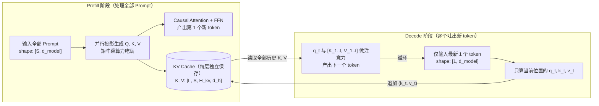

# 了解 KV Cache：从矩阵计算到显存墙与前缀复用

> 读完 [再读 Transformer](./01-再读Transformer.md) 后，我们已经看清了一个 token 是如何在 Attention 和 FFN 里层层流转的。到了真正的 LLM 推理系统里，第一个绕不开的工程概念就是 **KV Cache**。这篇笔记顺着硬件与数据流的视角，把它从公式、显存账本一直讲到跨请求的前缀复用。

---

## 1. 先看一个直观的痛点：为什么推理不能“每次重算”？

大语言模型是**自回归（Autoregressive）**生成文字的：它吐出第 1 个字，再把这 1 个字拼回输入里，重新预测第 2 个字，如此循环。

假设用户输入了一段 1000 个 token 的问题，模型要回答 500 个 token。如果没有 KV Cache，生成第 1 个回答 token 时要算 1000 个位置，生成第 2 个时要算 1001 个位置……生成第 500 个时要算 1499 个位置。总共做了超过 **62 万次 token 级前向计算**，而其中绝大部分是在把前面早就见过的 token 一遍又一遍地重新乘一遍权重矩阵。

KV Cache 做的事情朴素到近乎直觉：**把历史 token 在每一层 Attention 里算出来的 Key（K）和 Value（V）张量存起来；下一轮生成新 token 时，只算新 token 自己的 Q、K、V，再把新的 K、V 追加到缓存末尾，直接和历史 K、V 做注意力。**



把这两个阶段拆开看，你会发现它们的硬件脾气截然不同：

| 维度 | Prefill（预填充） | Decode（逐 token 解码） |
|---|---|---|
| **单步输入形状** | 整段 prompt：`[B, S, d_model]` | 每个请求只有 1 个新 token：`[B, 1, d_model]` |
| **主要计算形态** | 大矩阵 × 大矩阵（**GEMM**） | 向量 × 矩阵（**GEMV**，批小时） |
| **硬件瓶颈倾向** | **Compute-bound（算力受限）** | **Memory-bandwidth-bound（显存带宽受限）** |
| **直接影响的用户体验指标** | **TTFT**（首 token 延迟） | **ITL / TPOT**（吐字间隔 / 流畅度） |
| **KV Cache 的角色** | 负责**写入**整段 prompt 的历史 K、V | 每吐一个字都要**全量读取**历史 K、V，并**追加** 1 个位置 |

> **为什么单请求 Decode 时 GPU 算力利用率常常很低？**
> 一块现代 GPU（比如 V100 或 A100）的浮点算力极高，但把模型权重和历史 KV Cache 从 HBM（显存）搬到芯片片上寄存器（SRAM）的带宽相对有限。Prefill 时，把 3 GB 权重读进片上一次，可以同时给 512 个甚至 4096 个 token 做矩阵乘，**算术强度（Arithmetic Intensity，FLOPs / Byte）** 很高，Tensor Core 吃得饱；而单请求 Decode 时，同样要把 3 GB 权重外加历史 KV 全搬一遍，却只为了算 **1 个 token**。搬运时间远远超过计算时间，计算单元大部分时间都在干等数据。

---

## 2. 从公式验证：为什么历史 K、V 真的不用重算？

在工程上，任何“省掉计算”的优化都要先证明它**数学等价**。

以单层、单头的因果自注意力（Causal Self-Attention）为例。当序列长度为 $T$ 时，第 $t$ 个位置的隐藏输入记为 $x_t$，投影矩阵为 $W_Q, W_K, W_V$：

$$
q_t = x_t W_Q,\qquad k_t = x_t W_K,\qquad v_t = x_t W_V
$$

由于**因果掩码（Causal Mask）** 强制位置 $t$ 只能关注 $j \le t$ 的位置，第 $t$ 步的注意力输出完全由当前 $q_t$ 与所有历史键、值共同决定：

$$
o_t = \sum_{j=1}^{t} \operatorname{softmax}_{j \le t}\!\left(\frac{q_t k_j^\top}{\sqrt{d_h}}\right) v_j
$$

当我们在末尾追加第 $T+1$ 个 token 时，回头检查前 $T$ 个历史位置是否会被影响：

1. **输入层**：位置 $1 \dots T$ 的 token ID 和位置索引（如 RoPE 旋转角度）没有改变，进入第 1 层的嵌入向量不变。
2. **Attention 层**：因为因果掩码遮住了未来位置，位置 $1 \dots T$ 的注意力分数根本看不到第 $T+1$ 个 token，输出 $o_1 \dots o_T$ 与追加前完全一致。
3. **残差、Norm 与 FFN**：RMSNorm / LayerNorm 和 FFN 都是**逐 token 独立（position-wise）** 执行的，不会把 $T+1$ 的信息横向混入前面。
4. **逐层递推**：第 1 层历史位置的输出不变，进入第 2 层的输入就不变；归纳到全部 $L$ 层，每一层的历史 $k_j^{(l)}, v_j^{(l)}$ 都严格不变。

顺手还能看清两个高频细节：

- **为什么通常不缓存 Q？** $q_t$ 只在“计算位置 $t$ 自己的输出”那一刻用一次；后续位置 $T+1$ 算注意力时用的是 $q_{T+1}$ 去点乘历史 $K$，不再需要历史 $q_1 \dots q_T$。
- **为什么每一层都要各自存一份 KV？** 第 $l$ 层的输入是第 $l-1$ 层经过 Attention + FFN 加工后的隐藏状态，而且每层拥有独立的投影权重 $W_K^{(l)}, W_V^{(l)}$。第 1 层的 KV 无法替代第 2 层的 KV。
- **KV Cache 省了什么，没省什么？** 它省掉了历史 token 每一层的线性投影、历史位置的 Attention 和历史位置的 FFN，使单步计算量从 $O(T^2 d)$ 降到 $O(T d)$；但它**没有省掉当前 $q_t$ 对全部历史 $K, V$ 的注意力读取与点积**。序列越长，Decode 每一步要搬运的 KV 字节数仍然线性上升。

---

## 3. 算一笔显存账：KV Cache 是怎么撑爆 GPU 的？

### 3.1 通用体积公式

对标准的 Decoder-only 稠密注意力模型，缓存单个 token 在全部层的 KV 所需字节数为：

$$
M_{\text{token}} = 2\;(\text{K 和 V}) \times L\;(\text{层数}) \times H_{\text{kv}}\;(\text{KV 头数}) \times d_h\;(\text{单头维度}) \times s\;(\text{单元素字节数})
$$

若当前系统同时服务多条请求，第 $r$ 条序列当前缓存长度为 $S_r$，则逻辑 KV 总量为：

$$
M_{\text{KV}} = M_{\text{token}} \times \sum_{r} S_r
$$

### 3.2 从 MHA 到 GQA：架构演进怎样给 KV 瘦身？

如果直接沿用原始 Transformer 的多头注意力（MHA），KV 头数等于 Query 头数（$H_{\text{kv}} = H_q$），显存膨胀得非常快。现代 LLM 广泛采用 **GQA（Grouped-Query Attention）** 或 **MQA（Multi-Query Attention）**，让多个 Query 头共享同一组 K/V 头，直接把 KV 体积缩小 $H_q / H_{\text{kv}}$ 倍；DeepSeek 系列更进一步提出 **MLA（Multi-Head Latent Attention）**，把 KV 压缩为低维潜在向量后再缓存。

拿本仓库实际部署的 **Qwen2.5-1.5B-Instruct（FP16）** 与经典 **LLaMA-2-7B（FP16）**、**LLaMA-3-70B（BF16）** 横向对比，感受会非常直接：

| 模型 | 层数 $L$ | Q 头 / KV 头 | $d_h$ | 精度 $s$ | 单 token KV 大小 | 32K 上下文单条请求 |
|---|---:|---:|---:|---:|---:|---:|
| **Qwen2.5-1.5B-Instruct**（本项目实测） | 28 | 12 / **2**（GQA 6:1） | 128 | 2 B (FP16) | **28 KiB** | 896 MiB |
| **LLaMA-2-7B**（MHA） | 32 | 32 / **32** | 128 | 2 B (FP16) | **512 KiB** | **16 GiB** |
| **LLaMA-3-70B**（GQA） | 80 | 64 / **8**（GQA 8:1） | 128 | 2 B (BF16) | **320 KiB** | **10 GiB** |

拆解一下 **Qwen2.5-1.5B-Instruct** 的精确计算（后面在 vLLM 日志和 Mooncake 字节计数里会反复见到这几个数字）：

- **单 token、单层**：$2 \times 2 \times 128 \times 2\text{ B} = 1024\text{ B} = 1\text{ KiB}$
- **单 token、跨 28 层**：$28 \times 1\text{ KiB} = \mathbf{28\text{ KiB}} = 28{,}672\text{ bytes}$
- **单个 16-token KV 块（跨 28 层）**：$16 \times 28\text{ KiB} = \mathbf{448\text{ KiB}} = 458{,}752\text{ bytes}$
- **512-token 前缀（32 块）**：$512 \times 28\text{ KiB} = \mathbf{14\text{ MiB}} = 14{,}680{,}064\text{ bytes}$
- **496-token 前缀（31 块）**：$496 \times 28\text{ KiB} = \mathbf{13.5625\text{ MiB}} = 14{,}221{,}312\text{ bytes}$

即便有了 GQA，当服务面对上万 token 的文档问答、多轮 Agent 工具调用、几十上百路并发请求时，KV Cache 依然会迅速吞噬掉整个 GPU 的 HBM，成为限制并发数和上下文长度的**显存墙**。

> **工程里必须区分的三笔显存账**：
> 1. **请求的逻辑 KV 字节数**：当前请求按公式算出的真实有效 K/V（例如 512 token 对应 14 MiB）。
> 2. **已占用的物理块**：按块粒度（如 16 token/块）分配出去的块，多个共享前缀的请求会共同引用同一批物理块。
> 3. **引擎预分配的 KV 池总容量**：推理框架启动时一次性向 CUDA 申请好的大片显存池（例如 V100 上 `gpu_memory_utilization=0.3` 分配出的 6.32 GiB）。看到显存占了 9 GiB，实际活跃请求可能只用了其中 14 MiB。

---

## 4. 从“单请求缓存”走向“跨请求复用”：Prefix Caching 与 RadixAttention

上面讲的是**同一条请求**在 Decode 阶段复用自己 Prefill 算好的 KV。如果把视野放大到整个在线服务，很快会发现另一座金矿：**大量不同请求的前面一大段文字是完全相同的**。

典型场景随处可见：
- **System Prompt**：整个业务的所有用户都共用同一段几百到几千 token 的系统提示词或工具定义。
- **多轮对话（Multi-turn Chat）**：第 $k$ 轮发给模型的完整上下文，前面就是第 $1 \dots k-1$ 轮已经算过的历史记录。
- **文档问答 / Agent 轨迹**：多个问题针对同一份长合同，或同一个 Agent 循环中不断把工具返回结果追加在旧上下文后面。

只要满足**四个严格条件**——模型权重修订一致、tokenizer 与位置编码配置一致、数值与执行契约相容、且**从位置 0 开始的前缀 token 序列完全一致**——新请求就可以直接复用旧请求留下来的前缀 KV，跳过这段前缀的 Prefill 计算，只对后面新多出来的后缀做增量 Prefill。

### 4.1 为什么必须“从头连续一致”？

因果注意力把每个位置和它前面的全部历史绑在了一起。假如请求 A 和请求 B 在第 5 个 token 处不同，哪怕第 6 到第 500 个 token 的文字一模一样，从第 5 个 token 往后的每一层隐藏状态和 K/V 都会彻底分叉，无法直接复用。

因此，工程上标识一个 KV 块时，绝不能只对这一块里的 16 个 token 做哈希，而必须构成一条**前缀哈希链（Prefix Hash Chain）**：

```text
Block 0 ID = Hash(初始盐值/模型与配置标识, tokens[0:16])
Block 1 ID = Hash(Block 0 ID,            tokens[16:32])
Block 2 ID = Hash(Block 1 ID,            tokens[32:48])
...
```

只要前面任意一个 token 改了，它所在块及后面所有块的哈希值都会像多米诺骨牌一样全变掉，天然保证了前缀一致性。

### 4.2 两种常见的前缀索引结构

在主流推理引擎中，前缀查找主要有两种组织方式：

1. **定长块哈希表（vLLM Automatic Prefix Caching）**：
   把 prompt 按固定 `block_size`（如 16）切块，逐块计算前缀哈希并在哈希表中查找。实现简洁、$O(1)$ 查找、极易与外部对象存储（如 Mooncake Store）的 `key → block` 接口对齐；缺点是命中粒度对齐到块边界，不足一整块的零头无法作为外部块保存。
2. **前缀压缩树（SGLang RadixAttention）**：
   把所有请求的历史前缀组织成一棵**基数树（Radix Tree）**，边上存放压缩后的连续 token 段，节点指向对应的 KV 内存。新请求到来时沿树根向下做最长前缀匹配，甚至可以在一条压缩边的中间切分（split）实现任意 token 粒度的前缀共享，配合树叶节点的 LRU 驱逐机制管理缓存容量。

无论是哪种索引，一旦两个分支请求共享了同一段前缀，都必须做好**分支隔离**：对共享块只读不改；如果某个请求要在共享的未满尾块后追加新 token，必须先拷贝一份副本再写（**Copy-on-Write，写时复制**），避免污染另一条分支。

---

## 5. 用本地代码亲手验证：理论与实测如何一一对齐？

在直接面对上万行 C++/CUDA 的生产框架之前，本仓库用一套纯 CPU 的教学验证程序（[week1_kv_cache_demo.py](../scripts/week1_kv_cache_demo.py)，归档报告见 [kv-cache 结果说明](../results/week1/kv-cache/README.md)）把上述核心性质逐一落地校验过：

| 验证维度 | 做了什么测试 | 实测结果与工程含义 |
|---|---|---|
| **数值等价性** | 固定权重下，对比“完整重算”与“缓存增量前向”的输出 logits | 最大误差 `5.55e-16`（FP64 机器精度量级），验证因果增量计算数学等价 |
| **步长与边界** | 逐 token 追加（长度 `1→6`）及一次追加 2 个 token | 缓存长度、位置偏移与掩码行为一致，增量逻辑同样适用于多 token 后缀 |
| **生成尾差** | 4-token prompt 连续生成 8 个 token | 结束时缓存长度为 **11**（`4 + 7`），而非 12——第 8 个刚选出的 token 尚未作为下一步输入送进模型 |
| **分支前缀与身份隔离** | 共享 3-token 前缀的两条不同后缀；篡改前缀或更换模型标识 | 同前缀分支准确命中 3 token 且互不污染；改前缀或换模型 ID 后命中长度立刻降为 `0` |
| **Radix 边内匹配** | 在压缩边中间结束查询 | 准确返回匹配长度 `3`，验证前缀树的边切分逻辑 |
| **体积线性缩放** | 长度翻倍、batch 翻倍、FP64 改 FP32 | 实际张量字节数与 $M_{\text{KV}}$ 公式严丝合缝 |

> 这些 CPU 检验用于把数学等价性、位置偏移、尾差和前缀身份彻底跑透；它们不代表 GPU 推理框架的真实吞吐与延迟，真实框架与跨进程 DRAM 路径在后续笔记中展开。

---

## 6. 跳出单机看全景：KV Cache 优化的三大主线

当你理解了“KV Cache 是显存墙的核心，又承载了宝贵的跨请求复用价值”，再看整个领域琳琅满目的论文与系统（参考 [系统感知 KV Cache 综述](https://arxiv.org/abs/2607.08057)），就能把它们清晰地装进三个抽屉里：

1. **表示与保留（怎么把 KV 变小、留住更有用的）**
   - 架构压缩：GQA、MQA、MLA。
   - 数值与稀疏：KV 量化（FP8 / INT4）、token 驱逐/稀疏保留（会改变精确语义，需要额外评估质量）。
   - 共享与淘汰：Prefix Caching、RadixAttention，以及在容量受限时的驱逐策略（FIFO、LRU、频率/位置感知策略——这正是后续池容量与驱逐实验的研究对象）。
2. **放置与迁移（显存装不下时，KV 放哪里、怎么搬）**
   - 单机内存分页：PagedAttention 消除显存碎片。
   - 多级存储卸载：GPU HBM ↔ 主机 CPU DRAM ↔ 本地 NVMe SSD（利用 `O_DIRECT` 或 SPDK 绕过内核冗余拷贝）。
   - 跨节点共享池：把集群里空闲机器的内存和磁盘拼成统一 KV 池（如 Mooncake Store）。
3. **执行与调度（什么时候算、什么时候搬、怎么别让 GPU 干等）**
   - 连续批处理（Continuous Batching）与 Chunked Prefill。
   - 计算与 I/O 重叠：异步 DMA、pinned memory、预取（Prefetch）与双缓冲（Double Buffering）。
   - **PD 分离（Prefill-Decode Disaggregation）**：把算力敏感的 Prefill 和带宽敏感的 Decode 拆到不同节点，中间通过高速网络搬运 KV Cache。

沿着这条脉络，下一篇 [认识 vLLM](./03-认识vLLM.md) 会先看清推理引擎怎样在单张 GPU 内部把 KV 管理好；随后的 [认识 Mooncake](./04-认识Mooncake.md) 再把视野扩展到 GPU 之外的 DRAM 缓存池与跨进程/跨节点传输。
