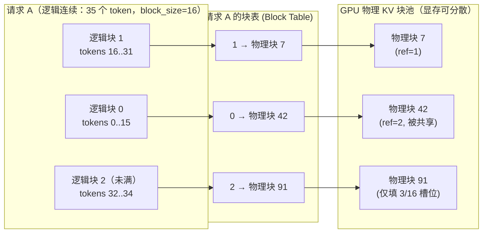
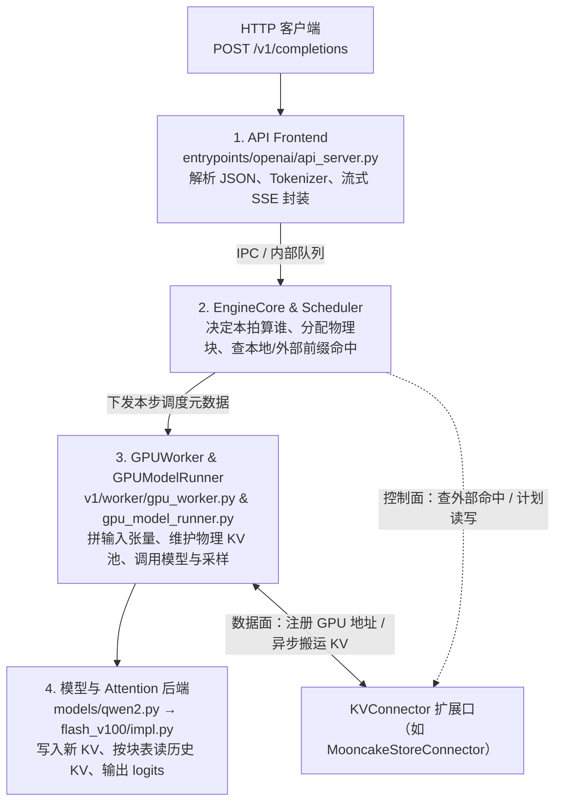

# 认识 vLLM：从 PagedAttention 到现代推理引擎的内部运转

> 写完一个 PyTorch 的 `model.forward()`，只解决了“单条请求怎么算出来”。一旦模型上线，同时涌进几十个长短不一、随时到来、随时结束的请求，真正的难题立刻从“算法公式”变成了**操作系统级别的资源管理**：显存碎片怎么消？并发请求怎么排？前缀缓存怎么管？外部存储接口插在哪里？vLLM 正是为解决这套工程难题而生的。

---

## 1. 为什么朴素的 LLM 推理服务会浪费掉一大半显存？

在 vLLM（SOSP 2023，[PagedAttention 论文](https://arxiv.org/abs/2309.06180)）出现之前，主流推理框架（如早期的 FasterTransformer、Orca）管理 KV Cache 的方式非常直接：**为每条请求在显存里申请一块连续的大数组**。

因为模型上线前根本不知道这条请求最终会生成 20 个 token 还是 2048 个 token，框架只能按最大上限（`max_model_len`）提前占坑。结果立刻爆出三种显存浪费：

1. **过度预留（Reserved Waste）**：明明最后只生成了 100 个 token，却按 2048 个 token 提前占了坑，剩下的 1948 个坑位在请求结束前谁也用不了。
2. **内部碎片（Internal Fragmentation）**：为了给未来即将生成的 token 留连续空位，已分配区尾部长期空转。
3. **外部碎片（External Fragmentation）**：不同请求长度不一、先后释放，连续显存被切得支离破碎，空余总显存明明够用，却找不到一整块连续空间塞下新请求。

原论文实测发现，在传统连续分配模式下，KV Cache 区域里**实际存着有效数据的比例往往只有 20%～38%**，超过六成显存白白浪费在预留和碎片上。同时，因为每条请求的 KV 独立连续存放，即使两个请求共用同一段长系统提示词，也无法在物理显存里共享同一份副本。

---

## 2. PagedAttention：把操作系统的“虚拟内存分页”搬进 GPU

vLLM 的核心洞察极其优雅：**既然操作系统早就用“虚拟内存 + 页表（Page Table）”解决了物理内存碎片问题，GPU 里的 KV Cache 为什么不能也分页？**

### 2.1 三个核心概念

- **逻辑 KV 块（Logical Block）**：站在单个请求的视角，它的 token 序列依然是连续编号的 `0, 1, 2, ...`，按固定大小 `block_size`（常见为 `16` 个 token）切成逻辑块 0、逻辑块 1、逻辑块 2……
- **物理 KV 块（Physical Block）**：引擎启动时，在 GPU 显存里一次性划出一大片整齐的物理块池（比如 14,783 个物理块，编号 `0 ~ 14782`）。请求真正需要写新 token 时，才按需领一个空闲物理块，物理块之间**完全不需要连续**。
- **块表（Block Table）**：每个请求维护一张极小的映射表，记录“我的第 $i$ 个逻辑块，现在放在哪号物理块里”。

### 2.2 Attention 内核怎样按页寻址？

当 PagedAttention 的 GPU 内核计算注意力，需要读取逻辑位置 $p$（例如 $p = 20$，块大小 $B = 16$）的历史 K/V 时，寻址只需要两步整数运算：

$$
\text{logical\_block} = \lfloor p / B \rfloor = 20 // 16 = 1, \qquad
\text{slot\_offset} = p \bmod B = 20 \bmod 16 = 4
$$

再去块表里查 `block_table[1] = 7`，就能精确定位到物理块 7 的第 4 号槽位。

结果立竿见影：
- **外部碎片降为零**：所有物理块大小完全一致，任意空闲块都能发给任意请求。
- **内部碎片降到极低**：只有每个序列的最后一个块可能没填满，平均浪费不超过半个块（原论文中总浪费低于 **4%**）。

### 2.3 物理块共享与写时复制（Copy-on-Write）

有了块表和**引用计数（Reference Count）**，跨请求共享变得水到渠成：

- 如果请求 A 和请求 B 共享前 32 个 token（逻辑块 0、1），只需要让两张块表的第 0、1 项指向同一批物理块，并把对应物理块的 `ref_count` 加 1，**零拷贝**完成共享。
- 如果两条请求在某个**未满的尾块**分叉（例如共享了前 4 个 token，接下来各自追加不同内容），谁要往一个 `ref_count > 1` 的物理块里写新 token，引擎就会触发 **Copy-on-Write（COW）**：先申请一个全新物理块，把旧块里已有的几个 token 拷贝过去，把旧块 `ref_count` 减 1，再把新 token 写进新块。两条分支从此彻底独立，互不踩踏。

本仓库的 [week1_paged_kv_demo.py](../scripts/week1_paged_kv_demo.py) 用 CPU 张量完整复现了这套页池机制（结果归档在 [paged-kv/checks.json](../results/week1/paged-kv/checks.json)）：
- 共享前缀时物理块占用从 `4` 块降为 `3` 块；
- 边界长度 `3, 4, 5`（块大小 4）对应的块数严格为 `1, 1, 2`；
- `fork` 后两条分支对共享尾块执行追加时，自动触发 COW 分配新尾块，且最终拼回连续 KV 做 Attention 的结果与未分页参考路径一致；
- 请求全部结束后，所有物理块引用计数归零并完整回收到空闲池。

---

## 3. 不止于分页：vLLM 吞吐飙升的另外三板斧

很多人把 vLLM 等同于 PagedAttention，其实在线服务里还有三个同样关键的引擎机制在协同工作：

### 3.1 连续批处理（Continuous Batching）

传统的静态批处理（Static Batching）必须凑齐一整个 batch 一起跑，而且**整批要等最慢、生成最长的那条请求完全吐完**，已经早早结束的短请求只能空占着显存和计算槽位发呆。

vLLM 采用**迭代级调度（Iteration-level Scheduling）**：每完成一次前向迭代（大约几十毫秒），调度器就重新审视队列——刚吐出 EOS 结束的请求立刻踢出 batch 并回收 KV 块，等待队列里的新请求下一拍马上补位进来。GPU 几乎不再因为长短句混排而空转。

### 3.2 Chunked Prefill（分块预填充）

把一个 4096 token 的新请求（Prefill）和 10 个正在逐字吐字的旧请求（Decode）混在同一张卡上时，如果一口气把 4096 token 全算完，正在 Decode 的用户会明显卡顿几百毫秒（TTFT 抢占了 ITL）。

**Chunked Prefill** 引入了单步调度预算 `max_num_batched_tokens`：把超长 Prefill 切成若干个调度片段，每一步把 Decode 的少量 token 和一小段 Prefill 拼进同一个 batch 一起算。既保证 Decode 用户流畅吐字，又用 Prefill 的大矩阵把 GPU 算力喂饱。

> **容易混淆的粒度边界**：Chunked Prefill 的“chunk”是**调度时间切片**，PagedAttention 的“block”是**显存管理页**，SSD 的读写块或网络的传输分片又是**I/O 粒度**。它们在代码里是互相解耦的，完全可以是不同大小。

### 3.3 自动前缀缓存（Automatic Prefix Caching, APC）

开启 `--enable-prefix-caching` 后，vLLM 不会在一条请求结束时立刻抹掉它用过的满 KV 块，而是把这些块的**前缀哈希链（如 `--prefix-caching-hash-algo sha256`）** 登记在本地哈希表里，将物理块放入一条**空闲可驱逐链表（通常按 LRU 顺序）**。

- **命中时**：新请求如果带有相同前缀，调度器直接把对应物理块从空闲链表里“捞回来”，增加引用计数，连数据拷贝都省了，**零延迟跳过这部分 Prefill**。
- **淘汰时**：当 GPU 物理块不够用、新请求急需空块时，块管理器就从 LRU 队列头部把最久未用的已缓存块踢出去，擦除它的哈希索引，把物理空间让给新请求。

> 理解这一点对后续的分层缓存实验非常关键：**GPU 本地前缀缓存被“自然淘汰”，恰恰就是外部 DRAM / SSD 缓存（如 Mooncake Store）登场的时刻。**

---

## 4. 拆开一台正在跑的 vLLM v1：请求怎么走完一整圈？

本仓库在实验室 V100 服务器上源码构建的是 **1Cat-vLLM v1.5.3**（基于 vLLM V1 架构，适配 SM70 算子）。把代码树摊开，它的运行时职责非常清晰地分成四层：

把每层在真实工程里干的活对应清楚：

1. **启动期（还没来请求之前）**：
   - `GPUWorker.init_device()` 绑定目标 GPU。
   - `GPUModelRunner.load_model()` 根据 `config.json` 里的 `architectures: ["Qwen2ForCausalLM"]` 找到 `qwen2.py`，把 `model.safetensors` 里的权重按布局灌进 GPU 显存。
   - `determine_available_memory()` 先用 `profile_run()` 跑一次假输入，量出权重和临时激活占了多少显存，再用总预算（`总显存 × gpu_memory_utilization`）减去这部分，剩下的显存全部划成 KV 物理块池（也可通过 `--num-gpu-blocks-override` 精确指定块数，这在控制变量的缓存淘汰实验里极其好用）。
   - `initialize_kv_cache()` 一次性向 CUDA 申请原始显存，按每层 `[num_blocks, 2, block_size, num_kv_heads, head_size]` 切好视图并绑定给各层 Attention。
2. **请求期（每来一条请求）**：
   - **查前缀**：Scheduler 先查本地 GPU 前缀缓存（`KVCacheManager`）；如果配置了外部 `KVConnector`，还会接着询问外部缓存有没有可复用的更长前缀。
   - **分块与执行**：为需要读回的块和需要新算的后缀分配 GPU 物理块；若有外部读回任务，等加载完成后再把未命中后缀送进 `GPUModelRunner` 执行前向计算。
   - **采样与流式返回**：末端 `lm_head` 算出词表 logits，采样选出新 token，通过 SSE（Server-Sent Events）立刻推给客户端。
   - **保存与回收**：如果开启了外部缓存写入（如 `kv_role="kv_both"`），满块会异步提交给 `KVConnector` 写往外部存储；**物理块要等异步写入真正完成之后才会彻底归还给空闲池**，防止新请求覆盖正在传输的数据。

---

## 5. 分页不是终点：vLLM 单机显存的边界在哪里？

把 vLLM 的原理摸透之后，一定要把它的能力边界画清：

- **PagedAttention 解决的是“GPU 显存内部利用率”**：它把显存碎片几乎清零，但并没有把一块 32 GB 的卡变出 256 GB 的显存。
- **APC 解决的是“单机显存内的热前缀复用”**：一旦并发流量上来或者长请求刷过一遍，GPU 里的物理块池很快被洗空，旧前缀被 LRU 淘汰；此外，vLLM 进程一旦重启，显存里的所有 KV 也会随进程退出而灰飞烟灭。

想突破单张 GPU 的物理容量上限、实现跨请求甚至跨节点的长周期 KV 复用，就必须把 KV Cache 引出 GPU，接上一套专门为 KV 设计的存储与高速传输系统——这正是下一篇 [认识 Mooncake](./04-认识Mooncake.md) 的主角。
