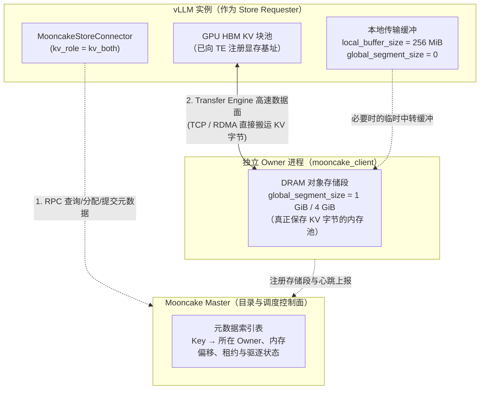

# 认识 Mooncake：以 KV Cache 为中心的存储与传输架构

> 看懂了 [vLLM](./03-认识vLLM.md)，你会发现单张 GPU 的 HBM 就像一张极快但极小的书桌：书摊多了就得把暂时不看的收进旁边的书架（主机 DRAM / SSD），或者传给另一张桌子继续处理。**Mooncake** 正是围绕这套需求成长起来的开源系统——它把分散在机器里的 CPU 内存、SSD 和高速网络组织起来，让 KV Cache 变成一种可以跨进程、跨节点存储与调度的**一等公民资源**。

---

## 1. 一句话看懂 Mooncake 的哲学：用便宜的存储换昂贵的算力

Mooncake 最早因 Moonshot AI（Kimi）在 **USENIX FAST 2025** 上发表的论文而广为人知，论文的副标题直接亮明了核心思想：

> **Trading More Storage for Less Computation — A KVCache-centric Architecture for Serving LLM Chatbot**（用更多存储换更少计算：面向大模型聊天的 KV Cache 中心化架构）

在真实的大模型在线推理集群里，存在一种普遍的资源错配：
- **GPU HBM 极度稀缺且昂贵**：长上下文和高并发下很快被 KV Cache 填满，导致大量本可复用的前缀被迫淘汰，下次再来只能重新做昂贵的 Prefill。
- **主机 CPU DRAM 与本地 NVMe SSD 大量闲置**：一台 GPU 服务器往往配着几百 GB 到上 TB 的内存以及高速 NVMe 盘，平时跑推理时利用率极低。

Mooncake 的破局思路分成两条腿走路：
1. **全局分布式的 KV Cache 池**：把集群里未充分利用的 CPU DRAM、SSD（以及空闲 GPU 显存）池化成一个统一的 KV 存储层，大幅延长前缀 KV 的存活时间、拉高命中率。
2. **Prefill 与 Decode 分离（PD Disaggregation）**：Prefill 吃算力、拉高延迟；Decode 吃显存带宽、怕被长 Prefill 打断。把它们拆到不同节点独立扩缩容，Prefill 节点算完后，通过高速网络（RDMA / TCP）把生成的 KV Cache 直接推给 Decode 节点继续吐字。

在论文架构里，顶层还有一个全局调度器 **Conductor**，在“选一个已经缓存了前缀但当前偏忙的节点”与“选一个空闲但需要跨节点拉 KV 或重算的节点”之间权衡，并在过载时做早期预测拒单，保证 **TTFT** 和 **TBT（Time Between Tokens）** 两个 SLO 都达标。

> **区分论文蓝图与开源组件**：FAST 2025 论文描绘的是包含 Conductor 调度和大规模集群 PD 分离的完整生产架构；而我们在开源仓库 [kvcache-ai/Mooncake](https://github.com/kvcache-ai/Mooncake) 中直接调用和部署的核心，是支撑这套架构的两大工程基座——**Transfer Engine** 和 **Mooncake Store**。

---

## 2. 拆开开源 Mooncake 的两大核心组件

如果把 Mooncake 比作一家专送 KV Cache 的顺丰物流，那么它由两个配合紧密的模块构成：



### 2.1 数据面基座：Transfer Engine（TE）

**Transfer Engine** 是一套只管“以最快速度把一段内存字节从 A 搬到 B”的高性能传输引擎，支持 RDMA、TCP、NVLink 等多种底层协议。

理解它只需要记住四个动作：

1. **初始化与协议选择**：进程启动时创建 `TransferEngine`，绑定本机监听地址、元数据握手方式（如点对点 `P2PHANDSHAKE` 或独立 metadata server）以及传输协议（`tcp` 或 `rdma`）。在测试强制走 TCP 路径时，可通过环境变量 `MC_FORCE_TCP=1` 禁用自动探测切换。
2. **内存注册（`register_memory(ptr, size)`）**：传输前，发送方和接收方都要把自己打算参与收发的内存区域（可以是 CPU 内存，也可以是 GPU 显存指针）向 TE 注册。在 RDMA 场景下，这一步会把内存钉住（pin）并向网卡注册 MR（Memory Region），让网卡 DMA 可以直接读写，避免 CPU 反复拷贝。
3. **控制面换坐标，数据面搬载荷**：发送方和接收方先通过轻量控制通道交换极小的元数据（会话地址、目标内存指针 `pointer`、字节数 `bytes`），然后由 TE 执行真正的批量读写（如 `transfer_sync_write`）。**真正的 KV 大块字节走的是 TE 的高速数据通道，绝不从控制通道偷渡。**
4. **明确完成信号**：传输调用返回成功且校验无误后，接收方才被允许把这段缓冲区里的字节交给模型继续算。

本仓库在两套环境中都独立校验过 Transfer Engine 的真实数据路径：
- **双进程 CPU/TCP 交接（[week1_mooncake_transfer_demo.py](../scripts/week1_mooncake_transfer_demo.py)，结果见 [mooncake-transfer/checks.json](../results/week1/mooncake-transfer/checks.json)）**：独立发送与接收进程通过 TE 传输 `3541 B` 载荷（含 `768 B` KV 张量），接收端直接接续前缀推理，logits 最大误差 `2.22e-16`。
- **单机双进程 V100 CUDA 指针往返（记录见 [lab-v100-info.json](../environment/lab-v100-info.json)）**：GPU 显存 → 独立进程 `8 MiB` DRAM → GPU 显存，强制 TCP 路径下往返逐字节与 SHA256 完全一致。

### 2.2 缓存服务层：Mooncake Store

只有 Transfer Engine 时，业务代码还得自己操心“这个前缀的 KV 存在哪台机器的哪个内存地址、内存满了该淘汰谁、多个并发读写会不会冲突”。**Mooncake Store** 在 TE 之上封装了一层分布式 KV 对象存储，把管理分成两个角色：

- **Master（`mooncake_master`）**：纯**控制面目录服务**。它不存任何 KV 原始字节，只管记录全网有哪些存储段、每个 `key` 是否存在、落在哪台机器哪个地址、哪些对象正在被读（防止读到一半被删）、空间满了按什么规则驱逐。
- **Client / Owner（`mooncake_client` 与嵌入 vLLM 的客户端）**：
  - 当启动一个独立 `mooncake_client` 并给它配置 `global_segment_size > 0`（如 1 GiB 或 4 GiB）时，它就是**存储提供者（Owner）**，把自己的 DRAM（或可选 SSD）注册给 Master，真正保管 KV 字节。
  - 当 vLLM 作为请求端接入时，通常设置 `global_segment_size = 0`（不往外贡献公共存储池），同时保留一块 `local_buffer_size`（如 256 MiB）作为本地传输中转缓冲。**区分“Owner 的存储池”和“vLLM 的本地传输缓冲”，能避免部署排障时把两笔内存混为一谈。**

---

## 3. vLLM 是怎么接上 Mooncake Store 的？

在 vLLM V1 中，引擎并不直接写死 Mooncake 的调用，而是通过统一的 `KVConnector` 接口解耦。当启动参数传入：

```bash
--kv-transfer-config '{"kv_connector":"MooncakeStoreConnector","kv_role":"kv_both"}'
```

`kv_role="kv_both"` 表示**同一个 vLLM 实例既当生产者（把新算出的前缀块写入 Store），又当消费者（显存未命中时从 Store 读回前缀块）**。

整个协同链路拆成“查、读、写”三步：

### 3.1 查：调度侧查询最长连续命中

请求进入 Scheduler 且本地 GPU 前缀缓存未命中（或只命中一部分）时，调度器调用 `MooncakeStoreConnector.get_num_new_matched_tokens()`：
1. 把剩余 token 按 `block_size=16` 切块，算出每个满块对应的前缀哈希 Key（Key 里包含模型名、并行 rank、KV group 和前缀哈希链）。
2. 向 Master 批量查询这些 Key 是否存在（`batch_is_exist`）。
3. 从头开始统计**最长连续命中**的块数。只要中间断了一个块，后面的块就不能再接着复用。
4. **尾块规则**：如果整条 prompt 恰好 100% 全部命中外部 Store，由于 Store 只存了 K/V 没存最终采样所需的最后一个位置 logits，当前实现会故意留出最后一个块重新计算（例如 512 token 满命中时恢复前 31 块 = 496 token，重算最后 16 token）。如果请求带有新后缀（例如 512 共享前缀 + 8 新后缀），则 512 个共享前缀 token（32 块）可以全部读回，只计算那 8 个新后缀 token！

### 3.2 读：分配新 GPU 块并异步搬回

1. 调度器为即将读回的前缀块在 GPU KV 池里分配目标物理块。
2. 执行侧的 `ChunkedTokenDatabase` 根据物理块号、各层显存基址和步长（stride），把一个逻辑块映射成 28 层对应的 GPU 显存地址片段。
3. 后台接收线程调用 `batch_get_into_multi_buffers()`，让 Transfer Engine 把 Owner DRAM 里的字节搬进这些新分配的 GPU 物理块。
4. 全部字节落位、核对无失败后，Connector 把“加载完成”状态报告回调度器，引擎才放行该请求进入模型计算剩余后缀。

### 3.3 写：等 CUDA 算完，异步落池再放行回收

1. 一条请求算完 Prefill（生成了新的完整 KV 块）后，执行侧先在 CUDA 计算流上打一个 **CUDA Event**。
2. 后台发送线程**先等待这个 Event 完成**（确保 GPU 已经把 KV 真正写进显存，绝不读脏数据），再通过 `batch_put_from_multi_buffers()` 把 28 层显存片段打包写入 Owner 的 DRAM 段。
3. 写入期间，调度器通过挂起计数把这些源物理块锁住，**直到写入完成回报引擎，才允许把物理块释放回 GPU 空闲池**。

---

## 4. 引入外部缓存后，两个最核心的系统权衡

把 vLLM 和 Mooncake Store 接通只是工程起点。真正让这个方向充满系统研究价值的，是下面两个必须用实测数据回答的问题：

### 权衡一：从主存“读回来”一定比在 GPU 上“重新算”快吗？

未必！把一次外部缓存恢复的耗时拆开来看：

$$
T_{\text{回读路径}} = T_{\text{查询与调度}} + T_{\text{Store GET 与搬运}} + T_{\text{剩余后缀计算}} + T_{\text{等待与同步开销}}
$$

对比直接关闭 Store、让 GPU 从头算完的耗时：

$$
T_{\text{重算路径}} = T_{\text{完整 Prefill}}
$$

- **前缀很短时**（如 64、128 token）：GPU 并行算力极其充沛，重算几十毫秒就完了；而走外部 Store 哪怕只搬几 MB，也要付出 RPC 查找、异步队列交接、跨进程 TCP 传输、状态同步等**固定开销（$\alpha$）**，再加上剩一小段后缀走小矩阵 fallback 内核，结果**回读反而可能比直接重算更慢**。
- **前缀拉长后**（如数千到数万 token）：Prefill 的注意力计算呈平方级增长、投影呈线性增长，重算耗时迅速攀升；而主存读取大致按字节线性增长（$D / B_{\text{eff}}$），此时回读的优势才会逐步显现。

找到这条真实硬件上的**收益交叉点**、拆解每一毫秒花在了哪里，并在命中后智能决定“该读还是该重算”，就是 [任务 A（回读与重算性能对比）](./06-认识task-a.md) 要系统解决的核心课题。

### 权衡二：缓存池开多大才够？满了该踢掉谁？

从 FAST 2025 论文的轨迹分析（Figure 9）可以看到：随着 KV 缓存池容量增大，前缀 token 命中率并非无限线性上涨，而是在覆盖掉活跃工作集后进入**收益趋缓区**。在容量吃紧的区间里，**驱逐策略**（FIFO 还是 LRU，甚至结合前缀访问频率和块在序列中的靠前位置——靠前的块一旦被踢，它后面整串依赖它的块全都会失效！）会对命中率产生显著差异。

这对应着后续的**缓存池容量与驱逐策略轨迹模拟**研究：用实机测清“每次命中能省多少时间”（A），用公开轨迹测清“多大池子、什么策略能拿到多少命中”（B），两块拼图合在一起，才能完整回答分层 KV 缓存系统的端到端价值。
