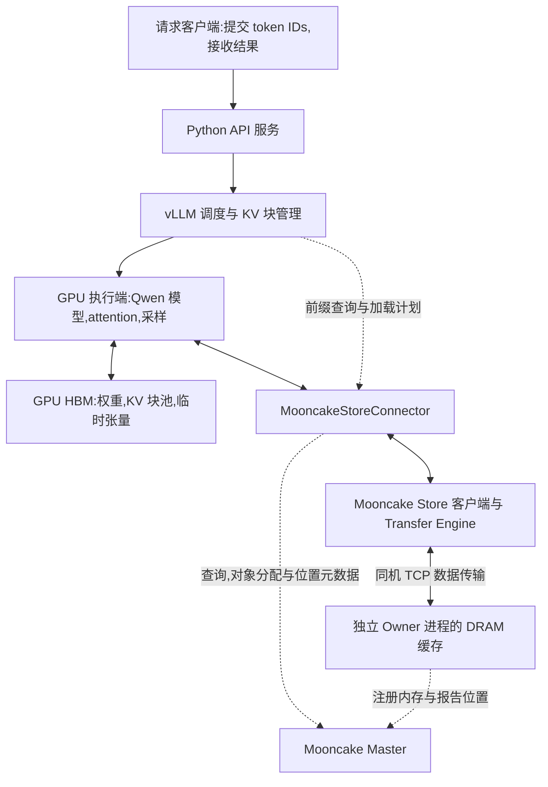
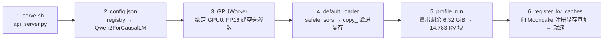
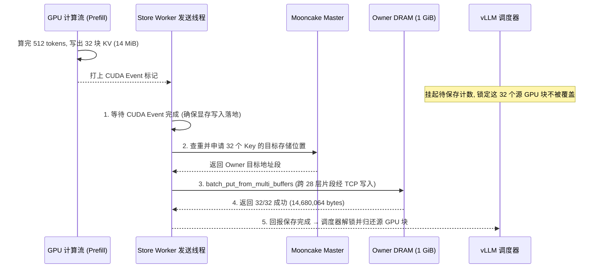
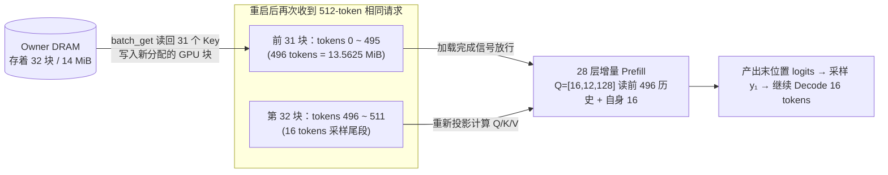

# 从真实工程场景认识 KV Cache 项目

理解了 [Transformer](./01-再读Transformer.md)、[KV Cache](./02-了解KV-Cache.md)、[vLLM](./03-认识vLLM.md) 和 [Mooncake](./04-认识Mooncake.md) 的基本原理之后，第一次真正登录到一台跑着推理服务的 GPU 服务器，很多人依然会瞬间迷路：模型权重已经在硬盘上了，vLLM 到底还替我们干了什么？Mooncake 存进去的那些字节究竟长什么样？日志里蹦出一次缓存命中，离真正完成分层卸载实验又有多远？

这篇笔记不讲空泛概念，而是直接解剖一套**已经在实验室单张 Tesla V100 上通过验收的真实部署**——由 **Qwen2.5-1.5B-Instruct**、源码构建的 **1Cat-vLLM v1.5.3** 以及 **Mooncake 0.3.14（Store + Transfer Engine）** 组成——把一整条 512-token 真实请求从发出 HTTP、进 GPU 算 KV、异步写进另一个进程的 DRAM，到重启 vLLM 后把前缀读回来续算的全过程彻底摊开来看。

> **30 秒全景速查（这套部署的关键数字）**
> - **硬件与精度**：单张 Tesla V100S-PCIE-32GB，FP16 推理，块大小 `block_size = 16`。
> - **模型几何**：Qwen2.5-1.5B-Instruct，28 层，hidden 1536，12 个 Q 头 / 2 个 KV 头（GQA 6:1），`head_dim = 128` → **每 token 跨层 KV 刚好 `28 KiB`，每块 `448 KiB`**。
> - **显存与主存分工**：vLLM 启动预算 `gpu_memory_utilization = 0.3`（KV 池约 `6.32 GiB`，`14,783` 物理块）；外部 Owner 进程贡献 `1 GiB` DRAM 对象池；vLLM 侧保留 `256 MiB` 本地传输缓冲。
> - **已验收的功能结果**：512-token 输入冷写入 **14 MiB（32 块）**；仅重启 vLLM 后，从 DRAM 恢复 **13.5625 MiB（31 块，496 tokens）** 并重算最后 16-token 采样尾块，生成的 16 个 token ID 与全显存对照**逐位一致**。

全文围绕三个问题层层展开：

1. [当前部署的项目怎样工作?](#一当前部署的项目怎样工作)——按真实执行顺序，把目录、启动、请求、计算、保存与恢复串成闭环。
2. [怎样围绕这套部署开展实验?](#二怎样围绕这套部署开展实验)——从正确性边界到性能对照（具体的单实例自然淘汰与长度扫描方案见 [认识任务 A](./06-认识task-a.md)）。
3. [除了这套部署,还需要完成哪些实验?](#三除了这套部署还需要完成哪些实验)——明确当前前缀恢复路径与活跃序列卸载、SSD、预取流水线、跨机 PD 等后续课题的边界。

第一部分顺着一条真实请求的生命周期读下来即可；第二、三部分说明实验设计与验收标准，其中尚未实施的环节均标注为待验证方向。实测验收数据归档在 [KV 前缀保存与恢复验证](../results/week1/deployment/README.md)，完整环境与修订信息在 [环境记录](../environment/lab-v100-info.json)。

## 一,当前部署的项目怎样工作?

### 1. 先把"部署了什么"说具体

这套工程提供的能力是:**接收一段输入,让 GPU 上的语言模型生成后续 token;同时把输入前缀对应的 KV 保存到独立的 DRAM 缓存中,使后来的相同前缀能够取回 KV,减少重复的 prefill.**

先把三个主要软件角色各自负责的事情放在一起看.

| 角色 | 实际使用的组件 | 它负责的事情 |
|---|---|---|
| 模型 | Qwen2.5-1.5B-Instruct,固定权重修订 | 定义怎样把 token 变成隐藏状态,Q/K/V,logits,以及后续 token 的概率 |
| 推理引擎 | 1Cat-vLLM v1.5.3,源码构建,固定提交 | 加载模型,安排请求,分配 GPU KV 块,调用 GPU 内核,采样,返回结果,并与外部缓存对接 |
| 缓存与传输 | Mooncake 0.3.14 的 Store 和 Transfer Engine | 管理 KV 对象的位置与生命周期,把 KV 字节送到存储它的内存,再按对象身份取回 |

模型权重是训练得到的参数,例如 attention 投影矩阵和 FFN 参数.它们决定模型的计算方式.**KV 则是这组参数处理某一段具体输入后产生的运行时状态.** 同一个模型遇到不同输入,会产生不同的 KV;模型权重没有因此更新.

vLLM 把"已经有模型公式和权重"变成"可以持续服务请求的程序".如果只有一个 PyTorch `forward()`,还没有解决并发请求该先算谁,不断增长的 KV 放在哪里,已经结束的请求如何回收内存,读回缓存没完成时能否继续计算等问题.vLLM 主要负责这些执行与管理工作.

Mooncake 负责保存和搬运 KV.对存储层而言,一块 KV 是有身份,长度,位置和访问状态的字节对象.这些字节被模型读取后,继续参与 attention 和生成计算.

这套部署选用 1Cat-vLLM,是为了使用该分支针对 V100 / SM70 的支持.下文沿实际部署的固定版本阅读请求,调度,KV 管理和 connector 代码,这样每一步都能对应到服务器上的实现.

### 2. 一台服务器里,其实有几条不同的工作线

这些组件位于同一台物理主机,分别由 API 服务,GPU 执行端和 Store 服务等进程协作完成.



图中的框表示职责,不严格等于操作系统进程.API 前端和 GPU 执行端可以有不同进程;调度器属于引擎的控制部分.connector 也分为调度侧和执行侧:
- 调度侧决定某个请求需要哪些缓存
- 执行侧才掌握 GPU 指针和传输线程.

Mooncake 这里又分成两种服务:

- **Master** 维护对象目录,例如某个 key 是否存在,有哪些副本,对象位于哪个内存段.可以把它理解成保管"在哪里"的目录服务.
- **Owner** 是一个单独启动的 `mooncake_client` 进程,贡献 1 GiB DRAM 作为可存储对象的空间.KV 的有效载荷最终放在这块空间里.

vLLM 侧的 Store 客户端设置 `global_segment_size=0`,不再额外贡献一个对象存储段;它有 256 MiB 本地传输缓冲.**Owner 的 1 GiB 对象空间,与请求端的 256 MiB 传输缓冲,是两笔不同用途的内存.** 前者是真正保存 KV 的内存,后者是搬运 KV 时临时使用的内存.

配置里的 `standalone-store` 对应本次采用的独立 Store 部署方式.本次 Master,Owner 和推理端都位于同一台主机.

实际测试接口均绑定回环地址:API 使用 `127.0.0.1:8102`,Master RPC 使用 `127.0.0.1:51063`;Owner 还使用自己的控制,传输和健康检查端口.

当前验收使用的是 **同机 TCP**.它仍然有协议处理,缓冲和数据拷贝开销.服务器上的 IB 网卡为后续研究提供了另一种硬件条件,RDMA 与 GPUDirect RDMA 路径需要各自验证.

### 3. 先找到服务器上的文件,再看模型怎样启动

一次推理要把三样东西接起来:描述网络尺寸的配置,执行计算的代码,以及训练好的权重.它们分别保存在数据目录和源码目录中,由启动程序装配到一起.

#### 3.1 服务器目录:代码,模型,环境和验收程序各在哪里

部署使用两个根目录.环境脚本 `~/kv-cache-lab/.local/deployment/env.sh` 定义了两个变量:

| 变量 | 指向哪里 | 放什么 |
|---|---|---|
| `LAB` | `$HOME/kv-cache-lab` | 源码,Python 环境,工具链和部署程序 |
| `DATA` | `/data/interns/当前账户/kv-cache` | 模型文件,下载缓存和较大的运行输出 |

`$HOME` 是当前登录账户的主目录.`DATA` 的实际账户路径已经写入 `env.sh`;下面用 `$DATA` 表示这个已配置的目录.在服务器终端加载该脚本后,`echo "$LAB"` 和 `echo "$DATA"` 就能查看绝对路径.

先看代码这一侧.以下列出本节真正用到的文件:

```text
$HOME/kv-cache-lab/
├─ .venv-v100/                         运行这套部署的 Python 环境
│  ├─ bin/python
│  ├─ bin/mooncake_master
│  ├─ bin/mooncake_client
│  └─ lib/python3.12/site-packages/     PyTorch,Mooncake 等依赖
├─ 1Cat-vLLM/                          实际安装并使用的框架源码
│  ├─ vllm/
│  │  ├─ entrypoints/openai/
│  │  │  ├─ api_server.py              API 服务启动入口
│  │  │  └─ completion/api_router.py   /v1/completions 的 HTTP 入口
│  │  ├─ model_executor/
│  │  │  ├─ models/registry.py         根据架构名称查找模型实现
│  │  │  ├─ models/qwen2.py            Qwen 的层,attention 投影和 forward
│  │  │  ├─ model_loader/             构造模型,读取并填入权重
│  │  │  └─ layers/attention/          通用 attention 接口
│  │  ├─ v1/worker/
│  │  │  ├─ gpu_worker.py              选择 GPU,加载模型,评估显存
│  │  │  └─ gpu_model_runner.py        准备模型输入,管理 KV 张量,执行模型
│  │  ├─ v1/attention/backends/flash_v100/
│  │  │  ├─ impl.py                    V100 attention 执行入口
│  │  │  ├─ prefill.py                 prefill 路径
│  │  │  └─ decode.py                  decode 路径
│  │  └─ distributed/kv_transfer/kv_connector/v1/mooncake/store/
│  │     ├─ scheduler.py               决定外部 KV 的加载范围
│  │     ├─ worker.py                  注册 GPU 缓冲,收发 KV,报告完成
│  │     └─ data.py                    key 和 GPU 地址的映射
│  └─ csrc/                           框架的原生算子源码
├─ dependencies/                       包括构建使用的 FlashAttention 等依赖
├─ toolchains/                         项目自己的 CUDA,protoc,rdma-core 等
└─ .local/deployment/
   ├─ env.sh                           设置模型,环境,动态库等路径
   ├─ serve.sh                         组装参数并启动 vLLM
   ├─ start_store.sh                   启动 Mooncake Master 和 Owner
   ├─ mooncake-config.json             vLLM 侧的 Store 客户端配置
   ├─ overnight.sh                     串起部署与三阶段验收的控制器
   ├─ smoke.py                         发 HTTP 请求并检查推理与 KV 搬运
   ├─ verify_cuda_transport.py         单独检查 CUDA 指针传输
   └─ evidence/                        请求,响应和指标快照
```

再看模型数据这一侧:

```text
$DATA/
├─ models/
│  └─ Qwen2.5-1.5B-Instruct/
│     ├─ config.json
│     ├─ model.safetensors
│     ├─ tokenizer.json
│     ├─ tokenizer_config.json
│     ├─ vocab.json
│     ├─ merges.txt
│     ├─ generation_config.json
│     ├─ README.md
│     └─ LICENSE
├─ cache/                              下载和运行时缓存
└─ results/                            为后续运行输出准备的数据位置
```

模型目录中的文件来自官方 ModelScope 模型仓库.其中 `config.json` 给出网络结构的尺寸,`model.safetensors` 存放训练好的数值,tokenizer 文件负责文字与 token IDs 的转换.本次模型的计算实现由 `1Cat-vLLM/vllm/model_executor/models/qwen2.py` 提供.

因此,阅读模型时可以同时打开两个地方:在 `config.json` 里看“28 层,hidden size 1536,12 个 Q 头,2 个 KV 头”,在 `qwen2.py` 里看“怎样按照这些尺寸创建层,怎样运行这些层”.

源码通过 editable 安装接入 `.venv-v100`,部署时也核对过 `vllm.__file__` 指向这份 `1Cat-vLLM` 源码.这把启动的 Python 环境和实际阅读的代码对应了起来.Mooncake 则以 CUDA 版安装包进入同一个虚拟环境,其可执行程序和库位于 `.venv-v100` 内.

#### 3.2 从启动入口到 GPU 上的模型:顺着六步走

把下面这张启动装配图先印在脑子里，再顺着六步看源码，就不会在层层嵌套的 Python 模块里迷路：



**第一步:启动脚本告诉服务“使用哪个模型,怎样运行”.**

服务器上的 `.local/deployment/serve.sh` 最后一行命令执行:

```bash
exec python -m vllm.entrypoints.openai.api_server "${args[@]}"
```

这里的 `python` 由 `env.sh` 设置为 `.venv-v100/bin/python`.Python 按模块名找到 `1Cat-vLLM/vllm/entrypoints/openai/api_server.py`,从这个入口建立 API 服务与推理引擎.

`args` 是脚本前面组装的参数数组.以 all-GPU 阶段为例,展开后的启动命令相当于:

```bash
python -m vllm.entrypoints.openai.api_server \
  --model "$DATA/models/Qwen2.5-1.5B-Instruct" \
  --served-model-name week1-qwen \
  --dtype half \
  --tensor-parallel-size 1 \
  --max-model-len 2048 \
  --max-num-seqs 1 \
  --max-num-batched-tokens 2048 \
  --block-size 16 \
  --gpu-memory-utilization 0.3 \
  --enforce-eager \
  --seed 0 \
  --host 127.0.0.1 \
  --port 8102 \
  --no-enable-prefix-caching
```

这是既有启动代码的展开说明.其中 `--model` 把模型目录交给引擎,`--dtype half` 选择 FP16,`--host` 与 `--port` 决定 HTTP 服务在哪里监听.其余长度和内存参数会在下一节逐项用到.

**第二步:配置里的架构名称指向模型类.**

模型配置中有类似下面这些实际字段,这里摘出与构造网络有关的部分:

```json
{
  "architectures": ["Qwen2ForCausalLM"],
  "num_hidden_layers": 28,
  "hidden_size": 1536,
  "num_attention_heads": 12,
  "num_key_value_heads": 2
}
```

注册表 `vllm/model_executor/models/registry.py` 将 `Qwen2ForCausalLM` 对应到 `qwen2.py` 中的同名类.Qwen2.5-1.5B 在这套引擎里使用的就是这个架构实现.

`Qwen2ForCausalLM` 创建 `Qwen2Model`,后者创建 Embedding,28 个 `Qwen2DecoderLayer` 和末端 RMSNorm.每个 decoder layer 再创建自己的 attention,FFN 和归一化模块.这个过程把配置中的整数落实成具体的 Python 模块与参数张量.

**第三步:执行端选择 GPU,在目标设备上创建参数.**

`vllm/v1/worker/gpu_worker.py` 的 `Worker.init_device()` 选择 CUDA 设备,本次使用可见的第 0 张 GPU.随后 `GPUModelRunner.load_model()` 调用模型加载器.

加载器的关键逻辑位于 `vllm/model_executor/model_loader/base_loader.py`.下面摘出直接相关的语句:

```python
target_device = torch.device(load_device)
with set_default_torch_dtype(model_config.dtype):
    with target_device:
        model = initialize_model(
            vllm_config=vllm_config,
            model_config=model_config,
            prefix=prefix,
        )

    self.load_weights(model, model_config)
```

在本次配置中,目标设备是 CUDA,默认参数 dtype 为 FP16.`with target_device` 让模型构造过程中按设备上下文创建的张量落到相应设备上.创建完成后,模型已经有了各层参数所需的形状和存储位置,接下来要把训练好的数值填进去.

**第四步:从 safetensors 读取权重,写入这些参数.**

`model_loader/default_loader.py` 组织模型目录中的权重文件,用权重迭代器逐项读出“参数名称,张量数值”,再调用模型的 `load_weights()`.

例如,检查点中第一层的 Q 投影权重,应当填入第一层的 Q 投影位置.实际引擎还会做布局变换:Qwen 的实现把 Q/K/V 投影打包为 `qkv_proj`,`qwen2.py` 中的权重加载逻辑负责把原来的 `q_proj`,`k_proj`,`v_proj` 放到这个打包参数各自的区域.

加载器最终会执行张量复制.例如参数加载实现中的核心操作是:

```python
param_data.copy_(loaded_weight)
```

这里的目标 `param_data` 是先前创建好的模型参数或其切片.当目标在 GPU 上时,加载过程把权重内容送入 GPU 参数存储,并按目标 dtype 转换数值.原检查点采用 BF16,本次运行选择 FP16,加载后的模型按 FP16 配置执行.

这样,完整关系就串起来了:

```text
config.json 的结构尺寸
    → qwen2.py 构造对应的模块与参数
    → model.safetensors 提供训练好的数值
    → 权重加载器按名称与布局写入 GPU 参数
```

**第五步:模型的 forward 调用 attention 实现.**

`qwen2.py` 中的 `Qwen2Attention.forward()` 可以先沿下面几行读.这里摘出本次常规路径上的操作,保留源码中的变量名:

```python
qkv, _ = self.qkv_proj(hidden_states)
q, k, v = qkv.split([self.q_size, self.kv_size, self.kv_size], dim=-1)
q, k = self.rotary_emb(positions, q, k)
attn_output = self.attn(q, k, v)
output, _ = self.o_proj(attn_output)
```

第一行使用 GPU 上的投影权重处理隐藏状态.第二行把打包的结果拆成 Q,K,V.第三行给 Q/K 加入位置信息.第四行进入 attention 接口,利用当前 Q 和对应的 K/V 得到加权结果.第五行完成输出投影,把结果交回 decoder layer.

`self.attn` 对接 vLLM 的通用 attention 层,再由选定后端执行.本次选中 `FLASH_ATTN_V100`,对应代码集中在:

```text
vllm/v1/attention/backends/flash_v100/
├─ impl.py       接收 Q/K/V,KV cache 和本轮 attention 元数据
├─ prefill.py    处理 prefill 执行路径
├─ decode.py     处理 decode 执行路径
└─ kv_layout.py  处理分页 KV 的视图与布局
```

后端根据当前是在 prefill 还是 decode,输入尺寸和缓存状态选择相应算子.本次短 decode 的日志记录了 `decode_scalar_paged` 路径,后文分析实际执行和性能时会继续使用这条信息.

**第六步:CPU 组织调用,GPU 执行张量计算.**

运行时 Python 对象和控制逻辑由 CPU 执行.模型权重,KV 和主要计算张量位于 GPU 显存中.PyTorch 与原生扩展把计算提交给 CUDA,编译后的 GPU kernel 由运行时和驱动加载并在 GPU 上执行.

这就是“模型加载到 GPU”在这套工程里的具体含义:GPU 上准备好了模型参数与计算需要的存储,执行端能够调用相应 GPU 算子处理输入.随后还有 KV 池准备和启动预热,这些完成后 API 才进入就绪状态.

上面的源码分别可在固定版本的 [模型实现](https://github.com/1CatAI/1Cat-vLLM/blob/cb97f379b67eb9f5703709db961d9dabcdecbcff/vllm/model_executor/models/qwen2.py),[模型构造与加载](https://github.com/1CatAI/1Cat-vLLM/blob/cb97f379b67eb9f5703709db961d9dabcdecbcff/vllm/model_executor/model_loader/base_loader.py),[权重填充](https://github.com/1CatAI/1Cat-vLLM/blob/cb97f379b67eb9f5703709db961d9dabcdecbcff/vllm/model_executor/parameter.py)中对照.

#### 3.3 GPU KV 池:先算预算,再申请空间,最后分给请求

模型参数已经加载.接下来,引擎要为不断增长的历史 K/V 准备空间.这件事按下面的顺序完成.

**先计算本引擎的显存预算.**

启动参数 `gpu_memory_utilization=0.3` 参与预算计算.在这张总显存 32 GiB 的 V100 上,对应约 `32 × 0.3 = 9.6 GiB` 的目标预算.权重,临时计算空间,运行时开销和 KV 都要在规划中得到安排.这是本次引擎的内存规划;共享 GPU 上其他进程的资源状态也会影响实际启动条件.

**再通过一次 profile 估计计算还需要多少空间.**

`gpu_worker.py` 中的 `determine_available_memory()` 组织显存测量,调用 `self.model_runner.profile_run()` 跑准备好的输入,观察权重以外的运行内存开销.可以先用下面的关系理解计算结果:

```text
可用于 KV 的预算
≈ 引擎总显存预算
  − 模型权重
  − 计算时需要预留的临时空间和其他开销
```

本次日志给出的结果是约 `6.32 GiB` 可用于 KV.这是启动阶段测算得到的池预算.

**然后按 KV 页大小换算成块数.**

这份模型每 token 的跨层 FP16 KV 为 28 KiB.一块覆盖 16 个 token,跨 28 层合计:

```text
28 KiB/token × 16 tokens = 448 KiB/block
```

本次池准备了 14783 个物理块槽位,因此总 token 容量是:

```text
14783 blocks × 16 tokens/block = 236528 tokens
```

换回字节为 `14783 × 458752 = 6781730816 bytes`,约 `6.316 GiB`.后文第 9 节会从层数与头数重新推导每 token 的 28 KiB.

**接着实际申请 GPU 张量,把块池交给 attention.**

`gpu_model_runner.py` 中的 `initialize_kv_cache()` 组织这一步,`initialize_kv_cache_tensors()` 创建各层 KV 的存储与视图,再绑定到对应 attention 层.

在通用分配路径 `_allocate_kv_cache_tensors()` 中,可以看到按字节申请显存的语句:

```python
tensor = torch.zeros(
    kv_cache_tensor.size, dtype=torch.int8, device=self.device
)
```

这里的 `int8` 用来表示原始字节缓冲.后续根据 KV dtype 和后端布局,把缓冲解释为 FP16 的 K/V 张量,形成“物理块,K/V,块内位置,KV 头,头维度”的视图.这一阶段确定的是存储空间和地址;真实输入的 K/V 会在后面的 prefill / decode 中写入.

**请求到来后,调度器才从池中分配具体块号.**

一个 512-token 输入需要 32 个完整块.调度器为它建立块表,记录每个逻辑块对应哪个 GPU 物理块.生成继续增长时,它再取得后续块.请求结束并且相关传输处理完以后,块号归还给池,供后来的请求复用.整座池在引擎存活期间继续保留.

最后把几个参数各自放回这条链里:

| 设置 / 观测 | 控制或描述什么 | 在本次请求中怎样使用 |
|---|---|---|
| `gpu_memory_utilization=0.3` | 整个引擎的目标显存预算比例 | 启动时参与计算 KV 可用空间 |
| `block_size=16` | 每块覆盖的 token 位置数 | 512 个输入位置分成 32 个满块 |
| 14783 个块,236528 tokens | 整座已准备 KV 池的容量 | 调度器从中取块,并在请求之间复用 |
| `max_model_len=2048` | 单请求允许的输入与输出总长度 | 决定请求长度是否合法 |
| `max_num_seqs=1` | 当前允许同时安排的序列数 | 本次按单请求执行 |
| `max_num_batched_tokens=2048` | 一轮调度可安排的 token 预算 | 本次 512-token prefill 在预算内 |

运行时同时观察“池有多大”和“请求占了多少块”,就能理解显存统计.池可以已经占用约 6.316 GiB 的 KV 空间,当前请求的有效前缀 KV 仍然只有 14 MiB.未来评估卸载容量收益时,活跃块数,空闲块数和池预算都要记录.

这一段可以沿 [GPU worker 的 profile 与初始化](https://github.com/1CatAI/1Cat-vLLM/blob/cb97f379b67eb9f5703709db961d9dabcdecbcff/vllm/v1/worker/gpu_worker.py)和 [GPUModelRunner 的 KV 分配函数](https://github.com/1CatAI/1Cat-vLLM/blob/cb97f379b67eb9f5703709db961d9dabcdecbcff/vllm/v1/worker/gpu_model_runner.py)对照阅读.

#### 3.4 Mooncake 在什么时候接进来,接进来以后准备了什么

all-GPU 阶段完成模型与 KV 池准备后即可提供推理.cold / restore 阶段还需要外部 Store,对应准备顺序是:

```text
控制器启动 Master 和 Owner
    → 启动带 Mooncake 配置的 vLLM
    → 加载模型,准备 GPU KV 池
    → 将 KV 缓冲注册给 connector / Store
    → 启动收发线程,建立前缀查询通道
    → 服务就绪,接收请求
```

**先准备一个真正存得下数据的外部进程.**

`start_store.sh` 运行 `.venv-v100/bin/mooncake_master` 和 `mooncake_client`.Master 监听 `127.0.0.1:51063`,Owner 提供 `1073741824 bytes`,即 1 GiB 的 DRAM 段.两者准备好以后,vLLM 侧才能连接这个 Store.

**再把 Store 的连接信息交给 vLLM.**

`serve.sh` 在 cold / restore 模式设置 `MOONCAKE_CONFIG_PATH`,指向同目录下的 `mooncake-config.json`,并增加:

```bash
--enable-prefix-caching --prefix-caching-hash-algo sha256 \
--kv-transfer-config '{"kv_connector":"MooncakeStoreConnector","kv_role":"kv_both"}'
```

配置中的 `master_server_address` 给出 Master 地址,`protocol=tcp` 选择本次协议.`kv_both` 让这个 vLLM 实例同时具备保存和加载能力.vLLM 客户端另有 256 MiB 本地传输缓冲,Owner 的 1 GiB 段用于留住对象内容.

**GPU KV 池建好后,注册它的地址范围.**

`gpu_worker.py` 的 `initialize_from_config()` 初始化 KV connector,`gpu_model_runner.py` 在创建并绑定 KV 张量后调用 `register_kv_caches()`.Mooncake 执行侧 `worker.py` 再取得这些张量的存储基址,长度和 stride,向 Store 注册缓冲.

注册把“这段地址属于可用于传输的 GPU 内存”告诉传输组件.此时获得的是访问准备.具体请求的 token 到来以后,才能计算其前缀 key,找出它分到的块号,并决定哪些字节需要保存或取回.

**最后准备好异步收发和状态反馈.**

保存线程负责等待源 KV 写完,发起保存,报告完成.接收线程负责把查询到的 KV 写入新分配的 GPU 块,报告完成或加载错误.调度器依据这些反馈继续安排请求,并在数据使用结束后回收块.

还可以在 `env.sh` 中看到 `VLLM_RPC_BASE_PATH="$LAB/.local/ipc"`.它为本次部署的本机查询 IPC 文件指定独立目录.这里的查询元数据,HTTP 请求,以及真正的 KV 有效载荷,分别走各自的通路.沿着后文保存和恢复两节,就会看到这些已准备好的通路怎样开始工作.

### 4. 请求写在哪个文件里,又怎样抵达模型?

#### 4.1 客户端就在服务器上,文件名是 smoke.py

本次验收的请求由下面这个已有文件发送:

```text
~/kv-cache-lab/.local/deployment/smoke.py
```

它是一个单独运行的 Python 客户端,负责构造输入,发送 HTTP 请求,检查结果.推理服务则由 `serve.sh` 启动的另一个程序提供.两者都运行在同一台服务器上.

`overnight.sh` 控制器串起了整次验证.与请求直接有关的调用关系是:

```text
启动 serve.sh baseline → 等 API 就绪 → smoke.py baseline → 停止该 vLLM
启动 Master / Owner
启动 serve.sh cold     → 等 API 就绪 → smoke.py cold     → 停止该 vLLM
保留 Master / Owner
启动 serve.sh restore  → 等 API 就绪 → smoke.py restore
```

其中 `wait_api.sh` 检查服务是否就绪.控制器还为整轮运行设置 `KV_DEPLOY_RUN_ID`,让三次请求与对应记录保持同一身份.因此,`smoke.py` 的 baseline / cold / restore 参数与整轮控制流程配合使用.

用 VS Code Remote-SSH 查看实际项目时,最值得同时打开的三个文件是 `serve.sh`,`smoke.py`,`1Cat-vLLM/vllm/model_executor/models/qwen2.py`:第一个启动服务,第二个把输入送进去,第三个定义模型怎样计算.

#### 4.2 客户端先用模型配套的 tokenizer 构造 512 个整数

`smoke.py` 的 baseline 分支加载模型目录中的 tokenizer,把固定文本编码后截取前 512 个 token.下面把这段逻辑连在一起展示,模型路径用前面定义的 `DATA` 表示;原文件写的是同一目录的绝对路径:

```python
import os
from pathlib import Path
from transformers import AutoTokenizer

model_dir = Path(os.environ['DATA']) / 'models' / 'Qwen2.5-1.5B-Instruct'
tokenizer = AutoTokenizer.from_pretrained(model_dir, local_files_only=True)
text = (
    'KV Cache stores keys and values computed for earlier tokens. '
    'Explain how a later query uses those tensors. '
) * 150
ids = tokenizer.encode(text, add_special_tokens=False)[:512]
assert len(ids) == 512

payload = dict(
    model='week1-qwen',
    prompt=ids,
    temperature=0,
    seed=0,
    max_tokens=16,
    min_tokens=16,
    ignore_eos=True,
    return_token_ids=True,
    logprobs=5,
)
```

读这段代码时,可以按数据变化的顺序看:

```text
英文字符串 text
    → tokenizer.encode()
    → 512 个 token IDs,保存在 ids 中
    → 组装成 payload 字典
    → 下一步编码为 JSON 请求体
```

客户端这一步使用 tokenizer 处理文字.服务器执行端已经提前加载好权重,收到这些 IDs 后会做 Embedding 和模型计算.

几个参数也都能对应到具体用途:

| 字段 | 本次用途 |
|---|---|
| `model='week1-qwen'` | 选择服务暴露的模型别名;它由 `serve.sh` 的 `--served-model-name` 设置 |
| `prompt=ids` | 直接提交已编码的 512 个整数 |
| `temperature=0` | 使用贪心生成方式 |
| `seed=0` | 固定相关随机设置,配合结果对照 |
| `max_tokens=16`,`min_tokens=16`,`ignore_eos=True` | 固定生成 16 个位置,便于逐位置核对 |
| `return_token_ids=True` | 响应中带回整数 token IDs |
| `logprobs=5` | 带回候选 token 的 logprob 信息,供客户端检查 |

baseline 把这份请求保存到 `evidence/case.json`.cold 和 restore 读取同一份已保存的 payload.三阶段因此使用完全相同的输入整数和生成参数,比较输出时还能追溯到具体请求.

#### 4.3 真正发送网络请求的代码在这里

`smoke.py` 使用 Python 标准库 `urllib.request`.下面是原脚本中的请求函数,补上它依赖的 import 和 API 地址后即可读成一段连续逻辑:

```python
import json
from urllib.request import Request, urlopen

api = 'http://127.0.0.1:8102'

def request_json(path, payload=None):
    req = Request(
        api + path,
        data=json.dumps(payload).encode() if payload else None,
        headers={'Content-Type': 'application/json'},
    )
    with urlopen(req, timeout=180) as response:
        return json.load(response)

response = request_json('/v1/completions', payload)
```

最后一行就是实际发出推理请求的位置.把它展开,这次 HTTP 交互的含义是:

```text
客户端:smoke.py
方法:POST
地址:http://127.0.0.1:8102/v1/completions
请求体:payload 编码后的 JSON
响应:包含生成结果的 JSON
```

`json.dumps(payload)` 把字典编码成 JSON 文本,`.encode()` 将文本转成要发送的字节.`Request` 带有 `data` 时采用 POST.`Content-Type` 告诉服务端按 JSON 解释请求体.`urlopen()` 建立连接并等待响应,`json.load(response)` 再把响应转回 Python 字典.

`127.0.0.1` 在这里指运行 `smoke.py` 的这台服务器自身.`serve.sh` 也在这台服务器的 8102 端口监听,所以请求在本机到达 API 服务.远程 SSH 连接用于执行终端命令;本次模型请求由服务器本机的客户端发送.

Mooncake 的 Master 使用另外的端口,KV 传输也有自己的通路.8102 这一条承载的是模型请求与响应,下面的模型和缓存工作由服务端继续安排.

#### 4.4 HTTP 服务收到 JSON 后,怎样进入 GPU 计算?

接收端入口位于 `vllm/entrypoints/openai/completion/api_router.py`,其中 `/v1/completions` 路由对应 `create_completion()`.它解析请求字段,交给生成处理逻辑与引擎,由引擎安排请求执行.

可以把一次往返沿下面的箭头读:

```text
smoke.py 的 payload
    → HTTP POST 到 127.0.0.1:8102/v1/completions
    → completion/api_router.py 接收与解析
    → 引擎安排请求,调度器准备需要的 token 与 KV 块
    → GPUModelRunner 准备输入张量与位置
    → Qwen2ForCausalLM / Qwen2Model 执行各层
    → attention 后端使用当前 Q/K/V 与历史 KV
    → 末端输出层计算 logits,采样得到下一个 token
    → 重复生成直到满足本次 16-token 条件
    → API 整理响应 JSON
    → smoke.py 得到 response 字典
```

这里“送入 GPU”还包括请求数据:最初的 IDs 是 HTTP 解析得到的主机数据,执行端会把本轮所需的 token IDs,位置和相关元数据准备成计算所用的设备张量.模型参数已经在启动阶段加载,每条请求复用这些参数.

Qwen 的源码中 `forward()` 负责得到隐藏状态,`compute_logits()` 使用语言模型输出层生成词表分数.采样再依据生成参数选 token.这几步共同完成一次生成迭代.后文 prefill 与 decode 会进一步展开它们的张量形状.

HTTP 路由与服务启动可分别在固定版本的 [completion 路由](https://github.com/1CatAI/1Cat-vLLM/blob/cb97f379b67eb9f5703709db961d9dabcdecbcff/vllm/entrypoints/openai/completion/api_router.py)和 [API 服务入口](https://github.com/1CatAI/1Cat-vLLM/blob/cb97f379b67eb9f5703709db961d9dabcdecbcff/vllm/entrypoints/openai/api_server.py)中核对.

#### 4.5 客户端拿到什么,怎样判断这次工作完成?

请求返回后,`smoke.py` 从响应中取得:

```python
choice = response['choices'][0]
generated_ids = choice['token_ids']
selected_logprobs = choice['logprobs']['token_logprobs']
prompt_tokens = response['usage']['prompt_tokens']
```

其中 `generated_ids` 用来逐 token 对照,`selected_logprobs` 用来观察所选 token 的数值差异,`prompt_tokens` 用来确认服务端处理了预期的 512 个输入位置.

客户端还在请求前后读取 `/metrics`,计算 Store 操作计数的增量.cold 阶段等待成功保存字节出现,restore 阶段等待成功加载字节出现,并检查失败计数.因此,一次有效验收同时有生成结果,实际 KV 操作和数值对照三个方面的记录.

文件随后写入同一轮的 `evidence/`:

| 文件 | 保存什么 |
|---|---|
| `case.json` | 三阶段共同使用的请求 |
| `baseline.json` | all-GPU 的参考响应 |
| `cold.json` | 空 Store 首次计算与保存后的响应和检查结果 |
| `restore.json` | 重启后恢复的响应和检查结果 |
| 各阶段的 `metrics-before / metrics-after` | 请求前后的原始指标快照 |

本次输出对照覆盖 16 个生成 IDs 和对应所选 token 的 logprobs.完整词表 logits 的检查可以在后续正确性实验中补充.所有验收步骤和服务清理结束后,控制器停止自己的测试进程,磁盘上的源码,环境与模型继续保留.

### 5. 请求进入调度器:先决定是否需要重算

API 前端接收并校验请求,把 token IDs,生成参数和请求身份交给引擎.调度器需要回答两个紧接着的问题:

1. 这条请求有哪些位置的 KV 已经可以使用?
2. 余下需要计算的位置,是否有可用 GPU 块与本轮计算预算?

#### 5.1 本地前缀命中和外部前缀命中是两回事

**本地 GPU 前缀缓存**保存的是仍驻留于当前 vLLM 实例 GPU KV 池的可复用块.命中后通常直接建立引用,不必从外部搬回数据.

**Mooncake 外部前缀缓存**保存的是 Store 中的 KV 对象.即使查询发现存在,也还要分配 GPU 目标块,把字节取回来,等取回完成才能使用.

查询命中 496 个 token 后,还要经过目标块分配,传输和完成通知,这段 KV 才能在 GPU 上使用.这些步骤也构成恢复的成本.

本次测试有三次独立启动的 vLLM:

| 启动方式 | GPU 本地前缀缓存 | Mooncake | 目的 |
|---|---|---|---|
| baseline | 关闭 | 不接入 | 得到完整 GPU 计算的参考输出 |
| cold | 开启 | 接入一个新建空 Store | 先计算,再验证确实保存了 KV |
| restore | 开启,但进程刚重启,旧 GPU 缓存已消失 | 保留 cold 阶段的 Store | 排除旧 vLLM 本地命中,验证从外部取回 |

cold 与 baseline 的设置有这项差异,这三次首先用于验收功能.性能比较还要加入同样开启 GPU 本地前缀缓存的对照组,再单独观察外部缓存的作用.

#### 5.2 为什么必须查询连续前缀?

对 causal decoder 来说,某个位置的 KV 依赖这个位置之前的上下文.两个请求都出现"缓存"这个词时,还要核对它们前面的 token 是否相同,才能判断该位置的 KV 是否兼容.

一个块的身份因此需要包含前缀依赖.可以用下面的示意理解哈希链,实际序列化细节以对应版本实现为准:

```text
第 0 块身份 = H(起始状态, 第 0~15 个 token, 相关额外身份)
第 1 块身份 = H(第 0 块身份, 第 16~31 个 token, 相关额外身份)
第 2 块身份 = H(第 1 块身份, 第 32~47 个 token, 相关额外身份)
```

这样,前面的 token 一旦改变,后续块的身份也随之变化.Store 里的 key 还带有模型名称,并行 rank 和 KV group 等元数据.对应实现见 [PoolKey 与 ChunkedTokenDatabase](https://github.com/1CatAI/1Cat-vLLM/blob/cb97f379b67eb9f5703709db961d9dabcdecbcff/vllm/distributed/kv_transfer/kv_connector/v1/mooncake/store/data.py).

前缀复用还需要核对权重修订,tokenizer,RoPE 配置和相关数值设置.当前验收始终使用同一套固定环境.未来更换权重,加载适配器或改变这些设置时,应检查 key 的命名空间和缓存失效规则,让每份 KV 与生成它的模型状态保持一致.

### 6. GPU 块表:512 个 token 怎样找到自己的 KV?

请求的 token 位置是逻辑顺序:0,1,2......511.GPU 池中的空闲块不一定连续.例如,调度器可能为这条请求分到如下物理块,数字只是示意:

```text
逻辑块 0:token   0~15  → 物理块 42
逻辑块 1:token  16~31  → 物理块  7
逻辑块 2:token  32~47  → 物理块 91
......
逻辑块 31:token 496~511 → 某个物理块
```

attention 需要位置 20 的 KV 时,先算出逻辑块 `20 // 16 = 1`,再查表得到物理块 7,最后用块内偏移 `20 % 16 = 4` 定位.块表的工作就是维持这个"逻辑上连续,物理上可以分散"的映射.

512 个位置正好需要 32 个满块.每个 decoder 层都有独立的 K/V.同一请求的块映射把各层的对应位置联系起来,attention 在第几层就读取第几层的缓存.

本次后端采用的标准分页视图,可按每层如下形状理解:

```text
[物理块数, K/V 二选一, 每块 token 数, KV 头数, head_dim]
[14783,    2,          16,           2,       128]
```

运行时根据实际 stride,存储基址和后端布局计算地址.本分支的 [KV 布局实现](https://github.com/1CatAI/1Cat-vLLM/blob/cb97f379b67eb9f5703709db961d9dabcdecbcff/vllm/v1/attention/backends/flash_v100/kv_layout.py) 支持按 K/V 维拆视图.connector 注册时据此生成传输片段,本次日志观察到 1 个 KV group,28 个内存片段.

**分页与卸载是相邻的两件事.** 分页解决 GPU 内的分配与寻址;卸载还要回答物理内容是否离开 GPU,何时取回,取回后放到哪个块,以及旧块什么时候可以释放.

### 7. 没有缓存可用时,512-token prefill 到底怎么算?

#### 7.1 先核对真实模型的尺寸

本次模型是 **1.5B** 版本,其结构为:

| 项目 | 数值 |
|---|---|
| decoder 层数 | 28 |
| hidden size | 1536 |
| Query 头数 | 12 |
| KV 头数 | 2 |
| 每个头的维度 | 128 |
| 本次推理 / KV dtype | FP16,每元素 2 字节 |

其他笔记若用 Qwen 7B 举例,尺寸会不同.本节统一使用上表中的 1.5B 配置推导形状与容量.

#### 7.2 token 先变成隐藏状态

512 个 token IDs 最初是整数.Embedding 为每个整数查出一个长度为 1536 的向量,得到逻辑形状 `[512, 1536]`.如果把批维显式写出来,就是 `[1, 512, 1536]`.vLLM 可能把本轮多个请求的 token 展平处理;这里先沿单请求理解.

这是进入 decoder 第一层的隐藏状态.下一步的投影会从它产生第一层的 Q/K/V.

#### 7.3 每一层分别产生 Q,K,V

在一层中,隐藏状态经过该层的归一化和投影,形成:

```text
Q:[512, 12, 128]
K:[512,  2, 128]
V:[512,  2, 128]
```

Q 有 12 个头,K/V 有 2 个头,意味着每组 6 个 Q 头共享一组 K/V.这是 GQA.这 6 个 Q 头各自计算注意力权重,读取同一组 K/V 后,产生各自的输出.

Qwen 使用 RoPE 编码位置信息,Q/K 的位置处理与 token 的真实位置对应.后续复用时,KV 数值和位置身份要一起保持:在原前缀位置 100 算出的状态,恢复后仍对应那个位置.

本层新产生的 K/V 写到本层对应的 GPU KV 块.Q 通常只服务本次 attention,使用后不必作为历史状态一直保存;以后的 token 会产生自己的新 Q.

#### 7.4 attention 读的是本层的 K/V

prefill 中,位置 `t` 的 query 只能读取 `0~t` 的 key/value.概念上,每个 Q 头都在做:

$$
a_{t,j}=\operatorname{softmax}_{j\le t}\!\left(\frac{q_t k_j^\top}{\sqrt{128}}\right),
\qquad
o_t=\sum_{j\le t}a_{t,j}v_j.
$$

`a` 是"当前位置应该怎样读取历史"的权重,`o` 是加权读取后的向量.K/V 则是被这次 attention 读取的历史状态.

如果把 scores 全部写出来,逻辑上可以看到 `[12,512,512]` 这组尺寸.高效 attention 内核通常分块计算,逐块使用和归并中间结果.实际同时占用的临时显存由这种执行方式决定.

attention 输出经过输出投影,残差,以及本层的归一化与 FFN,得到下一层的输入.第二层再使用**第二层自己的参数**生成第二层的 Q/K/V.依次经过 28 层,每层各留下本层的 KV.

下一次 decode 从第一层开始时,需要第一层的历史 K/V;到第二层时又需要第二层的历史 K/V,后面逐层如此.因此,28 层各自保留自己的历史状态.

#### 7.5 prefill 的末位置负责产生第一个新 token

512 个输入位置处理完后,最后一个输入位置的最终隐藏状态经过末端归一化和语言模型输出层,得到词表上的 logits.贪心选择得到第一个新 token,记为 `y₁`.

此时有一个很容易漏掉的时间差:

> `y₁` 已经被选出来,但还没有作为输入经过模型,因此缓存里还没有 `y₁` 自己的 K/V.

这时缓存覆盖的是 512 个已处理的输入位置.`y₁` 的 KV 要在下一次把 `y₁` 送入模型时才产生.

### 8. decode 怎样继续?KV 究竟省掉了什么?

下一步把刚选出的 `y₁` 送入模型,并配合已有的 512-token 历史 KV 计算.在每一层中:

1. 处理 `y₁` 的当前隐藏状态,得到新的 Q/K/V.Q 为 `[1,12,128]`,新增 K/V 各为 `[1,2,128]`.
2. 把新 K/V 写入当前位置,也就是逻辑位置 512 对应的块.
3. 用新 Q 读取本层的旧 512 个位置,以及当前新增位置的 K/V.
4. 得到当前位置下一层的隐藏状态,继续经过余下层.
5. 在输出层得到新 logits,选出 `y₂`.

KV 缓存省掉的是:为了产生当前位置输出,重新把所有历史 token 从第一层到最后一层再算一遍.**它没有省掉当前 query 对所需历史 KV 的 attention 读取.** 对标准全注意力,序列越长,每一步仍然需要访问越多历史 K/V.

这一点直接决定后续卸载是否划算:把大量历史 KV 放到慢层以后,每个 decode step 可能都需要持续搬运.评估时要把容量收益与这部分传输和等待放在一起看.

本次总共生成 16 个 token.在常规逐步生成路径上,产生 `y₁` 用的是原输入的末位置;产生 `y₁₆` 之前,模型处理到 `y₁₅`.所以最终已处理的位置通常是 `512 + 15 = 527` 个.如果继续执行下一步,刚选出的 `y₁₆` 才会作为输入产生自己的 KV.

这也能帮助理解保存粒度:输入的 512 个位置刚好组成 32 个满块;接着处理的 15 个输出位置组成一个未满尾块.有效长度与完整块边界要分别记录.

### 9. 用这条请求算清楚 KV 大小

单 token,单层的 K/V 数据量为:

$$
2\;(K,V)\times2\;(KV\ heads)\times128\;(head\ dim)\times2\;(bytes)=1024\ bytes.
$$

乘上 28 层:

$$
M_{\text{token}}=28\times1024=28672\ bytes=28\ KiB.
$$

所以:

| 对象 | 逻辑 FP16 KV 大小 |
|---|---|
| 一个 token,所有层 | 28 KiB |
| 一个 16-token 块,所有层 | 448 KiB,即 458752 bytes |
| 512-token 前缀 | 14 MiB,即 14680064 bytes |
| 496-token 前缀 | 13.5625 MiB,即 14221312 bytes |
| 2048-token 序列 | 56 MiB |

这些数字只统计有效 K/V 元素,不包含权重,临时激活,分配器开销,块表,传输缓冲和预留但未占用的 KV 块.

一般公式是:

$$
M_{KV}=2\times L\times H_{KV}\times D\times s\times\sum_{r}S_r.
$$

其中 `s` 是每个元素的字节数,`S_r` 是第 `r` 条序列当前需要保留的长度.等长 batch 才能把最后一项直接写成 `B×S`.如果不同请求共享某些物理前缀块,逐请求相加还会重复计数;物理容量需要再扣掉共享.

因此,真实服务至少要区分三种统计:所有请求的逻辑 KV,当前占用的物理块,整座预分配池.三者回答不同问题.

### 10. cold 阶段:GPU 上的 KV 怎样进入 Mooncake DRAM?

到这里,模型已经能完整计算.接入 Mooncake 后,多出来的是一条**异步保存路径**。先看清整条保存链路的时序与所有权交接，再逐段拆解细节：



#### 10.1 先确定哪些块值得保存

connector 从调度元数据中拿到请求的 token 范围,块哈希和 GPU 物理块号.对于本次模型,保存以完整 16-token 块为单位.发送线程检查 Store 中哪些 key 已经存在,避免把同一批前缀每次都重复写入.

这时 key 表示"哪一段兼容的前缀状态",物理块号表示"这次执行时数据在 GPU 池哪里".重启后,同一个 key 可以对应新分配的 GPU 块号,由 connector 重新建立映射.

#### 10.2 从块号算出源地址和每段长度

`ChunkedTokenDatabase.prepare_value()` 根据存储基址,块跨度和物理块号,列出这一对象对应的 GPU 地址与长度.因为一个 token 块包含多层 K/V,一次逻辑对象可以对应多个内存片段.

发送方交给 Store 的是类似下面的描述:

```text
key:这一个前缀块的身份
源片段:第 0 层该块的地址,长度
       第 1 层该块的地址,长度
       ......
       第 27 层该块的地址,长度
```

地址只在所属进程及相应传输机制的上下文中有意义.把十六进制指针字符串发给另一进程,不会自动使那段内存变成共享内存.真正完成的是传输引擎按注册内存与会话信息搬运指针所指向的**字节内容**.

#### 10.3 先等 GPU 写完,再让传输线程读

CUDA 计算通常异步提交.CPU 发起保存时,前面的 GPU kernel 可能仍在写 KV,所以保存线程需要等待相应的计算完成事件.

本分支在执行侧记录 CUDA event,发送线程在读取相关 KV 之前等待这个 event.可以把这个顺序写成:

```text
计算流写 KV → 记录完成事件 → 发送线程等待事件 → 读取这些 KV 字节
```

这个等待建立了明确的数据依赖:源 KV 写完以后,传输线程才开始读取.并发越高,这种明确的同步关系越重要.

另一个方向同样重要:发起异步保存以后,GPU 源块必须保持有效.若调度器提前把它交给下一个请求,新请求可能覆盖旧内容,传输线程却还在读.该分支通过待完成保存计数与请求完成处理延迟回收相关块;保存线程完成后再把完成状态交回引擎.

#### 10.4 Master 决定位置,Owner 保存字节

Store 客户端为待写 key 取得对象位置与目标内存描述,再通过 Transfer Engine 把源 KV 写入 Owner 提供的 DRAM 段.Master 处理目录与位置元数据,实际有效载荷通过传输通路抵达 Owner 的目标缓冲.

本次强制 TCP,并关闭本机 Store memcpy 快捷路径,以便实际验证所选传输路径.后端按需使用拷贝和缓冲;若要分析这部分性能,还需逐级记录内部拷贝和等待时间.

发送线程调用 `batch_put_from_multi_buffers()`,接收每个 key 的状态,记录成功字节数和失败计数.完整保存依次经历任务入队,源数据可读,传输完成,Store 返回成功,以及引擎处理完成通知.具体调用见固定版本的 [Store worker](https://github.com/1CatAI/1Cat-vLLM/blob/cb97f379b67eb9f5703709db961d9dabcdecbcff/vllm/distributed/kv_transfer/kv_connector/v1/mooncake/store/worker.py).

本次 cold 阶段观察到成功 `save_put` 为 **14680064 bytes,正好是 512-token 前缀的 14 MiB**.这份相等关系把模型结构,保存粒度和实测传输计数联系了起来.

这个计数记录 connector 的有效载荷字节.TCP/IP 头,控制消息,内存注册和重试等成本,可以通过网络计数器和 trace 另行量化.

### 11. 只重启 vLLM:为什么这是一次很重要的验证?

cold 阶段结束以后,测试保留 Master 和 Owner,只停止并重新启动 vLLM API / 执行端.

此时状态如下:

| 数据 / 状态 | 重启之后 |
|---|---|
| 磁盘模型权重 | 仍在,供新进程加载 |
| 旧 vLLM 的 GPU KV 池内容 | 随旧执行进程退出而失效 |
| 新 vLLM 的 GPU KV 池 | 重新建立,旧物理块号没有复用语义 |
| Owner DRAM 中保存的前缀 | 因 Owner 仍在,继续存在 |
| Master 中的对象目录 | 因 Master 仍在,可以继续查询 |

如果不重启 vLLM,第二次请求可能只是命中 GPU 本地前缀缓存,根本没有从 Mooncake 读数据.这个重启步骤是在主动排除那条容易混淆的路径.

本次缓存的生命周期跟随 Owner 的 DRAM 段.Owner 继续运行时可以保留对象;Owner 退出或整机断电后,这些易失内存中的对象会丢失.SSD 持久层需要另外配置与验证.

### 12. restore 阶段:外部 KV 怎样重新成为模型可用的状态?

新 vLLM 接收与之前完全相同的 512-token 请求,重新生成同样的块身份,向 Store 查询最长可复用前缀.整个“查询 → 留尾 → 搬回 → 续算”的数据切分如下：



#### 12.1 为什么保存 512 个位置,却只恢复 496 个?

只保存 KV,不一定保存能够直接用于选下一个 token 的末位置最终 logits.全前缀命中后,引擎仍需要完成末端计算来产生采样所需输出.

本分支的调度器针对完全命中做了一个明确处理:留下末尾一段 token 重新计算,并对齐 16-token 边界.对应逻辑是:

$$
\text{num\_external\_hit\_tokens} = (\text{request.num\_tokens} - 1) // \text{block\_size} * \text{block\_size}
$$

代入这次的请求:

```
(512 - 1) // 16 × 16 = 496
```

所以恢复范围是位置 `0~495`,共 31 个块;位置 `496~511` 的 16 个 token 重新经过模型,产生正确的末位置输出.这是当前实现为采样尾段选择的处理方式.额外保存并管理末位置输出的系统,也可以研究其他恢复方式.

这个处理可在固定版本的 [Store scheduler](https://github.com/1CatAI/1Cat-vLLM/blob/cb97f379b67eb9f5703709db961d9dabcdecbcff/vllm/distributed/kv_transfer/kv_connector/v1/mooncake/store/scheduler.py) 的 `get_num_new_matched_tokens()` 中核对.

#### 12.2 先有目标 GPU 块,才能读回

调度器为这些 token 分配新 GPU 块,把新块号和加载范围放入 connector 元数据.Store 根据相同 key 找到 Owner 内的对象;执行端则根据新块号算出**这次**的目标 GPU 地址.

读取过程由 `batch_get_into_multi_buffers()` 将 Store 对象写入这些目标片段.每次恢复都使用新进程当前有效的 GPU 地址,对象 key 负责把新目标位置与原来保存的内容联系起来.

#### 12.3 "查到存在"与"可以计算"之间还有一道门

加载线程拿到成功结果后报告完成;引擎要等相应接收完成状态被处理,才能把这些位置当作已计算的 KV.完整依赖顺序是:

```text
查到 key → 分配目标块 → 发起读取 → 数据写入完成
        → 核对成功 / 失败 → 通知调度器 → 允许依赖它的计算
```

key 在查询之后仍可能被淘汰,读取也可能部分失败.该 connector 会把加载错误对应的块号报告回引擎.本次启动使用 `kv_load_failure_policy=fail`,故障测试需要检查请求是否按这个策略明确结束.自动重算回退属于另一项需要单独验证的行为.

源码中还有一个值得记住的细节:这个分支的 `start_load_kv()` 和 `wait_for_save()` 是空实现,实际加载和保存任务在 `get_finished()` 中排入队列,以配合计算与 I/O 的时序.按函数名猜调用链,会在这里走偏.

#### 12.4 剩下 16 个位置怎样利用恢复的 KV?

第一层处理位置 `496~511` 时:

- Q 的逻辑形状为 `[16,12,128]`.
- 新产生的 K/V 各为 `[16,2,128]`.
- attention 可读取恢复的前 496 个位置,以及尾段中当前因果位置允许读取的新 K/V.

得到尾段的第一层输出后,再进入第二层.第二层读取的是恢复的**第二层**前缀 KV,依次走完 28 层.对于标准 causal decoder,前缀位置不会受到后来后缀的反向影响,所以兼容前缀的层间状态可以复用.

恢复的前 496 个位置提供历史中间状态.尾段仍然经过 Q/K/V 投影,attention,FFN 与输出采样,由本次模型计算得到答案.

本次读取了 **14221312 bytes = 31 × 448 KiB = 13.5625 MiB**.tier 日志同时报告 `memory_keys=31`,`disk_keys=0`,`success_keys=31`,`failed_keys=0`.字节数,块数与存储层级能够互相核对.

### 13. 一次缓存操作,要把哪几种"完成"分开?

把前面的链路压缩到生命周期上,可以看到至少五个不同时间点:

| 时间点 | 此时已经完成什么 | 接下来还要等什么 |
|---|---|---|
| 请求进入发送 / 接收队列 | 工作已登记 | 线程取得任务,开始处理依赖与传输 |
| GPU 写 KV 的 event 完成 | 源 KV 已经可读 | 传输使用源块并完成读写,期间保持源块有效 |
| Store 操作返回成功 | 对应对象按 API 契约处理完成 | 检查其他 key,汇总整笔任务的状态 |
| connector 把完成 / 错误交回引擎 | 引擎可以更新请求状态 | 依赖它的计算完成,再进行输出对照 |
| 输出与参考核对通过 | 该输入与配置的检查通过 | 用额外用例覆盖其他长度,并发和故障 |

取消请求时也需要沿这条链收尾.源内存要保持到相关搬运完成或安全终止,然后才能释放.重试前应确认上一笔工作是否仍在飞行,目标对象是否部分存在.清空缓存也要协调在飞写入,防止旧写入在清空后重新落入缓存.

现有验收证明正常路径和本轮有限控制器的清理成功.高并发取消,传输超时,Owner 中途退出等情况还没有因此自动通过.

### 14. 已经拿到了哪些真实证据?

同一次验收运行的身份为 `a532cab7-139d-4c2a-a7ca-cb4bd61ccc77`,三阶段使用相同请求哈希.结果如下:

| 检查 | 结果 | 说明 |
|---|---|---|
| CUDA 指针传输 | GPU → 独立进程 8 MiB DRAM → GPU,逐字节与 SHA256 一致 | 实际使用 CUDA 缓冲和 TCP,payload 没有通过控制 Pipe 偷渡 |
| all-GPU baseline | 512 输入 / 16 输出,成功 | 获得参考 token IDs 和所选 token 的 logprobs |
| cold 保存 | 成功写 14680064 bytes | Store 初始为空,未出现成功外部读取 |
| 重启后 restore | 成功读 14221312 bytes | 31 个 key 来自 DRAM,全部成功 |
| 输出 token IDs | 三阶段全部 16 个位置相同 | 是整数 ID 的逐位置比较,不只是答案意思相近 |
| cold 所选 logprob 最大误差 | 0 | 相对 baseline |
| restore 所选 logprob 最大误差 | `1.9046710804104805e-05` | 通过本次 `<1e-3` 的验收阈值 |
| 运行收尾 | 控制器成功,自己的 API / Store 停止 | 本轮测试进程与资源已完成收尾 |

那次检查还确认实际后端为 `FLASH_ATTN_V100`.短 decode 走过 `decode_scalar_paged`,恢复后的短 prefill 走过 `prefill_smallq_decode_scalar`.分析性能时应按这些实际路由解释成本.cold 阶段的 route 汇总缺失,相应字段记录为 `null`,表示这项观测未知.

这轮结果覆盖功能与输出一致性.速度收益需要多轮计时与稳态对照才能判断.小模型,短输入下,查询,线程调度和搬运的固定开销也可能超过省下的计算.

验收完成后,测试服务已经停止.磁盘上的源码,环境,模型和启动配置仍在,下一次可复用构建结果启动.后续使用时,分别检查环境文件是否完整,服务是否启动,以及客户端是否能连到服务器,就能定位当前处在哪一步.

### 15. 为什么环境里还会出现 Rust,CUDA 和 rdma-core?

顺着业务链路看,这些东西容易显得多余.把"构建时要用什么"与"请求时谁处理数据"分开,就容易理解了.

| 组件 | 为什么需要 | 在本次部署中的位置 |
|---|---|---|
| Python / PyTorch | 组织引擎调用,提供 tensor 与算子接口 | Python 在 CPU 上组织调用,CUDA 算子在 GPU 上执行 |
| CUDA 12.8 编译工具链 | 编译 V100 对应的原生 GPU 算子 | 项目工具链目录,面向 SM70 构建 |
| Rust,protoc | 构建该分支要求的相关原生 / 前端组件 | 用于构建;这次实际使用 Python API 入口 |
| 项目私有 rdma-core | 满足 Mooncake CUDA wheel 对 verbs / mlx5 的二进制依赖 | 由项目进程加载匹配的用户态库;本轮使用 TCP 数据通路 |
| NVIDIA CUDA compatibility 用户态库 | 提供本次运行需要的 CUDA 驱动接口 | 项目加载 570 用户态兼容库,共享内核驱动保持 535 |

这些依赖放在项目自己的工具链与环境中,没有为一次实验替换共享服务器的驱动或 OFED.加载路径与真实 GPU 运算都检查过.相关版本,下载来源和摘要在 [环境记录](../environment/lab-v100-info.json) 中可以逐项追溯.[NVIDIA 官方兼容说明](https://docs.nvidia.com/deploy/cuda-compatibility/latest/forward-compatibility.html)解释了这种每应用用户态兼容库的适用条件.

第一次理解链路时,不必先钻进每个编译选项.先确认它解决哪一层的问题,再回到源码或部署记录追踪对应依赖.否则很容易花很久研究构建工具,却仍说不清一块 KV 从哪来,到哪去.

### 16. 当前部署与完整课题之间,还差在哪?

可以用两个场景区分.

**场景 A:旧请求结束了,新请求复用了它的前缀.**

旧请求的 GPU 块可以在保存完成后释放.新请求到来时,从 DRAM 取回前缀,省掉部分 prefill.这就是当前已经验证的主路径.

**场景 B:一条仍在生成的长请求,其所需历史 KV 已经放不进 GPU.**

这条请求还活着,下一次 attention 仍要用历史状态.系统必须决定哪些块留在 GPU,哪些暂放 DRAM / SSD,何时取回,以及怎样在有限 GPU 工作区中完成精确计算.把整段历史 KV 一次性全部读回 GPU,可能马上又遇到原来的容量上限.

原课题中的"DRAM 作为溢出层,SSD 作为第三层,按块或头按需回读",需要继续覆盖场景 B.**当前 prefix connector 提供了真实框架,真实 KV,传输接口和观测入口.接下来要补齐活跃序列的驻留决策,有限工作区与按需回读,再验证容量扩展.** 若最终研究范围调整为场景 A,也应与课题要求明确对齐.

接下来开展实验时,始终写清楚研究的是哪一种缓存生命周期.这样,"GPU + DRAM"才不会只是名称相同,实际比较的却是两个问题.

## 二,怎样围绕这套部署开展实验?

### 1. 先确定这套工程最适合回答哪些问题

现有部署已经把真实模型,GPU KV 池,外部 DRAM,传输和输出对照接在一起.沿着这条链,可以逐步回答:

- 取回来的 KV 是否真的被模型使用,输出是否正确?
- 相同,部分相同和完全不同的前缀,分别走什么路径?
- 读取缓存省下多少计算,又引入多少查询,搬运和等待?
- GPU 或 DRAM 空间紧张时,哪些状态被保留,丢弃或重新计算?
- 把存储从本机 DRAM 换成 SSD 或远端内存,代价增加在哪一段?

这些问题可以沿用现有工程继续做.至于活跃序列按层回读,专门的存储微基准,以及真正的双 GPU 节点 PD,还需要额外机制或设备,放在第三部分单独说明.

下面按实验问题说明实施逻辑.落到代码时,先核对固定版本的 connector 和存储接口,再确定需要调整的配置与新增机制.三层管理要把放置,回读,调度和完成状态接成一条可验证的路径.

### 2. 先补正确性:从一个"能过"的请求变成一组能发现问题的请求

现有 512-token 用例已经很有用,但它正好对齐 16-token 块边界,输入相同,并发为 1,没有中途故障.它没有碰到最容易出错的那些角落.

#### 2.1 每个用例都走同一套对照流程

对一个确定的输入,先固定权重,tokenizer,FP16,采样方式和执行配置,运行 all-GPU 参考路径,保存生成 IDs 和所需数值输出.随后清空属于本实验的 Store,运行写入;确认写入完成后,只重启推理进程,再运行恢复.

每次不仅比较最终字符串,还要核对:

1. baseline,保存,恢复三阶段确实使用相同输入与模型身份.
2. 恢复阶段从哪层读了多少 key,多少字节,有没有失败或缺块.
3. 引擎把多少位置视为缓存命中,实际重新算了多少位置.
4. 输出 token IDs 是否逐位置相同,数值误差是否满足事先规定的标准.

第三项尤其重要.引擎如果偷偷把所有 token 重新算了一遍,答案也可能完全正确,但"外部缓存恢复"这个机制并没有因此得到验证.需要把加载计数,调度的计算 token 数,以及 GPU 执行轨迹联系起来.

#### 2.2 用块边界暴露 off-by-one 问题

先选输入长度 `15,16,17,31,32,33`,再加入 `511,512,513`.这几组分别覆盖不足一块,刚好一块,跨入新块,以及稍长前缀的同类边界.

预期值按实际块对齐和采样尾段规则计算.在当前完整命中处理下,长度 16 的请求保留整段计算,长度 17 的请求可以恢复前 16 个位置.长度 15 则按不足一个完整外部块处理.

每个用例都画清"有效 token 范围,保存的满块,可恢复的满块,剩余重算尾段".如果实测与预测不一致,先定位块对齐,保存范围和采样尾段,再判断是否是实现错误.

#### 2.3 用分支前缀检查"复用对不对"

构造三类 token 序列:

```text
A = [共同前缀 P] + [后缀 A]
B = [共同前缀 P] + [后缀 B]
C = [从中间改过一个 token 的 P'] + [后缀 C]
```

先写入 A,再运行 B,确认只复用兼容前缀,B 的后缀单独计算.随后运行 C,检查改变位置之后的块没有被当成 A 的缓存复用.

共同前缀的长度要同时覆盖块对齐与未对齐,例如 32 和 35.外部对象以满块保存,因此应根据前缀长度算出实际可恢复的满块范围.GPU 本地块共享和外部块恢复的行为分别观察.

分支实验还要检查写入后缀是否污染共享块.若两个请求共享未满尾块后继续追加,就涉及 copy-on-write 或等效的隔离处理.除命中长度外,还要核对另一条分支的原有结果是否保持正确.

#### 2.4 把"16 个 token 相同"再往前推一步

贪心生成 ID 相同是必要证据,但它比较的是每一步最大的概率项.即使其他词的分数偏了一点,最大的那个词也可能保持不变.

更细的检查可以固定同一段输入和同一段续写,做 teacher forcing:每一步都喂入同一个参考 token,对照两条路径在相同历史下产生的 logits.这样即便某一步的自由生成分叉,也能继续比较"同一输入状态"下的差异.

在少量代表位置上取完整词表 logits,在更多位置上记录最大绝对误差,相对误差和 top-k 是否变化.必要时再直接比较同层,同位置的 KV 张量.注意实际分页布局可能不同,应先还原到相同逻辑顺序,再比较有效元素.

一旦出现第一个 token 不同,保留这个最早分叉位置,按下面的顺序缩小范围:

```text
输入 / tokenizer 是否相同
→ 位置与 mask 是否一致
→ 恢复的 KV 是否对应同一模型和前缀
→ 字节是否完整
→ attention 路由和数值精度是否一致
→ 采样设置是否一致
```

不要先把问题归为"浮点误差".只有确认数据,位置和依赖关系正确后,才有条件分析数值计算的差别.

### 3. 再问性能:什么时候"读回来"比"重新算"划算?

这是现有前缀缓存工程最直接的性能问题——也是 [任务 A（单机单卡回读与重算性能对比）](./06-认识task-a.md) 专门要落地实测的核心课题。

对一段已经从 GPU 显存里淘汰、但仍留在主存池里的前缀，系统要比较两条路径的真实端到端代价：

$$
T_{\text{恢复路径}}
=T_{\text{查询与排队}}+T_{\text{读回}}+T_{\text{剩余计算}},
$$

$$
T_{\text{重算路径}}=T_{\text{完整 prefill}}.
$$

上式先用于拆解组成部分.发生重叠时,再沿时间线找关键路径,区分已经被计算覆盖的传输时间和真正暴露的 GPU 等待.

#### 3.1 对照组要把 GPU 本地缓存纳入

至少区分以下四种状态:

| 状态 | 缓存在哪里 | 用来回答什么 |
|---|---|---|
| G0:无复用 | GPU 正常计算,关闭前缀复用 | 完整重算花多长时间 |
| G1:GPU 前缀命中 | 当前实例的 GPU 前缀块 | 最接近热数据的强基线是什么 |
| D0:外部冷写入 | 本次无可读外部前缀,计算后写 DRAM | 增加保存机制本身有多少开销 |
| D1:DRAM 恢复 | GPU 本地无此前缀,Store 中有 | 外部恢复相对重算是否划算 |

G0 提供完整重算成本,G1 提供 GPU 热命中的强基线,两者都应保留.Mooncake 的研究价值主要落在扩大可复用范围,跨进程或跨节点保留状态,以及上层容量不足后的访问路径上.

#### 3.2 冷启动时间与请求时间分开

加载权重,初始化 CUDA,分配池和第一次编译 / 预热可能很慢.研究缓存请求路径时,计时应从服务准备好并完成规定预热之后开始,不把每次重启的几十秒初始化混入 TTFT.

另一方面,重启被用来排除 GPU 本地命中时,又必须确保 Owner 的外部状态没有同时丢失.服务启动与实验缓存状态是两个维度,要分别控制.

在共享 GPU 上,其他用户的任务会造成波动.记录测试时的资源状态,在约定的稳定窗口比较,并保留他人的运行进程.需要更严格的性能对照时,可以申请独占窗口或合适的独占资源.

#### 3.3 先在 2048 上限内做清楚,再扩大范围

当前配置可以先测输入 `128,512,1024` 和接近上限但留足输出空间的长度,例如输入 1920,输出 128.每组再改变相同前缀比例,例如 `0%,25%,50%,75%,100%`,实际命中 token 数按块对齐记录.

当前实现对完全相同的前缀仍保留末尾采样块.因此性能报告同时记录名义前缀比例,实际加载 token 数和重算 token 数.

8K,16K,32K 可以作为后续候选负载.扩展前重新核对模型配置,显存,内核支持与服务长度参数,完成相应启动和正确性验证后再纳入比较.

先固定输出长度,比较 TTFT;再固定输入与缓存状态,把输出延长,观察 decode 的 TPOT / ITL.这样能分别看见 prefill 复用和后续逐 token 执行的影响.

#### 3.4 计时定义写清楚,数值才有可比性

- **TTFT**:客户端开始发送请求,到收到第一个输出 token 的时间.服务端调度后的 TTFT 可以另报,并注明各自的计时起点.
- **ITL**:流式输出中相邻 token 的到达间隔;应保留分布,特别是 p95 / p99,而不只报平均值.
- **TPOT**:通常按首 token 之后的时间除以剩余 token 数计算;输出不足两个 token 的请求不适用这个定义.
- **总吞吐**:单位时间完成的 token 数或请求数,注明是否包含输入 token.单请求生成速度与系统并发总吞吐不同.
- **搬运量**:分别统计 GPU↔DRAM,DRAM↔SSD,网络链路上的有效载荷;重试,复制和协议开销可另列.

现有验收使用非流式 completions,记录的是完整响应.逐 token ITL 实验需要增加客户端流式时间戳或引擎侧逐步事件,据此计算相邻 token 的间隔与分布.

每种配置先预热,再重复测量,保留样本数和波动范围.比较次序可以交错或随机化,减少机器负载随时间变化的影响.请求失败,超时和 OOM 单列;它们不具有一个可以参与均值的"零延迟".

### 4. 看得更细:慢在查找,拷贝,还是 GPU 等待?

端到端只知道"慢了 20 ms",还不知道从哪里改.下一步应把同一个请求的关键事件串到同一条时间线上:

```text
请求到达
→ 查 GPU 前缀 / 查 Store
→ 分配目标块
→ 加载任务入队
→ 真正开始传输
→ 最后一段依赖数据就绪
→ 剩余 prefill 开始 / 结束
→ 首 token
→ 后续 decode
```

记录任务入队和真正开始传输的时间,就能看到线程 / 队列等待.记录数据就绪到计算开始的间隔,可以进一步定位调度等待.GPU 片段使用正确同步的事件计时;跨主机 / GPU 事件比较时,先建立可靠的时间对应关系.

还要分别记录 Store 调用耗时,TE 传输耗时和客户端端到端耗时.在时间线上标出它们的嵌套与重叠关系,最后依据关键路径解释总时间.

对固定对象大小,可以用一个朴素模型帮助判断:

$$
T(D)\approx\alpha+\frac{D}{B_{\text{eff}}}.
$$

`α` 代表查询,调度,注册或调用等固定成本,`B_eff` 是这条路径的有效带宽.小对象时固定成本可能占主导,较大对象时字节搬运更突出.真实系统还可能有排队和并发饱和,所以应看实测曲线,不强行把所有点拟合成一条直线.

如果连续增加前缀长度,读取时间几乎不变,可以先检查固定开销;如果近似按字节数增长,优先观察带宽;如果只有并发上来后尾延迟陡增,优先检查排队,线程与资源争用.这样的归因才足以支持下一步改动.

### 5. 有限 DRAM 与并发:让缓存真正经历压力

当前 Owner 有 1 GiB DRAM,一个 512-token 前缀约 14 MiB.忽略副本,对齐和管理开销时,简单除法大约能容纳 73 份完全不共享的这种前缀;真实可用数量会更少.为了制造容量压力,需要构造足够多彼此独立的前缀,让它们产生不同 key 并实际占用空间.

可以构造超过实际容量的独立前缀集合,让系统经历"写入--淘汰--再次访问".先观察固定版本真实的分配失败,跳过保存或淘汰策略,不预设一定实现了 LRU.

重要的检查包括:

- 对已经淘汰的对象,查询与加载都要正确报告 miss 或失败.
- 分配或加载失败时,应当按既定策略明确失败或经过验证后重算,保证 KV 有效范围完整.
- 正在被请求读取的对象,其存储空间要保持有效,直到相关访问完成.
- 请求结束后,待保存源块,注册缓冲和线程任务最终能归还.

并发实验先调整当前 `max_num_seqs=1` 的配置,再逐级测 `1,2,4,8`.每组分别观察客户端在飞请求数,服务端排队和 GPU 实际调度 batch,用这些信息解释并发带来的变化.

这组实验覆盖外部前缀缓存的容量,竞争和可靠性.活跃长序列的溢出能力再用第三部分的有限 GPU 工作区实验检查.

### 6. 故障也要单独设计,不等到偶然出错才研究

先在隔离的小型用例中制造以下情况:查询后对象被移除,读取过程中 Owner 退出,保存失败,客户端取消,进程正常停止后重新启动.

每次只制造一种故障,并预先写明期望行为:明确失败,合法重试,或者经过验证的重算回退.能够继续生成的路径,都要重新确认所用 KV 的身份,有效范围与完成状态.

观察输出之外,还要检查资源:是否有 GPU 块一直不归还,后台线程卡住,对象仍处于写入中,传输缓冲无法释放.请求超时只说明客户端不再等待,服务端可能仍在工作;这两者要分别收尾.

共享环境中的故障注入只操作本实验的进程与对象,缓存重置也必须等本轮在飞写入处理好,避免旧写入在清空之后又出现.这些测试应从单请求开始,不直接对共享服务做大规模破坏.

### 7. 每次改进,都让一个假设接受检验

如果观察到"小块请求耗时主要是固定 RPC 和 Python 调度",一个合适的改进可能是批量化提交或合并小对象;如果主要是磁盘等待,则先优化 Python 调度未必有效.

改进前后保持相同模型,输入,预算,缓存状态和计时方法,再做消融:只开启这一项机制,检查正确性,端到端收益,额外内存与不利负载.比如合并对象提高了吞吐,也可能放大读取量,降低局部命中的灵活性,这些代价都应该留下.

结果目录保留能读出结论的报告,图表和关键数据:**研究了什么,怎样比较,观察到了什么,适用条件是什么.** 版本,摘要和原始日志继续承担运行追溯的作用.

## 三,除了这套部署,还需要完成哪些实验?

### 1. 最核心的缺口:活跃序列的分层卸载

当前 prefix 路径解决了"前面算过,后来的请求少算一点".原课题还要求把 DRAM 作为显存溢出层,并加入 SSD.要验证容量扩展,就必须让**仍然需要参与后续 attention 的 KV** 在 GPU 放不下时能够继续使用.

这项工作通常需要进一步接入 KV 管理,调度与执行路径.仅在请求结束后保存一份前缀,不足以说明生成过程中显存压力已经缓解.

#### 1.1 先定义要保持的语义

标准全注意力需要保留后续计算所需的历史 KV.卸载改变它们的存储位置,在使用前再取回.如果研究删除历史 token 或近似保留,则要另外定义模型语义和误差标准.

在全注意力中,"按需回读"按当前层或当前计算阶段所需的历史数据安排读取.若采用稀疏注意力,窗口裁剪,KV 量化或近似选择,应单独测其数值与质量影响,再与数据放置机制分别分析.

#### 1.2 用固定 GPU 工作区完成更大的逻辑 KV

一种容易理解的路径,是按层安排工作区:计算第 `l` 层时准备第 `l` 层的历史 KV;这一层使用完成后,把暂时不再需要驻留的数据移走,再准备后面的层.是否可行,能够省多少,还要结合框架的层执行,异步流和内存所有权实现.

更细的做法可以按块流式读取历史 KV,分段完成 attention,并用正确的归并得到精确结果.这需要 attention 内核或等效执行支持;简单把 `torch.cat()` 换成磁盘读取,不会自动获得有限显存的精确流式 attention.

无论选择哪条路线,都要能回答:

```text
此刻 GPU 上必须有哪部分 KV?
其余部分在哪里?
下一段计算会用到什么?
读回尚未完成时,计算在哪里等待?
源 / 目标缓冲何时可以复用?
```

这些问题决定实现边界,也决定需要修改现有 connector,引擎,还是接入更合适的分层后端.可以借鉴 LMCache / CachedAttention 的设计,但必须核对与当前固定 fork 的兼容性,不必为了保留某个组件名而勉强套接口.

#### 1.3 三组对照要真正不同在存储层级

| 配置 | 应当实际发生的事情 | 必须拿到的证据 |
|---|---|---|
| C0:all-GPU | 所需 KV 保持在 GPU,作为数值参考 | 输出基线,活跃块 / 峰值显存,可容纳的长度与并发 |
| C1:GPU + DRAM | GPU 预算不足以保留全部逻辑 KV,部分移入 DRAM并在使用前取回 | 强制卸载与真实回读,仍可继续生成,数据量与等待时间 |
| C2:GPU + DRAM + SSD | DRAM 也受限,部分 KV 进入 SSD,并在上层 miss 后读取 | 真实 SSD 路径,分层状态变化,输出一致性,容量与延迟代价 |

同一组比较保持 GPU 预算,模型和负载一致.C0 在可容纳区域提供实际运行结果;超过容量时记录 OOM 或无法接纳,作为容量边界.数值正确性先在能运行 all-GPU 的同构用例中验证,再单独报告更大负载的容量结果.

当前模型的 2048-token 逻辑 KV 为 56 MiB,实测池容量远大于它.需要通过合适的上下文 / 并发,或经过确认的 KV 池预算控制制造压力.降低预算时先确保权重与必要计算空间仍能正常运行,再单独观察 KV 容量不足触发的行为.

### 2. 专门测数据路径:先知道机器"搬东西"有多快

模型端到端实验把很多成本混在一起.额外准备小而清楚的数据路径实验,才能判断模型结果是否合理.

| 路径 | 逐步改变的变量 | 需要观察的结果 |
|---|---|---|
| GPU ↔ 主机 DRAM | 数据大小,普通 / pinned buffer,同步 / 异步 | 有效带宽,固定开销,CPU 使用,GPU 等待,内容一致性 |
| DRAM ↔ 本地 NVMe | 块大小,队列深度,顺序 / 随机,读 / 写 | 延迟分位数,吞吐,IOPS,实际设备读写量 |
| 主机 ↔ 另一台主机 | 对象大小,并发,TCP / 确认可用的 RDMA | 连接与传输成本,带宽,尾延迟,重试和失败 |
| Store 层操作 | 对象粒度,批量数,命中 / miss | key 查找,分配,序列化,传输各占多少 |

优先使用与真实 KV 相近的数据量,例如每层一块的 16 KiB,跨层一块的 448 KiB,以及完整前缀的十几 MiB.只测一个超大连续缓冲的峰值带宽,难以解释大量小 KV 对象的表现.

传输基准不需要理解自然语言,但必须核对字节内容.随机或确定性非零数据比全零更容易暴露漏拷贝,越界或错误长度;发送与接收的完成条件也应明确.

现有 8 MiB CUDA 指针往返验证提供了正确性起点.接下来改变大小,并发和后端,增加计时,才能得到可解释的性能曲线.

### 3. SSD 实验:沿着应用缓存,page cache 和设备追踪读取

把 KV 写到一个位于 NVMe 的文件,并马上读回来,可能主要命中 Linux page cache.此时程序确实调用了文件读取,但并没有测到期待的冷设备读取.

SSD 层至少要分清:

1. GPU 本地是否命中?
2. 应用的 DRAM 缓存是否命中?
3. 文件读取是否命中 page cache?
4. 最后到底向设备提交了多少读写?

对三层实验,先准备上层 miss 状态,再结合设备 I/O 计数和路径日志确认 SSD 数据被读取.共享服务器上使用专门的实验文件,受控工作集或适当的直接 I/O 路径,保留其他用户的 page cache.全局 `drop_caches` 会影响整机文件缓存,应由明确的独占实验安排决定.

**`O_DIRECT` 让数据访问绕过 page cache,仍经由相应的内核文件系统和块层路径.** 缓冲区地址,文件偏移和长度可能有对齐要求,具体条件依文件系统与设备而异.实验应检查调用结果,分别统计对齐填充与有效 KV 字节.[Linux `open(2)` 文档](https://man7.org/linux/man-pages/man2/open.2.html)说明了这些边界.

直接 I/O 同样不自动提供持久性.一次写入完成,执行了怎样的同步,断电后能否恢复,是另外一组契约.若课题只做缓存,可以允许对象丢失后重新计算,但要把缓存 miss 与数据损坏分开处理.

接入本分支的 disk-offload 路径时,逐项核对 Mooncake 版本,Master / Owner 配置,磁盘目录,内存缓冲预算与完成语义,再用真实设备回读和输出对照验证 C2.

### 4. 预取与双缓冲:验证"真的盖住等待",而不只是"用了线程"

同步路径大致如下:

```text
读第 0 段 → 算第 0 段 → 读第 1 段 → 算第 1 段 → ......
```

双缓冲希望把它改成:

```text
缓冲 A:读第 0 段 → 算第 0 段 → 释放 / 复用
缓冲 B:             读第 1 段 → 算第 1 段 → 释放 / 复用
```

GPU 使用 A 时,I/O 可以向 B 写入.等 GPU 使用 A 的操作完成后,A 才能接收下一段数据.每个缓冲因此需要空闲,读取中,可用,计算中等状态,通过完成事件转移.

实验可以从同一负载的四组消融开始:同步读取,仅异步提交,增加有限预取,预取加双缓冲.比较端到端 TTFT / ITL,暴露的等待时间,以及额外 pinned / GPU 内存.

"线程与 kernel 同时存在"不够.应在 timeline 上看到某段 I/O 与另一段有用计算重叠,并看到依赖它的计算没有读到未完成数据.若 I/O 仍比计算长,多出来的等待也要如实显示.

预取距离不宜无限增大.太远会占用缓冲,挤出热数据,还可能为已经取消的请求读取无用内容.应测不同距离和队列预算,记录浪费读取量与不利场景.

### 5. 多机需要分成两类实验,设备需求也不同

#### 5.1 远端缓存:一台 GPU 主机加一台缓存主机

推理仍在原 GPU 主机执行,第二台机器贡献 DRAM 或 SSD.主机之间实际传 KV,研究网络多加的一跳会怎样改变查询,带宽和复用收益.

缓存节点可以采用 CPU 主机,配置足够内存,合适 NVMe 和可用网络.连接检查直接在两台服务器之间进行,分别验证控制连接和实际 KV 数据通路.

已有配置中的 `127.0.0.1` 用于单机回环.跨机时改为两端可达的地址,核对监听地址,对象地址通告,RPC 与数据端口,防火墙和网卡选择,并逐条验证控制与数据连接.

#### 5.2 PD 分离:两台能执行模型的 GPU 主机

Prefill 节点先处理输入,Decode 节点接收兼容 KV 后继续生成.两端都需要相应 GPU 执行能力,模型权重与执行配置.**只有一台 GPU 加一台 CPU Store,不构成这种双 GPU 端点的 PD 分离.**

交接不只有 KV tensor,还包括请求身份,前缀长度,位置,块映射或重排信息,采样起点和完成通知.Prefill 生成的第一个 token / logits 如何交给 Decode,也是需要核对的接口契约.

两端至少确认权重与 tokenizer 修订,dtype,KV 头数,head dimension,块布局,RoPE,以及 TP / PP 分片方式相容.不同 GPU 型号可以研究,但数值差异与性能差异必须分开记录.

PD 接入要同时核对 TE 传输和 connector 对协议与拓扑的支持.选定当前版本可用的组合后,先验证小请求交接,继续生成与输出对照,最后进行吞吐测试.

单机 / 多机性能比较要控制总 GPU 数与预算.若硬件或数量不同,分别列明资源增加,硬件改变与架构改变,再设计对应对照拆解它们的影响.

### 6. 存储寿命和写放大:同时观察写入代价

KV 缓存会经历写入,淘汰和重写.除了有效 KV 字节,对齐,对象重写,元数据,副本和设备内部机制也可能增加写入.因此应同时记录应用有效字节与设备可观察的写入量.

分别记录逻辑 KV 写入量,块层可观察的写入量,以及设备能提供的健康 / 累计写入指标.前两项用于估算应用级写放大;设备内部的 NAND 写放大则依据设备提供的相关指标分析.

若型号规格提供 TBW / DWPD,再结合实际写入速率估算长期压力.未知规格就明确未知,不编造寿命年限,也不通过磨损测试去消耗共享 SSD.

这项分析的价值在于发现"看起来容量便宜,持续写入代价却很高"的工作负载,并据此调整保存策略.例如,对于几乎不会再命中的短前缀,省略写入可能比把每一块都落盘更合理,但策略仍需用命中率和端到端代价验证.

### 7. "有余力"的计算下移,怎样做得有明确含义?

#### 7.1 先从存储服务端的策略开始

一个可实施的方向是把访问统计,热度计算或逐出选择放到缓存服务进程附近.它更接近对象目录,也能减少推理端维护策略状态的工作.

这需要测:推理端少做了多少 CPU 工作,控制消息是否变多,策略的命中率怎样,存储节点是否成为瓶颈,以及端到端延迟是否改善.用这些实测判断复杂策略的收益与额外成本.

这些逻辑在存储服务器的 CPU 上执行时,称为**存储服务侧计算**.进一步在 NVMe SSD 控制器内部执行,则需要设备提供相应的计算能力和接口.

#### 7.2 注意力的"初步归并"怎样保留完整归一化关系

假设历史 KV 被分成若干段.各段独立 softmax 会使用各自的归一化分母,最终归并时需要把这些分母重新对齐.下面保留每段的最大值,指数和及加权和,完成这个过程.

若研究精确分段归并,可对每段保留相容的统计.以单个 query / head 为例,段 `i` 的 score 为 `s_j`,计算:

$$
m_i=\max_{j\in i}s_j,\qquad
\ell_i=\sum_{j\in i}\exp(s_j-m_i),\qquad
u_i=\sum_{j\in i}\exp(s_j-m_i)v_j.
$$

归并时令 `m=max_i m_i`,则:

$$
\ell=\sum_i e^{m_i-m}\ell_i,\qquad
u=\sum_i e^{m_i-m}u_i,\qquad
o=u/\ell.
$$

每个段需要使用正确的位置与 mask.这样的 `(m_i, ℓ_i, u_i)` 才能保留跨段归一化关系,相关机制与在线 softmax / FlashAttention 的分块思想相通,可对照 [FlashAttention 论文](https://arxiv.org/abs/2205.14135).

把它放到存储侧,还会引入发送 Q,在存储侧执行计算,传回统计和同步的成本.只有这些成本低于取回全部 KV 的代价,并且正确性与端到端结果通过,才有实际收益.

#### 7.3 SPDK 是 I/O 路径选择,不自动变成计算型 SSD

SPDK 的用户态 NVMe 路径可以改变提交,轮询和内核交互的开销.实验应使用明确分配的专用设备与权限,保留共享服务器现有系统盘和数据盘的正常使用.

可以在专用 NVMe 上比较 buffered I/O,`O_DIRECT` 和 SPDK,但要尽量保持对象大小,队列深度,CPU 核预算与缓存状态一致.轮询减少等待的同时可能占用更多 CPU,这部分资源也应计入.[SPDK 官方 NVMe 文档](https://spdk.io/doc/nvme.html)说明了用户态提交与完成处理方式.

真正把计算放进 SSD 设备,需要设备自身支持相应计算接口和执行资源.若当前没有这种硬件,CPU 存储服务原型可以先验证算法与协议,但应明确标注执行位置,不将它包装成设备端计算已经完成.

### 8. 用怎样的结果判断课题做扎实了?

可以把最终证据按问题检查:

| 问题 | 足够有说服力的产出 |
|---|---|
| 数据是否正确? | 固定输入,边界与分支用例,逐 token 比较,必要 logits / KV 对照,失败定位 |
| 是否真的卸载? | 逻辑 KV 超过受控 GPU 驻留预算,真实下移与回读,GPU 工作区和生命周期证据 |
| SSD 是否参与? | 上层 miss,实际设备 I/O,读取字节与分层路径吻合,排除纯内存命中 |
| 是否值得? | 相同资源与负载下的容量,TTFT,ITL,吞吐,失败率和搬运量,并有强基线 |
| 为什么有效或无效? | 时间线,组件拆解,带宽 / 固定延迟 / 排队分析以及机制消融 |
| 多机多了什么? | 真实跨机数据通路与继续生成,拓扑,总预算和硬件差异明确 |
| 拓展做到了哪? | 明确的计算位置,正确性,端到端收益与额外资源,未完成边界如实保留 |

一个可信的负结果也有价值.例如,在某个上下文和网络条件下,恢复始终不如重算,但实验找到了固定调用开销占主导的原因,进一步给出了收益交叉点.这比只展示一次漂亮回答或一张没有控制变量的吞吐图,更能说明系统被真正理解了.

已有部署给出了一个可以拆开观察的真实起点.沿着"状态从哪产生,存在哪,怎样取回,何时可用,付出什么代价"不断补齐证据,才能把能运行的工程推进为能回答问题的研究.
