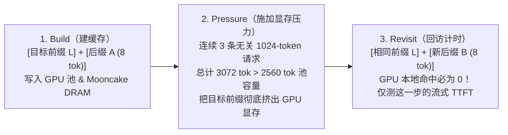
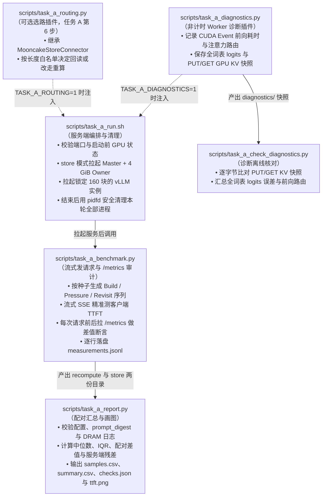

# 认识任务 A：单机单卡 KV Cache 主存回读与重算的性能对比

> 跑通一次“重启后能把 KV 从 DRAM 读回来”只是功能验证，还回答不了最关键的系统问题：**在真实在线服务中，当一段前缀刚从 GPU 显存里被挤出去、但还留在主存 Mooncake Store 里时，再次访问它——究竟是从主存读回更快，还是直接让 GPU 重新算一遍 Prefill 更快？** 这篇笔记完整拆解这套对照实验的设计逻辑、控制变量方法、代码架构与数据分析框架。

---

## 1. 先抓核心问题：我们在测什么，为什么要这么测？

把场景放到一台正在持续运行的推理服务器上（单机单卡 V100 + 源码构建的 `1Cat-vLLM` + `Mooncake Store`）：

1. 请求 1 带着一段长前缀（比如 512 或 1536 个 token）来到服务器，GPU 算完 Prefill 后，前缀 KV 同时留在了两处：**GPU 本地前缀缓存**，以及异步写入的 **Mooncake 主存（DRAM）池**。
2. 紧接着，服务器又涌进了好几条毫不相干的业务请求，把有限的 GPU 显存块池占满了。按照 LRU 规则，请求 1 的前缀块被**自然淘汰出 GPU 显存**；但主存池大得多，这份 KV 副本依然安稳躺在 DRAM 里。
3. 此时，回访请求带着**同一段前缀 + 一小段全新的后缀**再次到来。GPU 本地已经查不到了，系统面临一个非常现实的岔路口：
   - **路线 A（回读组，开启 Mooncake Store）**：向 Master 查询命中 → 在 GPU 分配空块 → 通过 Transfer Engine 从 Owner DRAM 把前缀字节搬回 GPU → 只对最后那一点新后缀做计算。
   - **路线 B（重算组，关闭 Mooncake Store）**：没有任何外部缓存可查，直接用 GPU 对“前缀 + 新后缀”整段重新做一次 Prefill。

我们要比较的核心指标是两条路线在回访请求上的 **TTFT（Time To First Token，首 token 延迟）**，并进一步观察：随着可复用前缀长度从短变长（`64 → 128 → 256 → 512 → 1024 → 1536` tokens），回读与重算的耗时曲线怎么走？什么时候回读更快、什么时候耗时接近、什么时候回读反而更慢？背后的每一毫秒究竟消耗在哪？

---

## 2. 实验设计的五个“防作弊”控制变量

做系统性能对比，最怕测出一堆看似好看、实则张冠李戴的数据。这套实验为了保证结论站得住脚，刻意卡死了五个关键细节：

### 2.1 同一实例自然淘汰，而不是重启进程

在功能验证阶段，重启 vLLM 进程是最简单的清空 GPU 缓存手段。但做性能计时，不能把“冷启动重新预热 CUDA”混进延迟里，而且真实线上服务是通过**后续流量自然挤出旧块**的。

因此实验让每个实验组内的 vLLM 进程**全程保持运行**，并用 `--num-gpu-blocks-override 160` 把 GPU KV 物理块池精确锁定在 **160 块**（$160 \times 16 = 2560$ tokens）：



- **为什么是 3 条 1024-token 的无关请求？** GPU 池只有 2560 tokens 容量，三条完全不共享前缀的 1024-token 请求总共需要 `3 × 64 = 192` 块（3072 tokens），足以把之前放进去的任意档位前缀彻底冲刷出 GPU 显存，同时把这些干扰请求的总字节量控制在主存池（默认 **4 GiB**）容量的零头以内，确保主存里的目标前缀绝不会被挤掉。
- **为什么要给回访请求换一个 8-token 的新后缀？** 一是贴近真实多轮对话/RAG 场景（同前缀 + 新问题）；二是避开整段完全命中时触发“保留末块重算”的特殊规则——因为第 `L` 个位置之后紧跟着新后缀（首 token 故意用不同标记 `100` vs `101` 切开），公共前缀严格等于 `L`（且对齐 16-token 块边界），回读组可以干干净净读回全部 `L` 个 token，恰好重算那 `8` 个新后缀 token！

### 2.2 两组都开 GPU 前缀缓存，只切一个开关

回读组和重算组使用**完全相同的**：
- 模型与精度（`Qwen2.5-1.5B-Instruct`，FP16，`--enforce-eager`）
- 物理块数（`160` 块，`block_size=16`）与显存预算（`gpu_memory_utilization=0.3`）
- 并发上限（`max_num_seqs=1`）与输出设置（贪心 `temperature=0, seed=0`，固定生成 `4` tokens，`ignore_eos=True`）
- **两组全部开启 `--enable-prefix-caching --prefix-caching-hash-algo sha256`**

唯一的变量就是是否挂载 `--kv-transfer-config`（Mooncake Store）。这样就能避免把“开没开前缀哈希计算”的杂音错算成 Mooncake 的开销。

### 2.3 用 Prometheus 指标做硬断言，杜绝“静默走偏”

只看时间不看路径，实验很容易作废——比如如果压力不够大导致 GPU 本地命中了，或者 Store 出错静默回退成了重算，表面上看请求都正常返回了，数据却全错。

因此客户端在**每一条请求发送前后**都会抓取一次 vLLM 的 `/metrics` 端点，对指标差值执行严格断言：

| 检查指标 | 重算组（Revisit 期望值） | 回读组（Revisit 期望值） | 守住什么底线 |
|---|---:|---:|---|
| `prefix_cache_hits_total` / `local_cache_hit` | **0** | **0** | 确认前缀确实已被挤出 GPU 显存 |
| `external_kv_transfer` / `external_prefix_cache_hits_total` | **0** | **$L$** | 确认外部回读的 token 数分毫不差 |
| `local_compute` | **$L + 8$** | **8** | 确认实际进 GPU 计算的 token 数符合预期 |
| `bytes_total/load_get/ok` | **0** | **$L \times 28{,}672$** | 确认真实搬运了对应字节的 FP16 KV |
| `keys_total/load_get/ok` | **0** | **$L / 16$** | 确认从 Store 读取的满块数完全吻合 |
| `failed_keys_total` / `error` / `partial_failure` | **0** | **0** | 确认无任何静默失败或部分降级 |
| 生成的 4 个 `token_ids` | 逐位置比对 | 与重算组完全一致 | 确认回读出来的 KV 语义正确无误 |

### 2.4 客户端流式计时 + 服务端指标双口径

- **客户端 TTFT（主指标）**：通过 `stream=True` 发送请求，在发出 HTTP POST 前用 `time.perf_counter_ns()` 打点，收到**第一个包含非空 `token_ids` 的 SSE chunk** 时立刻打点，差值即端到端客户端 TTFT（毫秒）。
- **服务端细分拆解**：同时记录 `/metrics` 里的 `time_to_first_token_seconds_sum`（服务端 TTFT）、`time_seconds_sum/lookup_exists/ok`（Master 查询耗时）、`time_seconds_sum/load_get/ok`（Store GET 搬运耗时）。把这几个数摆在一起，就能把“搬运本身花的时间”和“排队、调度、同步、算 8 个后缀花的时间”一眼拆开。

### 2.5 预热、随机顺序与交换起跑消除漂移

共享服务器上的系统缓存、温控与背景噪声会随时间波动。正式长度扫描采用：
- **6 档长度**：`64, 128, 256, 512, 1024, 1536` tokens（全部对齐 16-token 块边界，且 `1536 + 8 + 4 < 2048` 留足余量）。
- **预热 + 多轮重复**：每组先跑 1 轮 warmup（记录但不计入最终统计），再跑 3 轮正式测量，每轮用固定种子打乱 6 个长度的执行顺序，且每次都重新生成全新随机前缀。
- **双种子交叉配对**：用两组独立种子（如 `seed=53` 和 `seed=73`），第一批先跑重算再跑回读，第二批反过来先跑回读再跑重算，消除先后顺序偏差，每档合计得到 **6 对**严格配对的样本，汇总输出**中位数（median）和四分位区间（Q1–Q3 IQR）**。

---

## 3. 代码怎么组织？六个脚本的分工一目了然

整套任务 A 的自动化与诊断工程拆成 6 个职责单一、互相衔接的文件，全部位于 [`scripts/`](../scripts/README.md) 目录下：



几个关键的工程实现细节：

1. **`task_a_run.sh` 里的进程安全收尾**：共享服务器上避免使用宽泛的 `pkill -f vllm` 误杀其他任务。脚本启动每个服务时都用 `setsid` 建独立会话并注入本轮唯一的随机环境变量 `TASK_A_SERVICE_RUN=<uuid>`；结束时的 `cleanup()` 通过 `/proc` 核对 UID、会话号与环境变量标签，再借助 Linux `pidfd_open` + `pidfd_send_signal` 精准终止属于本轮的进程，并写入 `status.json` 记录客户端与清理退出码。
2. **`task_a_benchmark.py` 里的指标收敛等待**：vLLM 的外部 KV 异步保存（PUT）可能比 HTTP 响应返回稍晚几毫秒完成。客户端在发完 `build` 或 `pressure` 请求后，会循环轮询 `/metrics`，直到 `bytes_total/save_put/ok` 增量达到预期满块字节数才发下一条请求，彻底避免“前一条还没写完、后一条就来查”的竞态假 miss。
3. **`task_a_diagnostics.py` 与主计时严格隔离**：由于抓显存字节与保存全词表 logits 会显著拖慢执行，诊断插件只在单独的 `TASK_A_DIAGNOSTICS=1` 非计时运行中启用，绝不混入主 TTFT 统计。
4. **`task_a_routing.py` 的极简非侵入选路**：继承原有 `MooncakeStoreConnector`，重写 `get_num_new_matched_tokens()`：先调用父类查出真实的连续命中长度 `matched`，再检查请求参数 `kv_transfer_params.read_prefix_lengths` 是否允许该长度走回读；如果决定不读，就把父类刚准备好的 `load_specs` 弹出并返回 `(0, False)`，既不分配加载槽位也不发起 GET，让引擎平滑退回 GPU 重算。

---

## 4. 在服务器上怎么跑完一整套实验？

所有实机运行都在实验室 Linux 服务器的独立数据目录中完成（目录映射见 [服务器目录说明](../docs/02-服务器目录说明.md)）：

### 第一步：单档 512-token 配对预试（Pilot）

先用单档 `512` token、`repetitions=1` 把重算组和回读组各跑一遍，确认 `status.json` 双零退出、所有 `/metrics` 断言通过、生成 token ID 逐位一致：

```bash
# 重算组预试
bash scripts/task_a_run.sh recompute "$DATA/results/task-a/pilot-compute" \
  --lengths 512 --repetitions 1 --warmups 1 --seed 51

# 回读组预试
bash scripts/task_a_run.sh store "$DATA/results/task-a/pilot-read" \
  --lengths 512 --repetitions 1 --warmups 1 --seed 51

# 校验配对与初步汇总
python scripts/task_a_report.py \
  --pair "$DATA/results/task-a/pilot-compute" "$DATA/results/task-a/pilot-read" \
  --out "$DATA/results/task-a/pilot-summary"
```

### 第二步：六档长度完整扫描（双种子、交换起跑顺序）

```bash
# 批次 1（seed=53）：先重算，后回读
bash scripts/task_a_run.sh recompute "$DATA/results/task-a/compute-53" \
  --lengths 64,128,256,512,1024,1536 --repetitions 3 --warmups 1 --seed 53
bash scripts/task_a_run.sh store "$DATA/results/task-a/read-53" \
  --lengths 64,128,256,512,1024,1536 --repetitions 3 --warmups 1 --seed 53

# 批次 2（seed=73）：交换顺序，先回读，后重算
bash scripts/task_a_run.sh store "$DATA/results/task-a/read-73" \
  --lengths 64,128,256,512,1024,1536 --repetitions 3 --warmups 1 --seed 73
bash scripts/task_a_run.sh recompute "$DATA/results/task-a/compute-73" \
  --lengths 64,128,256,512,1024,1536 --repetitions 3 --warmups 1 --seed 73

# 生成汇总表、校验记录与 TTFT 对比折线图
python scripts/task_a_report.py \
  --pair "$DATA/results/task-a/compute-53" "$DATA/results/task-a/read-53" \
  --pair "$DATA/results/task-a/compute-73" "$DATA/results/task-a/read-73" \
  --out "$DATA/results/task-a/sweep-summary" --plot
```

### 第三步：非计时诊断与可选选路验证

- **非计时深度诊断**：开启 `TASK_A_DIAGNOSTICS=1` 针对代表长度（`64, 256, 1536`）抓取 GPU KV 字节、全词表 logits 与注意力路由，再用 `task_a_check_diagnostics.py` 离线核对。
- **可选选路验证（任务 A 第 6 步，待开展）**：根据六档实测结果制定长度白名单（仅当回读稳定快于重算且输出一致时选读），在独立验证集上开启 `TASK_A_ROUTING=1`，在相同 Store 查找路径下对照 `--read-prefix-lengths all`、`none` 与白名单策略。

---

## 5. V100 实测拿到了什么数据？曲线背后的“为什么”

按照上述流程，在独占空闲 V100（`32501 MiB free`）上完成了 36 对主实验与三档非计时诊断，完整数据与折线图归档在 [任务 A 实验报告](../results/week2-3/task-a/README.md)。三笔核心账非常清晰：

1. **端到端对比：在 64–1536 tokens 全区间，同机 TCP 回读均慢于重算（0/36 胜出）**
   - 重算组 TTFT 中位数从 `65.13 ms`（64 tok）平缓升至 `87.03 ms`（1536 tok）；
   - 回读组 TTFT 中位数从 `101.83 ms`（64 tok）线性升至 `180.57 ms`（1536 tok），配对差值从 `+36.82 ms` 扩大到 `+93.88 ms`。
2. **拆开回读组黑盒：不只慢在搬运，还慢在 V100 短后缀回退内核**
   - **目录查找几乎可忽略**：`lookup` 稳定在 `0.22 ~ 0.36 ms`。
   - **同机 TCP 搬运线性增长**：`GET` 从 `4.59 ms`（1.75 MiB）升至 `72.82 ms`（42 MiB），有效带宽约 `400 ~ 605 MB/s`。
   - **8-token 增量前向触发标量回退**：独立诊断显示，重算组走稠密 `prefill_no_prefix_dense_flash`（`64 / 256 / 1536` tokens 首步前向分别为 `29.7 / 30.4 / 76.3 ms`）；而回读组计算 8-token 短后缀时走 `prefill_smallq_decode_scalar` + `prefill_prefix_flash`（耗时 `52.3 / 52.9 / 66.7 ms`）。短前缀下增量前向反而更慢，1536 tokens 时也仅省约 `9.7 ms`，远抵消不了 `72.8 ms` 的搬运与异步加载框架开销。
3. **无损传输验证与 `35/36` 数值边界**
   - 36 对正式样本中 35 对输出完全一致；唯一差异样本（`256 / seed=53 / rep=1`）经诊断证实 **116 块（53.2 MiB）KV 搬运前后逐字节一致**，差异发生在传输之后——两条不同注意力内核在 FP16 下的微小累加差（全词表最大 logit 差 `0.0195`）恰好撞上几乎打平的 Top-2 候选（仅差 `0.0078`）。统一调度分块为 `max_num_batched_tokens=64` 后 6/6 输出全一致。

这也直接指明了交叉点移动的物理规律：当模型规模更大（单位 KV 对应的 Prefill 计算量大幅增加）、上下文更长（如 4K–32K）或底层切换至高带宽互联（如 RDMA / PCIe 直接搬运并消除小-q 标量回退）时，省下的 Prefill 计算才更容易跨过搬运与同步门槛，使外部主存缓存进入净收益区间。
