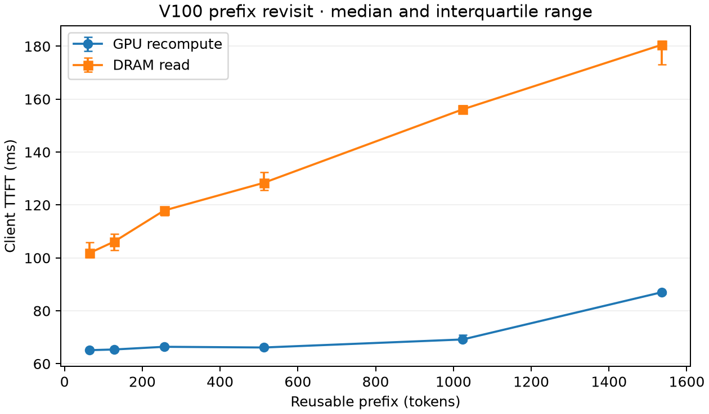

# 任务 A（1~5）：单机单卡 KV Cache 主存回读与重算性能对比

> **核心结论**：在单张 Tesla V100、`Qwen2.5-1.5B-Instruct`（FP16）、源码构建 `1Cat-vLLM v1.5.3` + `Mooncake Store`（同机 TCP）配置下，对 `64 ~ 1536` tokens 的可复用前缀进行 36 对受控回访实测：**从主机 DRAM 回读前缀 KV 的首 Token 延迟（TTFT）在全部 6 个长度档位均高于直接由 GPU 重新计算 Prefill**（中位数多花 **36.8 ms ~ 93.9 ms**，回读胜率 0/36）。
>
> 独立非计时诊断进一步定位了两层原因：**（1）1.5B 模型重算轻、同机 TCP 有效带宽约 400–605 MB/s**（1536 tokens 仅搬运就要 72.8 ms）；**（2）V100 后端对“有缓存前缀 + 8-token 短后缀”走标量回退路径**，在短前缀下 8-token 增量前向反而慢于整段稠密 FlashAttention，即使到 1536 tokens 前向也仅省约 9.7 ms，远不足以抵消搬运与框架调度开销。

---

## 1. 实验设置与控制变量

为真实复现“前缀已从 GPU 显存中自然淘汰、但仍留在主机 DRAM 中”的在线服务场景，实验在**同一持续运行的 vLLM 实例**内执行「建缓存（Build）→ 显存施压（Pressure）→ 回访计时（Revisit）」，不依赖重启进程清缓存。

| 控制维度 | 实际配置 | 作用说明 |
|---|---|---|
| **硬件与模型** | 单卡 `Tesla V100S-PCIE-32GB`（启动前均独占空闲 `32501 MiB`），`Qwen2.5-1.5B-Instruct` FP16，`--enforce-eager` | 排除多租户 GPU 抢占干扰，固定单 token KV 为 `28 KiB`（每 16-token 块 `448 KiB`） |
| **显存池与自然淘汰** | `--num-gpu-blocks-override 160`（GPU KV 池 `2560` tokens），每次建缓存后插入 3 条互不共享的 `1024`-token 干扰请求（总计 `3072 > 2560`） | 保证待测前缀从 GPU LRU 缓存中彻底淘汰，同时单组总 PUT 约 `2.52 GB < 4 GiB` Owner DRAM，主存不淘汰 |
| **公平对照** | 重算组（关闭 Store）vs 回读组（开启 `MooncakeStoreConnector`，`kv_both`，同机 TCP `MC_FORCE_TCP=1`）；**两组均开启 GPU 前缀缓存（SHA-256）** | 仅切换外部 Store 开关，排除前缀哈希计算带来的额外偏差 |
| **负载与重复** | 6 档块对齐前缀：`64, 128, 256, 512, 1024, 1536` tokens + 8-token 新后缀；并发 1；贪心生成 4 tokens；每档 1 轮预热（不计入统计）+ 3 轮正式 × 2 组独立种子（`53` 先重算后回读，`73` 先回读后重算），合计 **36 对** | 消除顺序漂移与冷启动噪声；新后缀使公共前缀严格等于 $L$，回读全部 $L$ tokens，仅计算 8 个新后缀 token |
| **路径硬断言** | 每条请求前后读取 `/metrics` 并核对 `serve.log` | 强制确认：两组回访 GPU 本地命中均为 `0`；回读组 `external_kv_transfer=L`、`load_get/ok = L × 28672 B`、`memory_keys = L/16`、`disk_keys = 0`、`failed_keys = 0` |

完整软件修订、环境依赖与复现命令见 [task-a-info.json](../../../environment/task-a-info.json)。

---

## 2. 主实验结果：TTFT 随前缀长度的变化

下表整理自 36 对正式配对样本（明细见 [samples.csv](samples.csv)，统计见 [summary.csv](summary.csv)）。客户端 TTFT 定义为发出 HTTP 请求到收到含首个生成 token ID 的 SSE 事件耗时；有效搬运带宽按 $\text{KV 字节数} / \text{GET 中位数}$ 估算。

| 前缀长度 (tokens) | 回读 KV 体积 | 重算 TTFT 中位数 [Q1, Q3] (ms) | 回读 TTFT 中位数 [Q1, Q3] (ms) | 配对差值 (回读 − 重算, ms) | 查找 Lookup (ms) | 搬运 GET (ms) | GET 有效带宽 (MB/s) | 服务端残差 (ms)¹ | 输出一致 |
|---:|---:|---:|---:|---:|---:|---:|---:|---:|---:|
| **64** | 1.75 MiB | 65.13 [64.88, 65.48] | 101.83 [100.25, 105.86] | **+36.82** | 0.23 | 4.59 | 400.2 | 94.91 | 6 / 6 |
| **128** | 3.50 MiB | 65.39 [64.92, 65.73] | 106.18 [102.96, 108.99] | **+41.29** | 0.22 | 7.27 | 505.1 | 96.47 | 6 / 6 |
| **256** | 7.00 MiB | 66.40 [65.94, 66.88] | 117.91 [116.00, 118.13] | **+50.69** | 0.25 | 16.81 | 436.7 | 97.95 | 5 / 6² |
| **512** | 14.00 MiB | 66.14 [66.05, 66.51] | 128.37 [125.66, 132.37] | **+62.32** | 0.25 | 26.76 | 548.6 | 99.15 | 6 / 6 |
| **1024** | 28.00 MiB | 69.18 [68.63, 70.83] | 156.16 [155.88, 157.57] | **+85.77** | 0.28 | 48.87 | 600.8 | 102.37 | 6 / 6 |
| **1536** | 42.00 MiB | 87.03 [86.34, 87.28] | 180.57 [173.08, 181.98] | **+93.88** | 0.36 | 72.82 | 604.8 | 102.61 | 6 / 6 |

> ¹ 服务端残差 = `read_server_ttft_ms − read_get_ms − read_lookup_ms`，涵盖模型前向计算、调度排队、异步加载同步与框架开销。  
> ² 唯一 1 对输出差异出现在 `length=256, seed=53, rep=1`，详见第 4 节专项归因。

---

## 3. 成本拆解：省下的 Prefill 为什么抵消不了回读开销？

从表中可以立刻看出两个值得深挖的现象：
1. **重算组在 64–1024 tokens 内非常平坦**（`65.1 → 69.2 ms`），到 1536 tokens 才升至 `87.0 ms`；
2. **回读组哪怕只读 64 tokens（GET 仅 4.59 ms，Lookup 仅 0.23 ms），端到端就已经比直接重算慢 36.8 ms**，且扣掉 GET 与 Lookup 后，服务端仍残留 **94.9 ~ 102.6 ms**！

为拆开这笔残差，实验单独运行了非计时 Worker 诊断（[diagnostics.json](diagnostics.json)，不计入主 TTFT 统计），对 `64 / 256 / 1536` 三档记录了首步模型前向的 CUDA Event 耗时与 V100 注意力内核路由：

| 前缀长度 | 重算组首步前向（输入 tokens / 路由 / 耗时） | 回读组首步前向（输入 tokens / 路由 / 耗时） | 首步前向节省 | 主实验 GET 耗时 |
|---:|---|---|---:|---:|
| **64** | 72 tok · `prefill_no_prefix_dense_flash` · **29.73 ms** | 8 tok · `prefill_smallq_decode_scalar` + `prefill_prefix_flash` · **52.29 ms** | **−22.56 ms**（反而更慢） | 4.59 ms |
| **256** | 264 tok · `prefill_no_prefix_dense_flash` · **30.37 ms** | 8 tok · `prefill_smallq_decode_scalar` + `prefill_prefix_flash` · **52.90 ms** | **−22.53 ms**（反而更慢） | 16.81 ms |
| **1536** | 1544 tok · `prefill_no_prefix_dense_flash` · **76.32 ms** | 8 tok · `prefill_smallq_decode_scalar` + `prefill_prefix_flash` · **66.65 ms** | **+9.67 ms** | 72.82 ms |

综合主实验与诊断数据，当前配置下“回读全程慢于重算”由三层开销叠加导致：

1. **目录查找几乎免费，但同机 TCP 搬运随长度线性攀升**：`lookup` 稳定在 `0.22 ~ 0.36 ms`；而同机 TCP 的 `GET` 有效带宽约 `400 ~ 605 MB/s`，1536 tokens（42 MiB）仅数据搬运就耗时 `72.82 ms`。
2. **小模型 Prefill 算力轻 + V100 短后缀算子回退**：1.5B 模型在 V100 上走稠密 FlashAttention 非常快（264 tokens 仅 30.4 ms）；而回读后剩余的 8-token 短后缀带有已缓存前缀，在当前 `FLASH_ATTN_V100` 后端中触发了较慢的 `prefill_smallq_decode_scalar` + `prefill_prefix_flash` 路径（64/256 tokens 时前向要 ~52 ms）。直到 1536 tokens，回读前向才反超重算约 `9.7 ms`，仍远小于 `72.8 ms` 的 GET 时间。
3. **框架与异步加载同步开销**：在 `--enforce-eager`（未启用 CUDAGraph）下，每步前向与外部异步加载的状态同步仍贡献约 30–40 ms 的固定服务端基线开销。

**推演交叉点在何处出现**：只有当**模型更大**（单位 KV 对应的 Prefill FLOPs 显著增加）、**上下文更长**（如 4K–32K，二次项注意力计算快速拉升重算耗时）或**传输与算子更高效**（如 RDMA / PCIe 直接拷贝、更优的小-q 前缀内核与 CUDAGraph）时，省下的计算才会超过搬运与固定开销，出现回读占优区间。

---

## 4. 正确性核验与 `35/36` 数值边界排查

36 对主实验样本中，**35 对生成的全部 4 个 token IDs 完全一致**（12 对预热样本也 12/12 一致），仅 `length=256, seed=53, rep=1` 出现首 token 差异（重算输出 `220 16 15 15`，回读输出 `82 13 220 16`）。

为确认是传输损坏还是数值精度敏感，实验执行了三步递进排查：

1. **证明 KV 搬运逐字节无损**（[diagnostics.json](diagnostics.json)）：在 GPU 侧 `before_put` 与 `after_get` 直接 `cudaMemcpy` 抓取显存块对比，覆盖 `64 / 256 / 1536` 共 **116 块（53,215,232 bytes）**，全部 SHA-256 与逐字节完全一致。
2. **定位到 FP16 平手翻盘**（[numerical-check.json](numerical-check.json)）：抓取该样本全词表（151,936 维）logits，最大绝对误差仅 `0.0195`（均值 `0.0057`）。但由于合成随机输入下第 1、第 2 候选（token `220` `' '` 与 token `82` `'s'`）在重算侧分别仅差 `0.0078`（`11.4765625` vs `11.46875`），两条不同的注意力内核路径（稠密 Flash vs 小-q 分页标量）引入的微小 FP16 累加差异使回读侧两者打平在 `11.46875`，触发贪心 argmax 翻盘。
3. **固定调度粒度复验**（[fixed-granularity/](fixed-granularity/)）：将两端 `max_num_batched_tokens` 同时设为 `64`（使重算的 8-token 尾块也走相同小-q 分支）复测 6 档（含原差异样本），**6/6 输出全部一致**。由于小分块会大幅拖慢重算（1536 tokens 重算升至 `960.0 ms`），该组结果严格独立存放，不混入主实验性能结论。

---

## 5. 目录文件说明与适用边界

| 文件 | 作用 |
|---|---|
| [summary.csv](summary.csv) / [samples.csv](samples.csv) | 主实验 6 档汇总表与 36 对逐样本明细 |
| [ttft.png](ttft.png) | 主实验 TTFT 对比折线图 |
| [checks.json](checks.json) | 36 对路径审计与 35/36 一致性校验记录 |
| [analysis.json](analysis.json) | 结构化结论、关键数值与局限汇总 |
| [diagnostics.json](diagnostics.json) | 116 块 KV 逐字节无损校验、全词表 logits 误差与 V100 注意力路由耗时 |
| [numerical-check.json](numerical-check.json) | `256 / seed=53 / rep=1` 差异样本专项分析 |
| [fixed-granularity/](fixed-granularity/) | `max_num_batched_tokens=64` 补充正确性核验（独立于主统计） |

**当前结论边界**：
- 本报告结论仅适用于 `Qwen2.5-1.5B-Instruct` FP16、单卡 V100、`--enforce-eager`、同机 TCP、合成 token ID、64–1536 tokens、单并发与 4-token 输出条件；
- 诊断前向耗时包含 CPU 启动间隙与同步开销，不代表纯 GPU kernel 时长；
- 默认 2048-token 调度预算下的 `35/36` 输出一致性边界保持原样记录；
- 可选的“基于前缀长度动态选路验证（任务 A 第 6 步）”及跨机/RDMA/SSD 实验尚未执行。
